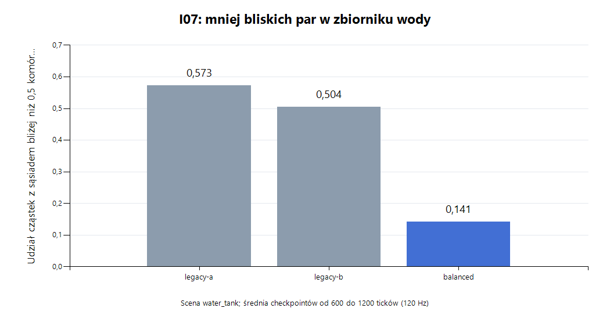
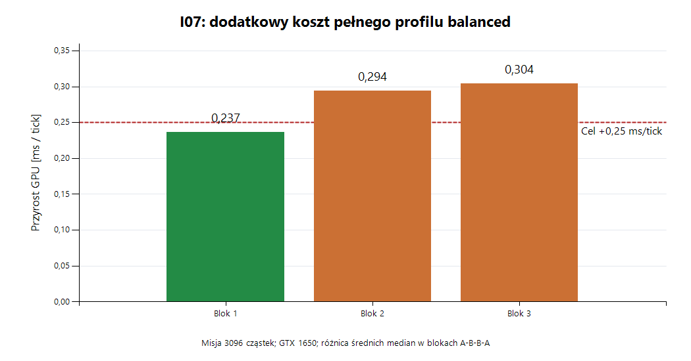

# I07 — jakość cieczy PBF w 2D

Data: 2026-10-30. Rewizja fizyki/nagrań: `I07.1`. Domyślny profil pozostaje `legacy` do przejścia bramek jakości, pełnej regresji i budżetu +0,25 ms/tick mediany misji. `balanced` jest jawnym kandydatem eksperymentalnym. I04.5 oraz stabilność wydajności I06 pozostają otwarte.

## Konfiguracja i zgodność

`FluidOptions` należy do `ExecutionOptions` i jest niezmienne przez czas życia świata. Gra, narzędzia, diagnostyka i nagrania korzystają z tej samej konfiguracji. Tick nadal wynosi 1/120 s, h=2, delta_q=0,6, wykładnik s_corr=4, pojemność 32768, Grain=64 B, osiem wiązań SSBO. Wariant czterech podkroków zmienia wspólny dt kapsuły i materiałów na 1/480 s; reguły CPU i emisja wyników pozostają raz na tick.

| Ustawienie | legacy | balanced (eksperymentalny) |
| --- | --- | --- |
| Granice | jednostkowe | objętościowe |
| Napięcie | potencjał Poly6, k=60 | kohezja i krzywizna 2D |
| s_corr | 0,0001 | 0,0001 |
| Adhezja | 0 | 1 |
| Wirowość | 0 | 1 |
| Podkroki / PBF / kontakty | 2 / 8 / 12 | 2 / 8 / 12 |

Profil `balanced` nie jest deklaracją zaliczonego budżetu. Parametry opisują model gry w komórkach i sekundach, nie wodę w jednostkach SI. Nie ma dodatkowego przyciągania między wodą i olejem; ciśnienie i dotychczasowe XSPH nadal obsługują obie fazy.

Nagrania v2 zapisują rewizję I07.1 i wszystkie parametry cieczy z dokładnością odtwarzającą float. Inna konfiguracja lub rewizja jest odrzucana przed odtwarzaniem. Nagrania v1 są obsługiwane tylko przy dokładnych ustawieniach legacy.

## Granice i pamięć

Dla zajętej próbki b: `V_b = rho0 / sum_k W(b-k)`, gdzie suma obejmuje próbki tej samej nieruchomej granicy. Niezależne obliczenie daje 1 we wnętrzu regularnej siatki, 1,7288135593 dla długiej linii 1px i 3,1875 dla izolowanej komórki. Wagi uwzględniamy w gęstości, gradientach, korektach oraz reakcji kapsuły. Nie pakujemy ich w istniejący nearWall ani HP.

Ważony profil dodaje piątą płaszczyznę FP32 w buforze Terrain: 245760 B, i tabelę 144 próbek kapsuły: 576 B. Przeliczanie terenu jest częścią istniejącego przebiegu dirty po malowaniu, załadowaniu lub destrukcji. Próbki kapsuły mają stałe lokalne pozycje i są tłumaczone z aktualną pozycją GPU; ich wagi inicjalizujemy raz.

Napięcie/wirowość potrzebują dwóch nowych vec4 na stabilny slot, dopisanych za istniejącymi kanałami FluidTerms: 1048576 B. Zawierają bieżącą gęstość oraz normalną, omega i RMS. Nie zmieniają offsetów kanałów reakcji ani ABI cząstek. Łącznie balanced dodaje 1294912 B. Legacy zachowuje dotychczasowe rozmiary buforów.

## Matematyka i kolejność przebiegów

Metody bazują na [PBF](https://mmacklin.com/pbf_sig_preprint.pdf), [granicach Akinci 2012](https://cg.informatik.uni-freiburg.de/publications/2012_SIGGRAPH_rigidFluidCoupling.pdf) oraz [napięciu i adhezji Akinci 2013](https://cg.informatik.uni-freiburg.de/publications/2013_SIGGRAPHASIA_surfaceTensionAdhesion.pdf), z jawną adaptacją do istniejącego modelu 2D.

- Kohezja używa spline'u z review z normalizacją `35840/(209*pi*h^8)`. Niezależna kwadratura wykazuje całkę po 2D równą **1**, a nie deklarowane w review 0. Weryfikujemy ciągłość w h/2 i znaki siły. Model zastępuje potencjał k=60. Współczynniki bazowe: kohezja 75,6 i krzywizna 0,5, mnożone przez osobne skale CLI. 75,6 dopasowuje rząd siły parowej przy r=h/2 do starej kohezji; nie jest zmierzoną stałą materiałową.
- Normalna zewnętrzna: `-h * sum(gradient_Poly6 / rho_j)`, osobno dla każdej fazy. Symetryczny współczynnik `2*rho0/(rho_i+rho_j)` zachowuje przeciwny impuls pary również przy różnych masach. Krzywizna nie jest siłą centralną, więc nie deklarujemy dokładnego zachowania momentu pędu.
- Adhezja działa dla h/2 < r < h. Współczynnik normalizacji przy h=2 wynosi 0,144366160386. Przeciwna reakcja na kapsułę jest konsumowana przed kontaktem/drag, aby reducer reference nie nadpisał wspólnego kanału. Nieruchomy teren stanowi zewnętrzne źródło reakcji.
- Po rekonstrukcji prędkości obliczamy aktualną gęstość, wykonujemy barierę, następnie normalne/omega/RMS i kolejną barierę. Dopiero aktualizacja prędkości czyta gotowe pola i zapisuje drugi bank cząstek.
- Omega to skalarny curl 2D; confinement wykorzystuje `omega * (N.y, -N.x)`, z różnicowym gradientem modułu omega. Impuls ma limit 25% lokalnego względnego RMS na podkrok. Confinement dodaje energię: ogranicznik nie jest dowodem jej zachowania.

Balanced dodaje po dwa przebiegi pól na podkrok oraz konsumpcję reakcji adhezji w misji. Przy wyłączonych efektach te przebiegi nie są zlecane; dodatkowe programy pól nie są kompilowane w wyspecjalizowanym legacy.

## Odtworzenie

```powershell
./StrefaZero.exe --gpu-fluid-check --gpu-fluid-profile legacy --profile wyniki-legacy
./StrefaZero.exe --gpu-fluid-check --gpu-fluid-profile balanced --profile wyniki-balanced
./StrefaZero.exe --gpu-fluid-benchmark --gpu-fluid-profile balanced --profile koszt-balanced
./StrefaZero.exe --mission --gpu-fluid-profile balanced
```

Niezależne ablacjе: `--gpu-fluid-boundary unit|volume`, `--gpu-fluid-surface legacy|akinci2d`, `--gpu-fluid-s-corr`, `--gpu-fluid-tension-scale`, `--gpu-fluid-curvature-scale`, `--gpu-fluid-adhesion`, `--gpu-fluid-vorticity`, `--gpu-fluid-substeps 2|4`. Profil i nadpisania są stosowane od lewej do prawej.

Pełny ograniczony protokół:

```powershell
./scripts/profile-fluids.ps1 -Executable ./StrefaZero.exe -Output ./quality-new -Suite quality
python ./scripts/analyze-fluids.py ./quality-new --output ./quality-summary.json
./scripts/profile-fluids.ps1 -Executable ./StrefaZero.exe -Output ./benchmark-new -Suite benchmark
python ./scripts/analyze-fluids.py ./benchmark-new --output ./benchmark-summary.json
```

Wymagane Windows, OpenGL 4.3 i Python 3 do analizy. Każda próba ma SHA256 EXE, argumenty, wynik procesu i osobny katalog. Skrypt odmawia nadpisania istniejącego katalogu. Dwie próby legacy poprzedzają kandydatów i zapis granic powtarzalności. Macierz jakości obejmuje granice, trzy większe s_corr, cztery podkroki, dwa warianty napięcia, osobną adhezję, wirowość oraz pełny balanced.

Benchmark ma trzy bloki legacy–balanced–balanced–legacy, 120 ticków rozgrzewki i 240 próbek dla misji, 16k i 32k. glFinish odbywa się poza pomiarem CPU kroku. Nie są to percentyle całej klatki; okno sprawdzamy oddzielnie. Sceny stress zachowują historyczną zawartość ziaren — nie reprezentują 32k cieczy. Narzut cieczy oceniamy przede wszystkim w mieszanej misji i scenach jakości.

## Kryteria i wyniki

Niezmienione bramki: tożsamość i masa per slot, skończone wartości stanu, brak przecieków przez 1px, kompresja <5%, zachowanie faz/misji, protokół I06 i sprzężenie Q. Nowe testy mają niezależne orakle CPU; test `physics.fluid_reference` działa także bez SDL/GL. `gpu.fluid_quality` obejmuje siedem scen po 1200 ticków, próbki co 60 i obrazy przy 600/1200. CSV podaje przestrzenne RMS powierzchni, średnią wysokość powierzchni, udział bliskich par <0,5 komórki, pęd i energię kinetyczną. Amplituda czasowa to zakres średniej wysokości powierzchni od 600 do 1200. To miary modelu, nie pomiar fizycznego eksperymentu.

Implementacja funkcjonalna zakończona. **Pozostaje domyślne legacy.** Pełny balanced jest opcjonalny: poprawia część miar jakości, lecz nie utrzymał celu +0,25 ms/tick we wszystkich trzech blokach. Nie deklarujemy odbioru wydajności I07 ani zamknięcia I04.5/I06.

Środowisko: Intel Core i5-9300HF 2,40 GHz, 4 rdzenie / 8 wątków; GTX 1650, NVIDIA 610.47, rzeczywisty kontekst GL 4.3; Windows 11, MSVC Release z ostrzeżeniami jako błędami. GCC 13.3: **8/8 PASS**, dodatkowo nowy moduł diagnostyczny przechodzi kompilację składni z `-Wall -Wextra -Wpedantic -Werror`.

### Poprawność

- Windows CTest: **58/58 PASS**, błędy: brak, pominięcia: brak.
- Macierz jakości: **12/12 procesów PASS**, siedem scen po 1200 ticków, łącznie 1680 checkpointów z kontrolą tożsamości, masy i skończonych wartości. Nowy niezależny orakl obejmuje też niejawne zewnętrzne ściany świata.
- Dodatkowe kontrole balanced: ciecze/32k, zachowanie oleju i piasku, sprzężenie Q, misja przy 30/60/144 FPS, przełączanie/nagrania, widoczne okno i protokół I06 — **7/7 PASS**. Cztery podkroki: osobne testy cieczy, misji i Q — **3/3 PASS**.
- Widoczne okno balanced: 900 klatek, 1798 ticków, brak pominiętego czasu; mediana / p95 / p99 klatki 16,6689 / 16,6764 / 16,8219 ms. To pojedyncza poprawna próba okna, nie dowód usunięcia historycznej zmienności.
- Oryginalny zamrożony I06 przechodzi własną misję. Największe odległości stóp w próbkach tras I07 legacy względem I06: 1.1380 / 0.8870 / 1.3230 komórki (30/60/144 FPS). To próbki trasy i jej wyniku, nie dowód bitowej zgodności całego świata.

[Pełne CTest](i07/ctest.log), [JUnit](i07/ctest.xml), [GCC](i07/gcc-tests.log), [kontrole integracyjne](i07/candidate-integration.json), [protokół z balanced](i07/candidate-gameplay/gameplay-tests.txt), [okno](i07/candidate-window/mission-ui.txt), [zgodność z I06](i07/legacy-i06-compatibility.json), [identyfikacja i kompletność](i07/final-validation.json).

### Jakość i wybór parametrów



Wartości opisują okno od 600 do 1200 ticków. Amplituda to zakres średniej wysokości powierzchni, a udział skupionych nośników oznacza cząstki tej samej fazy z sąsiadem bliżej niż 0,5 komórki. Próg 0,05% komórki z review nie został przyjęty jako arbitralny warunek.

| Miara | legacy A | legacy B | balanced |
| --- | ---: | ---: | ---: |
| Amplituda zbiornika [komórki] | 0.010999 | 0.012932 | 0.012642 |
| Skupione cząstki w zbiorniku [udział] | 0.005730 | 0.005042 | 0.001413 |
| Amplituda naczyń połączonych [komórki] | 0.577445 | 0.558094 | 0.552740 |
| Skupione cząstki w naczyniach [udział] | 0.005660 | 0.005446 | 0.003393 |
| Amplituda warstw woda/olej [komórki] | 0.003115 | 0.002832 | 0.002214 |
| Skupione cząstki w scenie kropli oleju [udział] | 0.001610 | 0.001563 | 0.000521 |

Balanced redukuje skupianie nośników w zbiorniku i scenie kropli oleju; nie daje jednak jednakowej poprawy każdej miary i każdej sceny. Samo nowe napięcie miało w tej serii amplitudę naczyń 0,3968 komórki wobec 0,5581–0,5774 legacy. To wariant ablacjny, bez pełnego osobnego odbioru wydajności i integracji.

Podniesienie s_corr ogranicza skupianie, ale zmienia amplitudy innych scen, więc nie podnosimy go automatycznie. Cztery podkroki zachowują reguły i szczelność, lecz podnoszą energię kinetyczną zbiornika do około 42674 jednostek modelu wobec 1376–1683 w legacy oraz koszt misji; pozostają wariantem diagnostycznym. Wybór bazowy to 2 × 8 PBF / 12 kontaktów, s_corr=0,0001. Nowe modele mają niezależne wyłączenia do analizy.

[Wszystkie miary](i07/quality-summary.json), [granice powtarzalności zapisane przed kandydatami](i07/quality/baseline-envelope.json), [surowe sceny i obrazy](i07/quality/).

### Koszt GPU i CPU



Poniżej średnie z dwóch median w każdym bloku A–B–B–A, nie percentyle połączonego rozkładu.

| Blok | Legacy GPU [ms/tick] | Balanced GPU | Przyrost |
| --- | ---: | ---: | ---: |
| 1 | 2.911296 | 3.147872 | +0.236576 |
| 2 | 2.866736 | 3.160480 | +0.293744 |
| 3 | 2.846080 | 3.150016 | +0.303936 |

Dwa z trzech bloków przekraczają +0,25 ms/tick. Pełne 12/12 procesów ABBA zakończyło się poprawnie i zachowało 8640 próbek czasu. Zakres p95 CPU kroku misji wyniósł 0.0335–0.0468 ms. Ten kontrolowany pomiar nie zamyka wcześniejszej rozbieżności I06. Pobranie wyników timerów odbywa się przed mierzonym krokiem; krok nadal obejmuje konsumpcję zdarzeń, reguły, upload, zlecenia solvera i staging.

Dodatkowe jednorazowe ablacjе kosztu:

| Wariant | GPU misji [ms/tick] | p95 GPU |
| --- | ---: | ---: |
| legacy-before | 2.829856 | 2.897920 |
| boundary | 2.911680 | 2.965504 |
| scorr-0005 | 2.834432 | 2.916352 |
| scorr-002 | 2.766848 | 2.825728 |
| scorr-008 | 2.768896 | 2.818048 |
| four-substeps | 3.330048 | 3.399680 |
| surface-quarter | 3.079872 | 3.162112 |
| surface | 3.010560 | 3.077344 |
| adhesion | 2.884224 | 2.944704 |
| vorticity | 3.068832 | 3.126400 |
| legacy-after | 2.846720 | 2.908928 |

Tych pojedynczych ablacjnych prób nie traktujemy jako powtarzalnej przewagi ani podstawy do zmiany ustawień. Sceny 16k/32k w tym protokole to historyczne ziarna z kapsułą, więc ich małych różnic nie przypisujemy ulepszeniom cieczy.

Osobna, perturbująca sonda passes zebrała po trzy próbki nowych etapów w misji: świeża gęstość około 0,04694 ms/przebieg, pole normalnych/omega około 0,04666 ms/przebieg, końcowa aktualizacja prędkości około 0,06349 ms/przebieg. Każdy wykonuje się dwa razy na tick; nie sumujemy median jako percentyla całego kroku. Przebudowa wag jest częścią istniejącego dirty-terrain, a jej koszt jest obecny w pełnej trasie z destrukcją; nie uzyskano osobnego, reprezentatywnego czasu samej przebudowy. Próbki op=9 sondy przypadały na przebiegi bez edycji, więc nie przedstawiamy ich jako kosztu aktualizacji wag.

[Bloki ABBA i pełne 16k/32k](i07/abba-summary.json), [surowe próby](i07/benchmark/), [ablacje](i07/ablation-costs/), [koszt przebiegów](i07/new-pass-costs.json), [surowa sonda](i07/candidate-pass-costs/).

### Integralność i zachowane próby

Baza 124 plików źródłowych została zamrożona przed edycjami; wszystkie odpowiadają archiwum source-I06. Wszystkie końcowe pomiary i regresja korzystają z tego samego EXE i shaderów. Raport integralności porównuje źródła produkcyjne z początkiem serii.

Pierwszy przebieg jakości balanced przeszedł. W przygotowawczej macierzy znaleziono błędne klamrowanie wag niejawnego zewnętrznego brzegu do komórek wewnętrznych. Dodano niezależny orakl CPU, poprawiono normalizację wirtualnych próbek i uruchomiono całą końcową macierz od początku. Wcześniejsze wyniki i przerwanie pozostałych prób zachowano osobno w `pre-boundary-fix/`. Początkowy skrypt zatrzymał się po dwóch poprawnych kontrolach, bo Windows nie miał polecenia python; eksport granic powtarzalności przeniesiono do PowerShell i sprawdzono względem niezależnego analizatora Python (7 scen × 5 miar). Nie nadpisano pierwotnego błędu skryptu.

Nie kontynuowano I04.5, nie zmieniono progów historycznych testów i nie wymieniono solvera ani renderera. APIC/FLIP, rozdzielczość 0,5, optyka, VFX i termika pozostają poza I07.

[Źródła bazy](i07/baseline-source.json), [zgodność archiwum I06](i07/baseline-source-archive-comparison.json), [zmiany](i07/source-changes.json), [zamrożony protokół](i07/protocol.json), [sprzęt](i07/host.json), [shader/EXE integrity](i07/runtime-assets-integrity.json).


Wykresy publikowane w raporcie można odtworzyć na Windows poleceniem `./scripts/plot-fluids.ps1 -Results ./docs/i07` (.NET Charting). Analizator `analyze-fluids.py` wylicza też bloki ABBA z surowych prób benchmarku.
