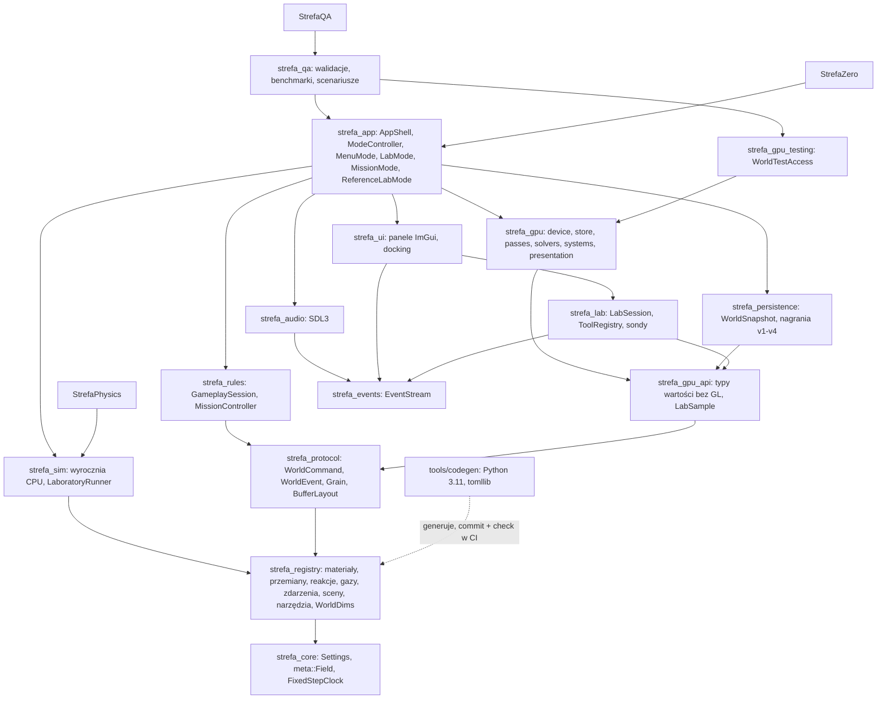
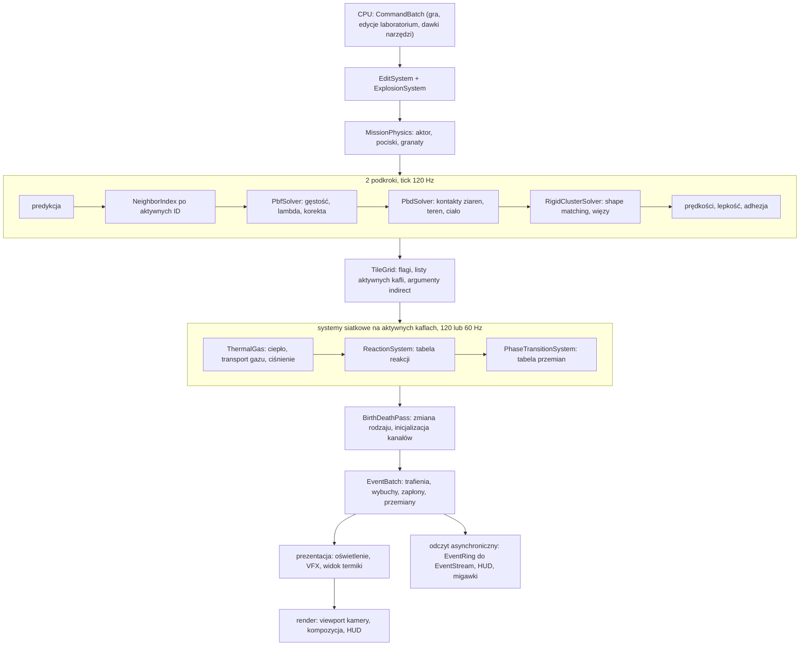

# Architektura v2 — „Strefa Zero” `main` @ `e12c39a` (po PR #13–#22)

> [!IMPORTANT]
> **Migawka na `e12c39a`.** Od tego czasu weszły #24, #27, #36 i #42; część faz A jest zrobiona, a budżety z §5
> zastąpił `tools/architecture_budget.json`. Aktualny status i rozstrzygnięcia:
> [REVIEW_V2_STATUS.md](../REVIEW_V2_STATUS.md). Numery linii odnoszą się do `e12c39a`. Zalecenia są treścią autora
> review, nie poleceniem właściciela. Dokument nadrzędny: [review_strefa_zero_v2.md](review_strefa_zero_v2.md).

> Analiza tylko do odczytu, 2026-11-03. Punkt odniesienia: poprzedni przegląd z `5f22f8c` (`review_strefa_zero.md`
> §2, problemy A1–A12, plan 25 PR-ów).
>
> Metoda: `git diff 5f22f8c e12c39a` i liczniki z tymi samymi wzorcami (`grep -E`, `git grep`) dla obu rewizji;
> skrypty pomocnicze autora (`scratch/count_api.py`, `scratch/arch_v2/include_edges.py`) nie są w repozytorium.
> Symbole binarki: `nm -C` na `build/app/StrefaZero` (GCC 15.2, Release + IPO; zakładam, że z `e12c39a`).
> Wartości oznaczone „szac.” to szacunki, nie pomiary.

## 0. Streszczenie

**Bilans A1–A12.** Żaden problem nie jest w pełni naprawiony. Trzy poprawiły się częściowo (A7, A8, A12), sześć jest
bez zmian (A2, A4, A5, A6, A9, A11), a trzy się pogorszyły (A1, A3, A10).

**Co dały PR #13–#22.**

- Zyski: proces i CI (#14, #16–#19: sanitizery, Clang/libc++, MSVC `/WX`, 16 testów `ci-smoke` na Mesa, nocny
  przebieg 63 testów graficznych, wymuszone etykiety i limity), wydajność CPU (#21), usunięcie drugiej gry CPU (#22).
- Koszty: granice modułów stoją w miejscu. PR #13 wprowadził kod benchmarku scen do binarki gracza. Po #22 zostały
  resztki: `strefa_game` nadal linkuje model CPU, a „arena” oznacza teraz HUD misji GPU.

**Rekomendacja.** Wizja (Noita + Soldat + The Powder Toy + laboratorium) zależy od pięciu rzeczy, w tej kolejności:

1. **Jeden rejestr danych** (`MaterialRegistry` + przemiany + reakcje + sceny + narzędzia + `WorldDims`) w TOML.
   Generator tworzy z niego C++ `constexpr` i GLSL.
2. **Jeden stan materiału na GPU.** Kanał boczny `ParticleMaterial` po stabilnym ID i jedno przejście narodzin/śmierci
   (`BirthDeathPass`) ze zmianą rodzaju cząstki przy przemianie fazowej.
3. **`TileGrid`, czyli aktywne kafle 16×16**, wspólne dla wszystkich systemów siatkowych. To warunek wstępny budżetu,
   zarówno termiki, jak i większych światów.
4. **Rozbiór `ParticleWorld`** na `ParticleStore`, `PassTable`/`PassRunner` i systemy.
5. **Jedno laboratorium GPU.** Model CPU zostaje wyrocznią testów, a fallback GL 3.3 zamrażamy.

Ciała sztywne robimy jako klastry PBD z dopasowaniem kształtu (shape matching), nie przez Box2D. Biblioteki
wprowadzane od razu: Tracy, glslang (tylko CI), doctest dla nowych testów, RenderDoc (narzędzie). Wraz
z laboratorium: ImGui docking, ImPlot, zstd.

## 1. Delta A1–A12 (stan na `e12c39a`)

| ID | Problem z `5f22f8c` | Status | Dowód na `e12c39a` |
| --- | --- | --- | --- |
| A1 | Podział gra/QA niedomknięty | **gorzej** | `validate_gameplay_protocol` w `world.cpp:1527-1842` (316 linii); `fluid_quality.cpp` (443) i `profile_samples.cpp` (71) w `strefa_gpu` (`CMakeLists.txt:119`); `friend class ScenarioRunner` (`application.cpp:100`, `scenario_runner.hpp:630-659`). **Nowe:** benchmark scen z #13 w zbiorze linkowanym do gracza (`scene_benchmark.cpp`, 267 linii, w `strefa_launch`, `CMakeLists.txt:87`; `record_frame` `application.cpp:594-678`; `run_scene_benchmark` `:1106-1233`; pola `:1095-1098`; `application.hpp:2`). `application.cpp` 1206 → 1360 linii (+13%). Haki fault-injection nadal w gorącej ścieżce: `hold_events`, `pbf_fault` (`:145, 229-237`). Binarka gracza (LTO): `validate_*`, `ScenarioRunner::*`, `write_profile_samples` (39 trafień) |
| A2 | Materiały rozproszone | **bez zmian** | `sim/material.hpp`, `gpu/thermal.hpp`, `thermal_system.cpp` i wszystkie shadery mają zerowy diff. `sim::Material` 20 (`material.hpp:8-30`), `gpu::Material` 7 (`world.hpp:43`); `thermal_material()` `:40-44` + `physicalMaterial()` (`thermal.comp:23`); literały ID w GLSL: `waterFamily` 3/8/17 (`thermal_common.glsl:7`), `tool = 4` (`:10`), `matter.w = 19` (`thermal.comp`); masy odwrotne 2.65/3.3125 w 25 liniach w 16 plikach C++ + 3 w GLSL; temperatury przemian w 8 plikach. Nowe objawy: laboratorium GPU udaje drewno, lód i lawę, malując `wall`/`metal`/`oil` (`ui/gpu_laboratory.cpp:218-223`); w UI jest trzecia kopia `cp` gazów i `sim::enthalpy_offset` (`:188-190`, obok `physics.hpp:46-48` i `thermal_common.glsl:25`) |
| A3 | `ParticleWorld` jako god-object | **gorzej (lekko)** | `world.cpp` 2091 → 2157, TU z `.inl` 4151 → 4217; deklaracje publiczne 87 → 88, w tym 31 haków testowych (`validate_`/`read_`/`audit_`/`*_for_test`/`benchmark`/`trace`). Kernele nadal wybierane numerami (`world.cpp:149-208, 386-425`). `step()` ma 202 linie (`:890-1091`) i nadal zawiera prezentację (`:1031-1049`; wydzielono tylko osobny pomiar `presentation_ms`) |
| A4 | Odwrócone, niewymuszone zależności | **bez zmian** | `gpu → game`: `world.hpp:2`, `world.cpp:74`, `event_ring.hpp:26` (`poll(game::GameplaySession)`); `gpu → sim`: `thermal.hpp:2`; `ui → gpu`: `gpu_laboratory.hpp:2`, `arena.hpp:3`. Krawędź `game → sim` zniknęła (#22), ale CMake nadal ma `strefa_game` → `strefa_sim` (`CMakeLists.txt:90-91`). Nowe krawędzie: `ui → sim` (`ui/arena.cpp:69-72`), `app → gpu/sim` w `strefa_launch` bez linku (`launch_options.cpp:3-4`). Globalny include root `src` PUBLIC (`CMakeLists.txt:70, 79, 83`) |
| A5 | Surowe `std::array<GLuint, 8>` + `unsigned` | **bez zmian** | 27 wystąpień `std::array<GLuint, 8>` w produkcyjnym `src/gpu`; 5× `unsigned& current`. `ThermalSystem` kopiuje tablicę (`thermal_system.cpp:163, 185, 197, 285`) i przełącza bank świata (`thermal_system.hpp:81-85`, `thermal_system.cpp:298`). `prepare()` wiąże 8 slotów przy każdym kernelu (`world.cpp:245-251`) |
| A6 | Monolit `Application`, dwa laboratoria CPU | **bez zmian** | `run()` 475 → 447 linii (`application.cpp:142-588`; mniej o gałąź areny), ok. 69 pól; synchroniczna ścieżka laboratorium nadal jest (`:790-849`), podobnie pola `smoke_` (`:1065-1066`) i `fault_screen_` (`:1054`) |
| A7 | `LaunchOptions` jako worek flag | **częściowo** | Plus: testy linkują `strefa_launch` zamiast kompilować źródło 4× (`CMakeLists.txt:87, 197-204`); `--scene` zastąpił dwie opcje (#20). Minus: `bool` 52 → 54 (`application.hpp:34-95`); `test_count()` 38 → 39 składników (`launch_options.cpp:49-57`); porównania `argument == "..."` 101 → 107; arytmetyka na boolach (`application.hpp:86-92`); 13 ręcznych reguł po parsowaniu (`launch_options.cpp:506-535`); martwy warunek (`diagnostic_scenarios.cpp:90-95`) |
| A8 | Eksplozja wariantów | **częściowo (tylko CI)** | Kod bez zmian: 16 pokręteł `ExecutionOptions` (`profiling.hpp:43-62`), 53 dyrektywy `#if` w GLSL, odrzucone eksperymenty dalej w kodzie. CI: PR uruchamia 16 testów `ci-smoke` (było 6), a nocny przebieg wszystkie 63 testy graficzne (`nightly-gpu.yml`; 25 z nich to macierze wariantów) |
| A9 | Kruche nagrania, magiczne indeksy | **bez zmian** | `session_recording.cpp` ma zerowy diff: pozycyjny nagłówek (`:13-21`), limity `scene > 11`, `thermal_scene > 4`, `material > 6`, `tool > 8` (`:128, 131, 138, 154`); `scene = 12 / 3 / min(..., 11)` (`application.cpp:480, 728, 747, 753-754, 957`). Doszła czwarta reprezentacja sceny (N2) |
| A10 | Zduplikowana infrastruktura GPU | **gorzej (lekko)** | #13 dopisał do własnych timerów `world.cpp` kolejną krawędź `presentation_` i `ElapsedQueryGuard` (+82 linie) zamiast wspólnego `GpuTimerRing`. Fence'y w 5 klasach i 2 cache uniformów (`lighting_system.hpp:48`, `scene_renderer.hpp:95`) bez zmian; 28 inwalidacji w `world.cpp` i 102 w `src/gpu` (ten sam regex) |
| A11 | Shadery | **bez zmian** | `shader_library.cpp` ma zerowy diff: biała lista 14 include'ów (`:18-22`), brak `#line`, brak hot-reload. `thermal.comp`: 80 linii, 18 733 B, najdłuższa linia 1422 znaki; 59 linii > 200 znaków w 65 plikach. Lista shaderów w CMake (`:121-123`) dubluje kopiowanie katalogu (`:142-145`, `:151-157`) |
| A12 | Dokumentacja jako dziennik etapów | **częściowo** | Plus: `CLAUDE.md` (DoD, kontrakty, CI, workflow), `GPU_CHECK.md` (147 linii), szablon PR. Minus: `ARCHITECTURE.md` zmienił się o 12 linii i dalej jest dziennikiem (`:108-111`). Nieaktualne zdania: `:7` („walidacje tylko w StrefaQA”), `:62` („sześciu ekranów”, jest 7), `:78` (`World::sample_fluid` dla prezentacji; konsument usunięty w #22); `INVENTORY.md` cytuje stare numery linii (`world.cpp:2017` zamiast `2077`). Brak `docs/adr/` |

## 2. Nowe problemy od `5f22f8c`

| ID | Problem | Dowód | Priorytet / wysiłek |
| --- | --- | --- | --- |
| N1 | **Benchmark scen (#13) w produkcji.** Plan P24 zakładał przeniesienie go do `src/qa`; stało się odwrotnie | Patrz A1; `LaunchConfig::benchmark` (`application.cpp:96`), `SmokeScenario::scene_benchmark` (`application.hpp:29`) | P1 / S–M |
| N2 | **Tożsamość sceny w czterech reprezentacjach i pięciu listach nazw** | `--scene` zna tylko `gpu`/`lab`, a `--scene-benchmark` zna `gpu`/`mission`/`thermal`/`lab`. Parser opcji gracza zależy od modułu benchmarku (`find_scene_id`). `gpu::scene_ids` (`world.hpp:40-42`), `sim::scene_ids`/`scene_names` (`sim/world.hpp:30-37`), `thermal_scene_ids` w nagłówku QA (`scene_benchmark.hpp:14`) z przesunięciem +1 (`launch_options.cpp:108`), nazwy w UI z misją na indeksie 12 (`gpu_laboratory::SceneConfiguration`, `BenchmarkScene{kind, index}`, `LaunchOptions{gpu_scene, lab_scene, thermal_scene}`, `int` w UI) | P1 / M |
| N3 | **Resztki po #22** | `strefa_game` zawiera już tylko `InputBuffer`, `TickInput` i `PlayerState`, ale nadal PUBLIC-linkuje `strefa_sim` (`CMakeLists.txt:90-91`). „Arena” oznacza teraz HUD misji GPU: `ui/arena.*` i menu „04 Podgląd areny” (`menu.cpp:137`). Rozmiar widoku GPU z `sim::world::width` (`arena.cpp:69-72`). `World::sample_fluid` używany już tylko w `tests/vfx_tests.cpp:39`. Nieużywane `soldier_p1.{bmp,png}` trafiają do paczki (`CMakeLists.txt:161`). Współrzędne świata wpisane w `session.hpp:13, 38` | P2 / S |
| N4 | **Model CPU dla GPU to dziś głównie dane i narzędzia, nie solver** | `strefa_sim` łączy trzy role: specyfikację materiałów, zegar i wyrocznię. Tabele termiki (`thermal.hpp:2`, `thermal_system.cpp:16-43`), inspektor GPU (`gpu_laboratory.cpp:190`), zegar `sim/fixed_clock.hpp` w `simulation_world.hpp:5`, ID scen CLI (`launch_options.cpp:123`), wymiary w HUD (N3); poza tym laboratorium CPU, GL 3.3, StrefaPhysics i testy | P1 / S–M |
| N5 | **Fallback GL 3.3 po #22 daje wyłącznie laboratorium CPU**, czyli inny produkt niż gra. Kosztuje `--opengl33`, `app.opengl33_smoke`, osobny przebieg CI `ci-gl33`, teksty i parytet UI laboratorium CPU | Opis PR #22; `CMakeLists.txt:407-418` | P2 / decyzja |
| N6 | **Monolityczny CMake.** Jeden plik ma 448 linii i 61 wywołań rejestracji testów (w tym 25 z macierzy wariantów). Listy źródeł mieszczą się w jednej linii (12 i 19 plików). Lista shaderów jest utrzymywana w 3 mechanizmach. Lista IPO jest ręczna | `strefa_launch` miesza CLI produktu i QA. Brak etapu codegen. `CMakeLists.txt:87, 119, 121-123, 135, 142-157, 440-441`; reguła w `CLAUDE.md:54` | P2 / S–M |
| N7 | **Luki CI po #16–#19.** Brak reguł architektury (P21 niewykonany). Na PR-ach GLSL jest sprawdzany tylko w 16 testach Mesa (bez walidacji offline wariantów). Golden master jest wyłączony na MSVC (#15). `pr-hygiene` liczy usunięte i dodane linie, więc PR-y „move only” wymagają `git mv` (detekcja zmian nazw) albo etykiety `large-pr-approved` | `scripts/pr-hygiene.sh:145-158` | P1 / S |
| N8 | **Strukturalna przyczyna słabej termiki GPU.** Brak aktywnych obszarów: ok. 20 operacji i 32 iteracje Jacobiego przechodzą po całej siatce 61 440 komórek, każda z pełną barierą SSBO. `ThermalCell` to 128 B AoS. Szac.: ok. 0,1 ms × ok. 52 przebiegi = 5–6 ms, co zgadza się z 5,3 ms sceny gaszenia z I10 | `thermal_system.cpp:156-157, 225-260`; `thermal.hpp:78-89`; „wykrywanie aktywności … niewdrożone” (`I10_GPU_THERMAL.md:157`); zimna scena +1,35 ms przy budżecie 0,05 ms (`:137`) | P1 / L |
| N9 | **Dostarczanie zdarzeń na sztywno.** Niezawodne zdarzenia GPU trafiają tylko do `GameplaySession`. `PhysicsEvent` CPU (zapłon, wybuch, przemiana) czytają tylko testy. Nie ma ścieżki do dziennika, kodeksu ani dźwięku | `event_ring.hpp:26`; `sim_tests.cpp:212` | P1 / M |
| N10 | **Architektura testów.** 10 z 18 plików testów ma własne `check`/`require`. Nie ma testów jednostkowych kontraktów GPU, bo `PassTable` i `BufferLayout` jeszcze nie istnieją. Laboratoria pokazują temperaturę w różnych jednostkach (CPU °C, GPU K) | `tests/*_tests.cpp`; `ui/laboratory.cpp:66` vs `gpu_laboratory.cpp:193` | P2 / S |

## 3. Architektura docelowa

### 3.1 Zasady

1. **GPU-first, jeden świat:** stan autorytatywny w buforach GPU, CPU wysyła `CommandBatch` i odbiera `EventBatch`,
   pełne odczyty tylko w migawkach.
2. **Najpierw dane:** ID, limity i wymiary pochodzą z rejestru, literały są liczone w CI.
3. **Systemy deklarują przebiegi i wiązania;** bufory, banki i kanały posiada tylko `ParticleStore`.
4. **Koszt proporcjonalny do aktywności:** siatki na aktywnych kaflach, cząstki na listach aktywnych ID (już jest).
5. **QA poza produkcją** (wzorzec attorney-client w osobnym targecie).
6. **Każda reguła ma licznik, który może tylko maleć** (§5).

### 3.2 Warstwy



Zakazane krawędzie: `gpu → rules | ui | app | sim`, `ui → gpu` (implementacja), `sim → gpu | ui | app`, `* → qa`.
`FixedStepClock` przechodzi z `sim` do `core` (N4). `strefa_game` zostaje zastąpiony przez `strefa_input` bez linku
do `sim` (N3).

### 3.3 `MaterialRegistry`: dane, codegen, konsumenci

**Źródło.** `data/registry/*.toml`, czytane biblioteką standardową Pythona 3.11 (`tomllib`), bez zależności C++.
Przykład:

```toml
[[material]]
key = "water"
id = 3                   # krok 1: numer = obecny enum (bez zmiany wyników)
name = "Woda"
description = "Płynie, gasi ogień, przy lawie zamienia się w parę."
category = "liquids"
hotkey = "3"
phase = "liquid"
kind = "pbf_liquid"      # pbf_liquid | pbd_grain | rigid | static_cell | gas_cell
mechanics = { density = 1.0, inverse_mass = 2.65, friction = 0.0, cohesion = 0.0, viscosity = 0.0 }
thermal = { cp = 4.18, conductance = 0.7, spawn_temperature = 293.15 }
render = { color = [49, 128, 214], glow = 0.0 }

[[transition]]           # przemiany fazowe = dane, zmiana rodzaju jawnie
low = "water"
high = "steam"
temperature = 373.15
latent = 2256.0
high_kind = "gas_cell"   # cząstka PBF -> masa gazu w siatce

[[reaction]]             # parametry w danych, kinetyka zostaje w kodzie (CPU i GLSL)
key = "wood_burn"
reactant = "wood"
oxidizer = "oxygen"
ignition = 550.0
burn_rate = 0.065
heat_release = 16000.0
oxygen_ratio = 0.7       # P56: CPU 0,7 vs GPU 2,0 -> jedna wartość, decyzja w ADR
products = { residue = "ash", residue_fraction = 0.12, smoke = 0.15 }
event = "ignition"
# acid: targets = ["stone", "sand", "wood", "coal"]; explosive: blast = { radius, energy, impulse }
```

**Wyjście.** Generator (`tools/codegen/registry.py --check`) tworzy następujące pliki. Wszystkie są commitowane
i oznaczone `linguist-generated`, więc nie wliczają się do limitu 800 linii (`pr-hygiene.sh:139-158`).

- `src/generated/registry.gen.hpp`: `enum class MaterialId : std::uint8_t`; `constexpr std::array<MaterialSpec, N>`
  z polami `Mechanics`/`Thermal`/`Chemistry`/`Explosive`/`Render`/`Ui`; tablice `transitions`, `reactions`, `gases`,
  `event_kinds`; `registry_hash` (SHA-256 kanonicznego JSON, 64 bity); `static_assert(validate(...))`.
- `assets/shaders/generated/registry.glsl`: stałe `MAT_*`, `KIND_*`, `MATERIAL_COUNT`, `EVENT_*`, `REGISTRY_HASH`;
  blok `layout(std140, binding = 0) uniform MaterialTable { MaterialGpu m[MATERIAL_COUNT]; ... }`. Przestrzeń wiązań
  UBO jest osobna od SSBO, więc kontrakt 0–7 zostaje nienaruszony. Przy 64 B na materiał i 64 materiałach blok ma
  4 KiB, poniżej gwarantowanych 16 KiB. UBO pozwala też stroić parametry w laboratorium bez rekompilacji shaderów.
- `docs/generated/materials.md`: tabela dla kodeksu i dokumentacji.

**„Generuj i commituj” zamiast generowania w buildzie:** MSVC nie potrzebuje Pythona, diff tabel jest widoczny
w recenzji, hot-reload czyta prawdziwy plik, a wzorzec jest ten sam co `format.sh --check`. Opcjonalny target
`strefa_codegen` uruchamia generator, gdy CMake znajdzie Pythona ≥ 3.11.

| Konsument | Co czyta | Co znika |
| --- | --- | --- |
| CPU sim | `materials`, `transitions`, `reactions`, `gases` (`constexpr`) | `physical[]` z 9 nienazwanymi liczbami, `switch` w `enthalpy_offset`, `liquid_materials`, stechiometria w `reactions.cpp` |
| Kernele GPU | `registry.glsl` (ID, rodzaje) + UBO (właściwości, przemiany, reakcje) | `material_defines()`, `thermal_material()`, `waterFamily`, literały 2.65/19/17/10 |
| C++ GPU | `registry::particle(material)` (masa odwrotna, rodzaj) | 25 linii z literałami mas, `static_assert(size == 20)` |
| UI | nazwa i opis PL, kategoria, kolor, skrót, dostępność rodzaju | listy w `gpu_laboratory.cpp:13-17, 107, 131`, sztuczka z narzędziami (`:218-223`), `cp` gazów w UI |
| Nagrania i migawki | `registry_hash` + lista kluczy | limity `material > 6`, `tool > 8` |
| Testy | wygenerowane pliki jako złote, `validate()`, tolerancje zgodności (P58) | ręczne kopie stałych w walidacjach |

**Golden master bitowo identyczny w kroku konsolidacji.**

- **B1 (tylko C++).** Rejestr ma literały przepisane dosłownie.
  - Stare tablice zostają wyłącznie w teście, który porównuje każdą wartość `double` przez
    `std::bit_cast<std::uint64_t>`.
  - `enthalpy_offset` liczymy z przemian w tej samej kolejności działań co dziś (latent + (cp_s − cp_l)·T, łańcuch par
    od lewej).
  - `material_defines()` przepisane na rejestr musi dać bajt w bajt ten sam łańcuch. Wtedy klucze cache shaderów się
    nie zmieniają, a zachowanie GPU jest identyczne z konstrukcji.
  - Bramki: `sim.golden_master` (GCC i MSVC), `sim.numerics_parallel`, `sim.materials`, `physics.thermal_contract`.
- **B2 (TOML + generator).** Wartości `double` są emitowane przez `repr()` (najkrótszy zapis, który odczytuje się do
  tej samej wartości), więc parser C++ dostaje identyczny `double`. Test porównuje tabele B1 i B2 wartościami, nie
  tekstem.
- Dopiero potem zmiany zachowania, każda jako osobny PR z nową referencją i raportem. Chodzi o rozbieżności z P56:
  piasek 1,6 vs 2,65, olej 0,85 vs 0,8, stechiometria 0,7/15% vs 2,0/10%.
- Usunięcie literałów z GLSL (B3) zmienia tekst shaderów. Testy GPU muszą przejść bez zmiany progów.

### 3.4 Zunifikowany stan materiału na GPU

| `SolverKind` | Reprezentacja | Przykłady | Przejścia (z tabeli przemian i reakcji) |
| --- | --- | --- | --- |
| `pbf_liquid` | `Grain` | woda, olej, kwas, lawa, stopiony metal, nitrogliceryna | krzepnięcie → `pbd_grain`/`static_cell`; wrzenie → `gas_cell` |
| `pbd_grain` | `Grain` | piasek, popiół, węgiel, proch, termit, drobiny metalu, kryształki lodu | topnienie → `pbf_liquid`; spalanie → pozostałość + gaz |
| `rigid` | `Grain` + rekord klastra | deska, płyta, blok lodu, skrzynia, segment ragdolla | pęknięcie → `pbd_grain`; topnienie → `pbf_liquid` |
| `static_cell` | komórka terenu (`walls[]`, wytrzymałość) | kamień, ściana drewniana, metalowa | zniszczenie → `pbd_grain` (dziś: przekazanie gruzu z masą i H); topnienie → `pbf_liquid` |
| `gas_cell` | kanały gazu `ThermalCell` | para, dym, gaz palny, O₂, produkty | kondensacja → `pbf_liquid` (dziś: `thermal_condense.comp`) |

**Zmiana rodzaju jest narodzinami albo śmiercią** na istniejących listach wolnych i aktywnych ID.

- `PhaseTransitionSystem` i `ReactionSystem` zapisują `TransitionRecord{id, from, to, mass, H}`. Kompaktowanie robi
  suma prefiksowa po ID, a nie atomowe dopisywanie, bo trzeba zachować determinizm i bitowe audyty.
- Jeden `BirthDeathPass` stosuje rekordy: zwalnia i przydziela ID, inicjalizuje wszystkie kanały z rejestru, dziedziczy
  masę i H oraz emituje zdarzenia `phase_change` / `ignition`.
- Zastępuje to rozproszone dziś narodziny: pędzel (op 5), „pending cells” misji (op 6), kondensację i `prepare_birth`
  oświetlenia.

**Kanały boczne po stabilnym ID.** `Grain` (64 B) się nie zmienia. `motion.z` (masa odwrotna) i `motion.w` (rodzaj
solvera) stają się polami pochodnymi, zapisywanymi tylko przez `BirthDeathPass` z rejestru.

| Kanał | Typ / rozmiar przy 32k | Właściciel | Dziś |
| --- | --- | --- | --- |
| `ParticleMaterial` | `uint`: materiał 8b, rodzaj 3b, flagi 5b, klaster 16b / 128 KiB | `ParticleStore` | brak; rodzaj jako `float` w `Grain`, tożsamość termiczna w `ThermalParticle.matter.w` |
| `ParticleThermal` | `ThermalParticle` 64 B × 2 banki / 4 MiB | `ThermalGasSystem` | istnieje (`thermal.hpp:69-76`) |
| `ParticleWetness` | R32F / 128 KiB | prezentacja | istnieje (I11) |
| `RigidRest` | `vec2` / 256 KiB | `RigidClusterSolver` | nowy |

Kontrakt SSBO doprecyzowany: ≤ 8 bloków SSBO na program, zadeklarowanych w `PassTable`. Tabele są w UBO albo
w generowanych stałych. Kanał to po prostu kolejny bufor, a nie slot w globalnej tablicy.

### 3.5 Rozbiór `ParticleWorld`, `PassTable`, potok ticku

| Jednostka | Odpowiedzialność | Źródło dziś (`e12c39a`) |
| --- | --- | --- |
| `GpuDevice` | `DeviceContext`, `GlStateTracker`, `ShaderLibrary`, `GpuTimerRing`, `FenceRing<T>` | timery `world.cpp:277-385`; fence'y w 5 klasach |
| `ParticleStore` + `BufferLayout` + `ParticleChannels` | bufory, banki (`swap()` jako jedyna mutacja), kanały, offsety generowane także do GLSL | `world.cpp:263, 536-547, 615-641, 674-736` |
| `PassTable` / `PassRunner` | deklaratywne przebiegi; różnica wiązań; bariery z dostępu; timery, trace i indirect w jednym miejscu | `world.cpp:96-262, 386-535`; `thermal_system.cpp:64-158` |
| `NeighborIndex`, `PbfSolver`, `PbdSolver`, później `RigidClusterSolver` | podkroki | `world.cpp:426-461, 959-1004` |
| `ThermalGasSystem`, `ReactionSystem`, `PhaseTransitionSystem` | siatka na kaflach, tabele z rejestru | `thermal_system.*` (ok. 590 linii), operacje 15–21 w `thermal.comp` |
| `EditSystem` + `BirthDeathPass`, `ExplosionSystem` | pędzel, narodziny i śmierć, wybuchy | `world.cpp:839-867, 267, 936-945` |
| `MissionPhysics` (GPU) + `MissionController` (aplikacja) | aktor, pociski; reguły poza GPU | `world.cpp:1452-1526, 1843-1877`; `GameplaySession` z `:74` |
| `SceneRenderer::on_tick(const TickReport&)` | prezentacja po ticku fizyki | `world.cpp:1031-1049` |
| fasada `ParticleWorld` | create / reset / apply / step / poll / render; ≤ 35 metod, ≤ 600 linii (szac.) | `world.hpp` |
| `WorldTestAccess` w `strefa_gpu_testing` | 31 haków + dostęp do `Impl` przez `gpu/detail/world_impl.hpp` | `world.hpp:101-183` |

```cpp
enum class Role : std::uint8_t { particles_cur, particles_next, cell_index, sorted_ids, terrain, free_list,
                                 mission, fluid_terms, thermal_cur, thermal_next, cells_cur, cells_next, aux };
struct Binding { Role role; Access access; };            // ro | wo | rw; bariery wynikają z access
struct PassDesc {
    PassId id; std::string_view program;                 // np. "thermal/pressure.comp" + PASS_PRESSURE_JACOBI
    Dispatch dispatch;                                   // fixed | per_active_id | per_active_tile | indirect
    std::array<Binding, 8> ssbo; std::uint8_t ssbo_count; // ≤ 8 na program; sprawdzane w teście CPU
    Rate rate;                                           // co tick | co N ticków (np. termika 60 Hz) | na żądanie
};
```

`PassTable` to dane, więc test CPU w CI sprawdza: ≤ 8 SSBO na przebieg, brak odczytu po zapisie bez bariery, parzystość
banków i unikalne nazwy.



### 3.6 Aktywne kafle i większe światy

**`TileGrid`.** Kafel 16×16 = 256 komórek = jedna grupa robocza; ten sam rozmiar co chunk CPU (`sim/world.hpp:40`,
maski `std::array<bool, 240>` w `physics.hpp:186`) i maska faz GPU (240 kafli, `world.hpp:148`).

- Każdy kafel ma słowo flag z bitem na system, a każdy system skompaktowaną listę aktywnych kafli z argumentami
  indirect.
- Budzi edycja, wybuch albo strumień na krawędzi kafla powyżej progu (z pasem jednego kafla wokół); uśpienie po K
  spokojnych tickach (histereza); śpiące kafle trzymają sumy do bilansów.
- Konsumenci: termika i gazy (Jacobi na aktywnych kaflach z obwódką), reakcje, pola oświetlenia i cieni, SDF/teren,
  pole VFX.
- Solvery cząstek już skalują się z liczbą cząstek, dlatego `phase_gating` nie dało zysku (`CHANGELOG.md:95`); to
  oczekiwane i nie jest argumentem przeciw kaflom dla siatek.

**Większe światy** (1024×512+, kamera, streaming) są wykonalne dopiero po `TileGrid`.

Literały do zastąpienia: 320/192/61440/32768 to 105 wystąpień w 23 plikach C++ i 94 w 31 z 65 shaderów; 960/576 to 38
wystąpień w 10 plikach. Do tego 4 tablice „240” i 5 niezależnych definicji wymiarów (`sim/physics.hpp:18`,
`gpu/world.hpp:23`, `thermal_system.cpp:14`, `thermal_common.glsl:4`, `particle_common.glsl:57`).

| Pamięć (szac.) | 320×192, 32k cząstek | 1024×512, 128k cząstek |
| --- | --- | --- |
| cząstki (2 banki) + `ThermalParticle` (2 banki) | 4 + 4 MiB | 16 + 16 MiB |
| `ThermalCell` 128 B × 2 banki | 15 MiB | 128 MiB (ok. 48 MiB po podziale SoA i half) |
| teren + indeks sąsiadów + aux | ok. 3 MiB | ok. 25 MiB |
| **razem** | **ok. 26 MiB** | **ok. 185 MiB (ok. 105 MiB po podziale)** |

Pamięć mieści się w 4 GB GTX 1650. Ograniczeniem jest przepustowość: jeden przebieg po `ThermalCell` 1024×512 to
ok. 128 MiB ruchu, czyli ok. 1 ms (szac.). Bez kafli to nierealne.

Kolejność zmian:

1. `WorldDims` w runtime (generowane `#define` w kluczu programu);
2. `TileGrid`;
3. kamera i viewport w `SceneRenderer` oraz picking w UI (dziś „kamera” to tylko wstrząs, `world.cpp:1286-1293`);
4. indeks sąsiadów bez sumy prefiksowej po całej siatce (zliczanie per kafel);
5. współrzędne misji w danych poziomu (`mission.hpp:26-28`);
6. na końcu streaming chunków (rezydentny pierścień z adresowaniem toroidalnym, skompresowane chunki po stronie CPU).

Wyrocznia CPU zostaje przy 320×192 (małe sceny zgodności).

### 3.7 Ciała sztywne: klastry PBD (shape matching) zamiast Box2D v3

| Kryterium | Klastry PBD w solverze cząstek | Box2D v3 + rasteryzacja do siatki (droga Noity) |
| --- | --- | --- |
| stan | GPU, te same bufory + `RigidRest` + rekord klastra | CPU; co tick rasteryzacja do terenu GPU; siły od cieczy wymagają odczytu GPU→CPU, sprzecznego z kontraktem |
| sprzężenie z cieczą i ziarnem | automatyczne, dwustronne, w tym samym podkroku | jednostronne albo z opóźnieniem o tick; wyporność przybliżona |
| destrukcja, topnienie, spalanie | odłączenie cząstki od klastra = zmiana rodzaju (§3.4) | marching squares + triangulacja po każdej zmianie kształtu |
| ragdolle (Soldat) | łańcuch klastrów + więzy odległości i kąta | dobre stawy i motory |
| determinizm | jak obecne redukcje o stałym porządku | v3.1 deterministyczny między platformami, ale sprzężenie z GPU już nie |
| koszt | M: środek masy + macierz A_pq 2×2 per klaster, kąt `atan2(A10 − A01, A00 + A11)`; wzorzec redukcji ciała już jest (`coupling.comp`) | L: nowy moduł, synchronizacja, druga reprezentacja kolizji |
| ograniczenia | sztywność zależy od iteracji, rozdzielczość = komórka, brak CCD | brak natywnej interakcji z PBF/PBD |

**Decyzja:** klastry PBD, w etapach: skrzynie i deski pływające na wodzie → pękanie przez podział klastra → ragdoll po
śmierci aktora. Żywa postać zostaje kinematyczną kapsułą (responsywność). Box2D wraca do rozważenia tylko dla pojazdów
i mechanizmów z dużą liczbą stawów.

### 3.8 Warstwa aplikacji, laboratorium, rola CPU, GL 3.3, zdarzenia, UI

**Tryby.** `AppShell` obsługuje zdarzenia SDL, zegar, ImGui i present. Nad nim `ModeController` z interfejsem `IMode`
i trybami `MenuMode`, `LabMode` (GPU), `MissionMode` (GPU) oraz `ReferenceLabMode` (CPU). `GpuSession` jest wspólny
dla laboratorium i misji, więc przełączenie nie resetuje świata. `ScenarioHooks` zastępuje `friend`.

**P57 po #22.** Nie robimy jednego ekranu z dwoma równorzędnymi silnikami. `LabMode` korzysta z `LabSession` (GPU)
i `ToolRegistry`, więc narzędzia pisze się raz; `lab::Backend` zostaje jako wąski interfejs (polecenia, `LabSample`,
zapytanie o pole, capabilities), żeby adapter CPU mógł istnieć w StrefaQA do porównań obok siebie. Macierzy
capabilities w UI gracza nie wprowadzamy: parytet narzędzi dla solvera CPU, w którego czasie rzeczywistym nie
inwestujemy (P53 odłożony), byłby czystym kosztem.

**Rola CPU:** wyrocznia (golden master, `--conformance` z P58), prototypownia reguł nowych materiałów, widok
referencyjny i dydaktyczny w StrefaQA, `StrefaPhysics`.

**GL 3.3.** Zamrozić teraz. Usunąć, gdy `LabMode` osiągnie parytet z narzędziami laboratorium CPU (zmiana kontraktu,
więc za zgodą właściciela). GL 4.3 mają praktycznie wszystkie karty klasy D3D11 z aktualnymi sterownikami na Windows
i Linux (macOS kończy się na 4.1, ale nie jest celem), a Mesa D3D12 pod WSL już działa (`world.cpp:602-610`).

**`EventStream`.** Typowana, ograniczona kolejka na tick z jednym producentem: wątek główny drenuje do niej `EventRing`
(przez `EventSink` zamiast `poll(GameplaySession&)`), zdarzenia termiki i `PhysicsEvent` CPU. Subskrybenci są
statyczni: `GameplaySession`, dziennik laboratorium, kodeks odkryć, `AudioSystem`, wskazówki VFX, statystyki,
nagranie. `EventKind` z rejestru jest wspólny dla C++ i GLSL, a klasy niezawodna i stratna są rozdzielone. To nie jest
„ogólny event bus” wykluczony w `ARCHITECTURE.md:48`.

**UI (z perspektywy architektury).** Docking z panelami: Paleta (z rejestru: kategorie, wyszukiwarka, skróty),
Narzędzia, Inspektor (`LabSample` asynchronicznie), Wykresy (ImPlot), Dziennik, Kodeks, Sceny. Ustawienia prezentacji
(bloom, winieta, aberracja) przenieść z panelu laboratorium (`gpu_laboratory.cpp:79-96`) do Ustawień. Jedna jednostka
temperatury z przełącznikiem.

### 3.9 Persystencja

**`WorldSnapshot` v1:** nagłówek `STZS` (wersja, `registry_hash`, `WorldDims`, tick, generacja, opcje klucz=wartość)
i sekcje TLV, każda skompresowana zstd i z sumą kontrolną: `GRNO` (cząstki), `CHN` (kanały), `TERO` (teren),
`THPO`/`THCO` (termika), `MITO`, `LITO`.

- Zapis przez asynchroniczny odczyt (PBO + fence, przez kilka klatek); odczyt przez `load()`, wgranie kanałów
  i `ThermalSystem::seed` (już istnieje).
- Rozmiar przy 320×192 (szac.): ok. 13 MiB surowo z termiką, ok. 3,5 MiB bez niej, ok. 1,5–4 MiB po zstd-1.

**Undo/redo:** migawka na początku transakcji (wciśnięcie pędzla, narzędzie, edycja sceny); pierścień 16 pozycji,
budżet 64 MiB, kompresja w wątku roboczym.

**Nagrania v4:** nagłówek `STREFA_SESSION 4`, klucz=wartość ze schematów `meta::Field`; pola `registry=<hash>`,
`materials=water,oil,...` (klucze zamiast indeksów), `scene=gpu:hourglass`, opcjonalnie `snapshot=<plik>` jako stan
startowy. Zawsze LF, czytnik v1–v3 zamrożony.

**Akceptacja:** migawka → odczyt → N ticków daje to samo co ciągły bieg (hash odczytu na tym samym sterowniku).

### 3.10 Potok shaderów

- **Czytelny GLSL.** `thermal.comp` dzielimy na `thermal/{heat,gas,pressure,reactions,condense}.comp` z nazwanymi
  przebiegami. `pass_ids.glsl` jest generowany z `PassTable`. Lint pilnuje maks. 160 kolumn.
- **`#include` dowolnej ścieżki.** Każdy plik dołączany raz, z detekcją cykli. Dyrektywa `#line N S` z tabelą indeksów
  plików (w core GLSL S jest liczbą), więc błędy kompilatora wskazują plik i linię.
- **Hot-reload** w StrefaQA i buildach deweloperskich (FS albo mtime). Nowy program podmieniamy tylko po udanej
  kompilacji, błąd pokazujemy w ImGui. Wymaga to odwołań przez `ProgramId` w `PassRunner`.
- **Walidacja offline.** Target `strefa_shader_dump` (bez GL, z preprocesingiem `ShaderLibrary`) zrzuca każdy wariant
  z macierzy `PassTable` × CI. Następnie uruchamiamy `glslangValidator` (apt `glslang-tools`) w jobie CPU.
- Generowane nagłówki `registry.glsl`, `world_dims.glsl`, `pass_ids.glsl` i `event_kinds.glsl` są częścią klucza
  cache. Listę shaderów usuwamy z CMake.

## 4. Biblioteki

Każda nowa zależność przechodzi przez `strefa_cached_archive` z URL i SHA-256 oraz instalację licencji (wzorzec
`cmake/Dependencies.cmake`).

| Biblioteka | Licencja | Rozmiar i integracja | Wartość | Decyzja |
| --- | --- | --- | --- | --- |
| Tracy | BSD-3 | klient to 1 TU (`TracyClient.cpp`); opcja `STREFA_TRACY=OFF`, włączana tylko w StrefaQA/dev; strefy GPU przez `TracyOpenGL.hpp` (kwerendy czasu GL ≥ 3.3, compute OK); strefy w jednym miejscu (`PassRunner`) | oś czasu CPU+GPU, „wolny reżim”, termika | teraz (dev) |
| ImPlot | MIT | 2 `.cpp` + 2 `.h`, ok. 12 tys. linii; commit zgodny z ImGui ≥ 1.92 (`ImTextureRef`) | sondy T(t), bilanse, skład gazów, wykresy benchmarków | z panelem sond (faza D) |
| ImGui docking | MIT | tag `v1.93.0-docking` (wzorzec `vX.Y.Z-docking`, sprawdzić); tylko `DockingEnable`, bez multi-viewport | układ laboratorium z dokowanymi panelami | z jednym laboratorium (faza D) |
| doctest / Catch2 v3 | MIT / BSL-1.0 | doctest to jeden nagłówek (ok. 7 tys. linii), szybki; Catch2 to kompilowana biblioteka | testy rejestru, kodeksu, nagrań, migawek, `PassTable` | doctest teraz dla nowych testów, bez migracji; Catch2 odrzucić |
| toml++ | MIT | header-only, ok. 17 tys. linii | parsowanie nadpisań materiałów i modów w runtime | później: codegen używa `tomllib`; ustawienia zostają w INI + `meta::Field` |
| stb_image / stb_image_write | PD / MIT | pojedyncze nagłówki | SDL 3.4 ma `SDL_LoadPNG` / `SDL_SavePNG` (+ `_IO`) | odrzucić (PNG przez SDL) |
| miniaudio / audio SDL3 | MIT-0 / zlib | miniaudio: nagłówek ok. 90 tys. linii; SDL3 już linkowane | efekty dźwiękowe z `EventStream` | SDL3 audio teraz; SDL3_mixer (zlib), gdy będzie muzyka lub dekodowanie; miniaudio tylko dla DSP |
| FastNoiseLite | MIT | 1 nagłówek + port GLSL | jaskinie, biomy, wariacja materiałów | później (większe światy) |
| Box2D v3 | MIT | biblioteka C, ok. 30 tys. linii | ciała sztywne CPU | odrzucić teraz (§3.7) |
| glslang | BSD/MIT/Apache | tylko CI (`glslang-tools`), nic nie trafia do paczki | walidacja wszystkich wariantów GLSL | teraz (CI) |
| RenderDoc / Nsight Graphics | MIT (in-app API) / freeware NVIDIA | narzędzia; `renderdoc_app.h` jako skrót przechwycenia w StrefaQA; etykiety obiektów już są (`world.cpp:631-641`) | przechwycenie compute i klatek, profil na GTX 1650 | teraz (narzędzia + `GPU_CHECK.md`) |
| zstd / lz4 | BSD-3 lub GPLv2 / BSD-2 | zstd ma amalgamat jednoplikowy | migawki, undo (poziom 1), zapisy (9+) | zstd z `WorldSnapshot`; lz4 niepotrzebny |

## 5. Roadmapa i strażnicy CI

Zasady dla każdego PR: ≤ 800 linii kodu (przeniesienia przez `git mv`, żeby detekcja zmian nazw liczyła tylko diff);
commity „tylko przeniesienie” oddzielone od zmian logiki; dla PR-ów GPU pełny `--test-suite all` na GL 4.3
i niezmieniony test `--show-only=json-v1`. Szacunki czasu (szac.): A 1–2 tyg., B 2–3, C 3–5, D 3–4, E 4–8.

> [!NOTE]
> Identyfikatory faz A1–A7, B1–B7 … E1–E6 to PR-y roadmapy, nie problemy A1–A12 z §1 ani mechanizmy E1–E9
> z [review_strefa_zero_v2.md §8.2](review_strefa_zero_v2.md#82-mechanizmy-silnika-które-odblokowują-najwięcej).

### Faza A — bezpieczniki i porządki, bitowo neutralne

| PR | Zakres | Strażnik / akceptacja |
| --- | --- | --- |
| A1 | `scripts/check_architecture.py`: graf `#include` i `target_link_libraries`, tabela reguł z §3.2, `architecture_allowlist.txt` (dziś `gpu-game`, `gpu-sim`, `ui-gpu`, `ui-sim`, `launch-gpu/sim`, link `game-sim`), budżety z `architecture_budget.json` | sztuczne naruszenie wywala job; lista może tylko maleć |
| A2 | Ratchet symboli QA w `StrefaZero` (`nm -C`) | baza: 39 trafień, ok. 76 KB |
| A3 | Resztki #22: `strefa_input` bez `sim`, `ui/arena` → `ui/mission_hud`, wymiary z `gpu::`, `fixed_clock` → `core`, decyzja o `sample_fluid` i `soldier_p1.*` | testy CPU i `ci-smoke` zielone |
| A4 | Benchmark scen → `src/qa/` (przez `FrameObserver`); `find_scene_id` i ID scen → `app/scene_ids.hpp` | ratchet A2 maleje; `gpu.scene_benchmark` zielone |
| A5 | `strefa_shader_dump` + `glslangValidator` w CI | wszystkie warianty kompilują się offline |
| A6 | Podział CMake (`cmake/StrefaTests.cmake`, listy per moduł, IPO przez helper, bez listy shaderów) | JSON CTest bez zmian |
| A7 | doctest i `tests/support.hpp` dla nowych testów | — |

### Faza B — jedno źródło danych (najpierw bitowo identyczne; odpowiada P26–P29)

| PR | Zakres | Strażnik / akceptacja | Odblokowuje w laboratorium |
| --- | --- | --- | --- |
| B1 | `strefa_registry` w C++ | hash golden master bez zmian; `material_defines()` bajt w bajt | — |
| B2 | TOML + `tools/codegen` + `--check` | tabele B1 = B2 (wartościowo) | edycja materiałów w danych |
| B3 | Generowany GLSL, usunięcie literałów i `thermal_material()` | testy GPU bez zmiany progów | — |
| B4 | `WorldDims` + `TILE`; ratchet literałów 105/94 → 0 | licznik w CI | — |
| B5 | `SceneRegistry` / `ToolRegistry` + `SceneRef{kind, id}` | licznik w CI | narzędzia z rejestru |
| B6 | Nagrania v4 (`registry_hash`, klucze) | zgodność v1–v3 + round-trip v4 | — |
| B7 | Tabele przemian i reakcji (parametry) dla CPU i GPU; potem osobne PR-y P56 | golden master bez zmian, potem raport | jedna stechiometria |

### Faza C — QA poza produkcją, rozbiór backendu (odpowiada P22, P23, P38–P42)

| PR | Zakres | Strażnik / akceptacja |
| --- | --- | --- |
| C1 | `WorldTestAccess` + `strefa_gpu_testing` + walidacje termiki | ratchet A2; `gpu.thermal*` zielone |
| C2 | Pozostałe `.inl`, `validate_gameplay_protocol`, `fluid_quality`, `profile_samples` | API ≤ 45, 0 `.inl`, haki 0 |
| C3 | `GpuTimerRing` + `FenceRing` | kolumny CSV bez zmian |
| C4 | `ParticleStore` + `BufferLayout` + `ParticleChannels` | `std::array<GLuint, 8>` 27 → ≤ 2; `unsigned&` 5 → 0 |
| C5 | `PassTable`/`PassRunner` (także 23 operacje termiki), test CPU niezmienników | `gpu.execution`, `CallCounters` ≤ baza |
| C6 | `MissionPhysics` + `MissionController`, `EventSink` | brak krawędzi `gpu → game` |
| C7 | Prezentacja poza `step()` (`on_tick`) | obrazy referencyjne bitowo bez zmian |

### Faza D — aplikacja i laboratorium (odpowiada P24, P25, P43 i P57 w nowym zakresie)

| PR | Zakres | Strażnik / akceptacja |
| --- | --- | --- |
| D1 | `ScenarioHooks`, usunięcie synchronicznego `update_lab` | 0 `friend`; `application.cpp` ≤ 1150 |
| D2 | Tabele opcji (`OptionSpec`, `requires` / `excludes`) | `bool` 54 → 0; ≤ 15 opcji gracza |
| D3 | `IMode`/`ModeController` + `GpuSession` | `run()` ≤ 120 linii |
| D4 | `LabSession` (GPU), jeden ekran, docking; `ReferenceLabMode`; `EventStream` + dziennik | `ui` nie włącza `gpu/world.hpp` |
| D5 | `WorldSnapshot` + undo + zapis/odczyt (zstd) | migawka = ciągły bieg |
| D6 | Sondy i wykresy (ImPlot), kodeks z rejestru | — |
| D7 | Tracy (dev) | zero kosztu przy OFF |

### Faza E — materiały GPU-first i skala

| PR | Zakres | Strażnik / akceptacja |
| --- | --- | --- |
| E1 | Kanał `ParticleMaterial` + `BirthDeathPass`; pełna paleta w laboratorium GPU | audyty bitowe przy niezmienionych scenach |
| E2 | `PhaseTransitionSystem` ze zmianą rodzaju i zdarzeniami | bilans masy i H; P58 |
| E3 | `TileGrid` dla termiki, gazów i reakcji (potem oświetlenie) | budżet I10 w `--scene-benchmark` |
| E4 | Klastry sztywne, potem ragdolle | sceny regresji pływania |
| E5 | Kamera i viewport + `WorldDims` w runtime (640×384, potem 1024×512) | testy przy dwóch rozmiarach |
| E6 | Później: streaming chunków, generator z FastNoiseLite | — |

### Kolejność

Proponowana kolejność z przepływem funkcji:

A1–A7 → B1–B3 (laboratorium GPU dostaje pełną paletę) → C1–C2 → C3–C5 → E3 (termika w budżecie) → D1–D4 (jedno
laboratorium, „narzędzia pisane raz”) → B5–B7 → D5–D6 (undo, sondy) → E1–E2 (lawa + woda → kamień na GPU) → E4 → E5.

Jeśli plan agenta termiki wymaga kafli wcześniej, E3 można zrobić wewnątrz `ThermalSystem` zaraz po C4. Tryb
`per_active_tile` dojdzie w C5.

### `architecture_budget.json`

Wartości startowe z `e12c39a` (propozycja review; obowiązujące wartości są w `tools/architecture_budget.json`). CI
pada, gdy któraś wartość wzrośnie. PR, który ją obniża, musi obniżyć też budżet.

```json
{ "world_cpp_lines": 2157, "world_tu_lines": 4217, "particle_world_public_decls": 88, "particle_world_test_hooks": 31,
  "application_cpp_lines": 1360, "application_run_lines": 447, "launch_options_bools": 54, "inl_includes": 8,
  "size_literals_cpp": 105, "size_literals_glsl": 94, "inverse_mass_literal_lines": 25, "raw_ssbo_arrays": 27,
  "unsigned_ref_banks": 5, "friend_in_app": 1, "qa_symbols_strefazero": 39, "glsl_lines_over_200": 59 }
```

Cele na koniec fazy C: `world.cpp` ≤ 800 linii, API ≤ 35 deklaracji, haki 0, `.inl` 0, symbole QA tylko dla smoke
testów.

## 6. Ryzyka i decyzje dla właściciela

- **Kontrakty do zatwierdzenia:** „≤ 8 SSBO na program”, UBO materiałów jako nowy kanał danych, zamrożenie i usunięcie
  GL 3.3, nagrania v4.
- **Determinizm.** Zmiana rodzaju i kafle muszą kompaktować przez sumę prefiksową po ID, nie przez atomowe dopisywanie.
  Bez tego bitowe audyty (`gpu.hot_*`) przestaną działać.
- **Python w łańcuchu.** Wygenerowane pliki są commitowane, więc build MSVC go nie potrzebuje. Brak `--check` w CI
  groziłby rozjazdem.
- **Koszt CPU `PassRunner`.** Wymagania: dane POD, brak alokacji na tick, `CallCounters` ≤ baza.
- **Zakres testów GPU w PR-ach.** Na PR-ach Mesa uruchamia 16 testów, a pełny zestaw idzie tylko nocą. PR-y z fazy C
  i E wymagają lokalnego `--test-suite all`.
