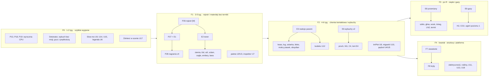

# Laboratorium materiałów i gra: ocena funkcji i backlog (GPU-first)

`maershal/strefa-zero` @ `e12c39a`, 2026-11-03. Ścieżki `plik:linia` liczone od korzenia repozytorium.

> [!IMPORTANT]
> **Migawka na `e12c39a`**, raport cząstkowy do [review_strefa_zero_v2.md](review_strefa_zero_v2.md) (§7–§9 streszczają
> go). Aktualny status: [REVIEW_V2_STATUS.md](../REVIEW_V2_STATUS.md). Numery linii odnoszą się do `e12c39a`.
> Zalecenia są treścią autora review, nie poleceniem właściciela.

**Metoda.** Przejrzałem kod i dokumentację. Błędy CPU zmierzyłem ponownie własnym harnessem, który kompiluje
niezmienione `src/sim/*.cpp` (`scratch/lab_features_harness/`, poza repozytorium). GUI ani GPU nie uruchamiałem, więc
oceny UX GPU wynikają z kodu.

**Oznaczenia.**

- „szac.” to szacunek do potwierdzenia pomiarami.
- Wysiłek: S ≤ 2 dni, M ≤ 2 tygodnie, L > 2 tygodnie.
- **[M]** zależy od rejestru materiałów (P26/P27), **[R]** od przeprojektowania termiki i gazów GPU (analizuje je inny
  agent).
- Prompty P12–P58: `prompty_claude_code.md` z review 2026-11-02 (poza repozytorium).
- E1–E9 to mechanizmy silnika z [R §8.2](review_strefa_zero_v2.md#82-mechanizmy-silnika-które-odblokowują-najwięcej);
  A1–A13 i B1–B9 to pozycje laboratorium z review 2026-11-02 (nie problemy architektury A1–A12).

## 0. Wnioski

1. **Laboratorium GPU to dziś piaskownica mechaniczna:** 3 ziarna, 2 ciecze i ściana (`src/gpu/world.hpp:43`).
   Brakuje chemii, wybuchów i narzędzi badacza. Cała chemia GPU siedzi w termice I10, która jest domyślnie wyłączona
   i droga: dokłada 3,2–9,7 ms na tick przy budżecie 0,05/0,70 ms (`docs/reports/I10_GPU_THERMAL.md:135-140`). Spala
   tylko olej, drewno i gaz palny (`assets/shaders/thermal.comp:26, 72`).
2. **Najważniejsza decyzja:** oddzielić chemię kontaktową od termiki. Większość materiałów z wizji nie potrzebuje pola
   temperatury: kwas, ziemia, błoto, sól, ług, obsydian (lawa + woda), proch, C4, lont i emitery. Wystarczą cztery
   mechanizmy:
   - identyfikator materiału w cząstce (E1);
   - materiały komórek terenu (E2);
   - reakcje parami (E3);
   - wybuchy v2 (E6).

   Termika [R] dokłada później przemiany zależne od temperatury i gazu.
3. **Zalążki tych mechanizmów już są w kodzie** i wystarczy je uogólnić:
   - przełączanie rodzaju cząstki przy przemianie fazowej (`thermal.comp:54`);
   - zamiana komórki terenu w gruz (`assets/shaders/mission.comp:191-199`);
   - HP terenu (`src/gpu/world.cpp:730`);
   - tablice GLSL generowane z `sim::physical` (`src/gpu/thermal_system.cpp:16-43`).
4. **Wszystkie 5 błędów laboratorium CPU z §6.2 review nadal występuje** (pomiar na `e12c39a`, §1.2). Model CPU ma
   być wyrocznią, więc P13, P18 i P19 są warunkiem testów zgodności (P58).
5. **Kolejność faz:**
   - F0: szybkie wygrane;
   - F1: rejestr i materiały bez termiki;
   - F2: reakcje kontaktowe, wybuchy v2 i kodeks odkryć;
   - F3: ciepło i gazy (po [R]);
   - F4: zawalanie się konstrukcji, elektryczność, zapis i PNG, eksperymenty.

   To fazy tego raportu; roadmapa F0–F7 w [R §11](review_strefa_zero_v2.md#11-kolejność-prac-roadmapa) jest inna.
6. **Biblioteki:**
   - TAK: ImPlot; gałąź docking ImGui (bez multi-viewport); PNG przez `SDL_LoadPNG` / `SDL_SavePNG` (SDL 3.4 już jest
     w projekcie); dźwięk przez SDL3;
   - NIE teraz: Box2D, Lua;
   - opcjonalnie: toml++, FastNoiseLite.

## 1. Stan obecny

### 1.1 Inwentarz i luki parytetu

| Obszar | Laboratorium CPU (`src/ui/laboratory.cpp`) | Laboratorium GPU (`src/ui/gpu_laboratory.cpp`) | Luka |
| --- | --- | --- | --- |
| Materiały | 19 + gumka (`src/sim/material.hpp:8-30`), płaska lista (`:126-135`) | 6 + gumka (`:131`). Z termiką narzędzia zastępcze (`:215-226`): drewno = ściana HP 3, lód = drobiny metalu, lawa = olej | GPU nie ma kwasu, węgla, prochu, termitu ani NG. Zastępniki dziedziczą masę nośnika (`thermal.comp:54`: `p.motion.z = 1/a.matter.x`; masy w `particle_common.glsl:208`). Dlatego lawa ma masę cząstki oleju i pływa po wodzie (na CPU ρ 2,4), a lód ma masę drobiny metalu i tonie. Woda z roztopionego lodu jest 7,6 raza cięższa od zwykłej cząstki wody |
| Reakcje | 5 paliw, termit, kwas, wybuchy (`src/sim/reactions.cpp:225-334`) | Tylko z termiką: olej, drewno, gaz palny. Spalanie zużywa 2,0 O₂ i daje 10% dymu, CPU 0,7 O₂ i 15% | Literały zamiast tabeli po obu stronach |
| Wybuchy | `ExplosionCommand`, łańcuch przez udar (`reactions.cpp:232-234`), do 16 na tick (`src/sim/world.cpp:350`) | Tylko przy aktywnej misji (`src/gpu/world.cpp:930`), 1 na tick (`:936-945`, `mission.comp:126`), r = 20, impuls 70 | W laboratorium GPU nie da się niczego wysadzić |
| Teren | Komórki z wytrzymałością, odrywanie fragmentów (`world.cpp:730`, `scene_terrain.frag:10-12`) | Dwa typy terenu zamiast palety materiałów | `wall`: 1 = stała ściana, ≥ 2 = krucha, HP 3 dla wszystkich |
| Sceny | 15 (`src/sim/world.hpp:12-29`) | 12 + misja + 4 termiczne (`:13-17`). Świat jest wspólny z misją (`:34`) | Brak wspólnego opisu scen (P49) |
| Pędzel | Koło 1–16, tylko w puste komórki (`src/sim/world.cpp:252`) | Koło 1–16, tylko w wolne miejsce (`granular.comp:62, 69-72`) | Brak trybu „zastąp”, kształtów i temperatury |
| Mapy, inspektor | 6 map bez legendy (`:90-94`), inspektor w dymku (`:64-69`) | 6 map tylko z termiką (`:103-104`). Inspektor tylko z termiką, bez nazwy materiału (`:183-198`) | GPU nie mówi, co jest pod kursorem |
| Czas | Pauza, krok, tempo 1–4× (`:142`) | Pauza, krok (`:64-67`) | Brak slow-mo |
| Zapis, undo | Brak; nagrania BMP i CSV | Brak; log poleceń v1–v3, materiały 0–6 (`src/app/session_recording.cpp:137`) | README: zapis świata „poza wydaniem” (`README.md:160-162`) |
| Koszt | `dam-break` 31,8 ms, `extinguish` 49,9 ms na krok (2 wątki, pomiar z 2026-11-03) | Fizyka 32 768 cząstek: 8,07 ms na tick 1/120 s (`GPU_MISSION_070.md:55`) | Sceny CPU z cieczami nie mieszczą się w 16,7 ms. GPU ma zapas na nowe przebiegi przy ≤ 16k cząstek (szac.) |

### 1.2 Błędy z review §6.2 na `e12c39a`

Wszystkie pięć nadal występuje. Pomiar: `verify_bugs_e12c39a.txt` (poza repozytorium).

| Błąd | Kod | Pomiar |
| --- | --- | --- |
| **Wisząca skorupa.** Ślad fazy stałej robi z komórki ścianę | `src/sim/thermal.cpp:28` (`solid_mass > 1e-12` → ciało stałe), `:138-140` (`barrier = masa > 1e-7`), `src/sim/motion.cpp:52-53` (ruszają się tylko proszki i luźne fragmenty) | `quench-metal`: środek masy metalu przesuwa się z 106,50 na 107,38 w ciągu 180 ticków, a woda zaczyna się na y = 135. 138 cienkich komórek skorupy, każda ≤ 0,156 masy pełnej komórki (pełna = 7,8) |
| **Grzałka CPU zależna od FPS** | `ui/laboratory.cpp:51-52`, `src/app/application.cpp:783, 804`, `sim/world.cpp:182-209` (jedna komórka, bez górnego limitu T) | 10 × +100 w pustej komórce daje 50 293 K |
| **Mgiełka śladów cieczy** | `thermal.cpp:143` (próg 1e-5), `sim/world.cpp:479` (alfa ≥ 24/255), `:252` | `extinguish` po 180 tickach: 45% komórek „wody” (8 668 z 19 367) ma < 1% wypełnienia |
| **Wyczerpany kwas daje lód.** Entalpia kanału kwasu (cp 2,2) trafia do kanału wody (cp 4,18) | `reactions.cpp:326-330` | Kwas na kamieniu po 240 tickach: minimalna T cieczy 192,9 K, 112 komórek lodu |
| **Opis mówi, że gaz się unosi, a gaz opada** | `material.hpp:69` vs `src/sim/air.cpp:181-184` (dodatnia wyporność oznacza ruch w dół) | Środek masy zimnego gazu: y 95,00 → 100,68 w 600 tickach |

**Co się zmieniło od `5f22f8c`:**

- **Poligon CPU usunięto (#22).** Nieaktualne są P18 pkt 3, P20 pkt 3 i P54 pkt 5 oraz uwagi z §6.3 review o regułach
  plecaka i granatów.
- **Zrobiono P01–P06.** Funkcje laboratorium się nie zmieniły: A1–A13 i B1–B9 są nadal otwarte.
- **Kurs GPU-first** (P56–P58) obowiązuje. Raport uzupełnia go o to, czego plan nie miał: materiały i reakcje
  projektowane od razu pod GPU.

## 2. Luki względem wizji „trochę Noita, Soldat i TPT + laboratorium”

| Oczekiwanie gracza (źródło) | Strefa Zero dziś | Priorytet |
| --- | --- | --- |
| Teren z wielu materiałów, kopalny i niszczalny co do piksela (Noita, Worms) | Dwa typy terenu, HP 3 (`world.cpp:730`) | P1 |
| Reakcje zapisane jako dane i odkrywanie alchemii (Noita: `<Reaction probability input_cell>` z tagami, receptury losowane z ziarna świata) | Literały w `reactions.cpp` i `thermal.comp` | P1 |
| Ziemia, błoto, mokry piasek (Noita, Terraria) | Brak. Wilgoć piasku na GPU jest tylko wizualna (`presentation_moisture.comp:10`) | P1 |
| Wybuch z gruzem, krater zależny od materiału, reakcja łańcuchowa (Noita, Worms, TPT) | CPU ma łańcuch. GPU: 1 wybuch na tick, gruz rodzi się bez prędkości (`mission.comp:197`), w laboratorium brak wybuchów | P1 |
| Ogień, który się rozprzestrzenia (Noita, TPT) | CPU: drewno spala się w 0,35% po 30 s. GPU: ogień tylko z drogą termiką | P1/P2 |
| Gazy, które widocznie się unoszą lub opadają i płoną (TPT) | GPU: wyporność zależy tylko od T (`thermal.comp:57`); brak H₂ i CO₂ | P2 [R] |
| Przemiana fazowa zmienia mechanikę (TPT: METL → LAVA) | Zastępniki: lód to drobiny metalu, lawa to olej | P2 [R] |
| Wiele cieczy układających się warstwami (TPT) | Dwie ciecze; lepkość to literał (`liquids.comp:159`) | P1 |
| Narzędzia piaskownicy: kategorie, wyszukiwarka, kształty, zapis, undo, dzielenie się (TPT, Sandspiel) | Płaska lista, okrągły pędzel, brak zapisu i undo | P1 |
| Zawalanie się konstrukcji i sztywne bryły (Noita) | Brak; README wyklucza bryły | P3 |
| Elektryczność i urządzenia (TPT: SPRK, METL) | Brak | P3 |
| Soldat: ruch, plecak, wiele broni, obrażenia, ragdolle, boty | Plecak, karabin i granaty są. Postać jest niewrażliwa (`GPU_MISSION_070.md:7`) | P2 |
| Dźwięk | Brak: tylko `SDL_INIT_VIDEO` (`src/platform/window.cpp:19`) | P2 |

## 3. Nowe materiały i interakcje

### 3.1 Model danych: rejestr, reakcje parami (Noita) i przemiany (TPT)

```cpp
// Rejestr materiałów (P26) -> generowany blok GLSL (P27) i tabela w UI (P34).
enum class Mech : std::uint8_t { none, terrain, grain, liquid, gas, energy };

struct MaterialDef {
    std::string_view key, name, hint; Category cat; Color color, glow;       // UI
    Mech mech; float density, friction, drag, viscosity, cohesion, adhesion; // mechanika GPU
    float strength /* HP terenu */, blast_transmission, porosity;
    float cp, k, spawn_K, ignition_K, burn_rate, heat_release, smoke_yield;  // termika: CPU, GPU po [R]
    MaterialId residue, burning_variant; TagSet tags; // acid, base, salt, metal, organic, flammable, explosive...
    std::optional<Explosive> explosive; std::uint8_t legacy_gpu_kind; bool gpu;
};

struct Reaction {                        // Selector to id albo tag, np. [acid], [organic]
    Selector a, b; MaterialId out_a, out_b; float rate_per_s; Cond when;
    float heat_per_mass; GasYield gas; Event event; Mode mode; // Mode: contact | thermal
};

struct Transition {                      // Trigger: T>, T<, p>, age>, wet, dry
    MaterialId from, to; Trigger on; float threshold, latent, hysteresis;
};
```

Zasady:

- **Tempo zawsze w 1/s.** Prawdopodobieństwo w ticku to p = 1 − exp(−rate·dt), tak jak zaleca `docs/PARTICLES.md:47`.
  Dzięki temu CPU (60 Hz) i GPU (120 Hz) mają to samo tempo makroskopowe.
- **Selektory z tagami zastępują pełną macierz N×N** (jak tagi w Noicie). Kompilujemy je do gęstej tablicy
  `reaction_index[64][64]` (8 KB) jako stałe GLSL. To ten sam wzorzec co `material_defines()`. UBO też jest możliwe, bo
  nie narusza kontraktu SSBO 0–7.
- **Stan dyskretny to wariant materiału:** mokry piasek, płonące drewno, zużyty kwas. `Grain` nie ma wolnych pól
  (`src/gpu/world.hpp:45-51`), a `motion.w` już przechowuje rodzaj. Dla terenu dokładamy płaszczyzny w SSBO terenu bez
  nowego wiązania.
- **Zakresy ID według klasy** (np. ciecze ≥ 32). Wtedy `liquid(p)` (`particle_common.glsl:181`) zostaje jednym
  porównaniem. Rodzaje 0–6 z nagrań v1–v3 mapujemy przy wczytaniu.
- **`Mode::contact` działa bez termiki** jako skrót izotermiczny. Po [R] `Mode::thermal` ma pierwszeństwo i wyłącza
  skrót, więc nic nie liczy się podwójnie.
- **Rola CPU jako wyroczni:** sprawdza chemię i bilans w teście „reaktora” (dobrze wymieszane pudełko 0-D). Pełne sceny
  się do tego nie nadają, bo mechanika MAC/PCG i PBF/PBD się różni. To uzupełnienie P58.

### 3.2 Prymitywy silnika, które odblokowują najwięcej

| ID | Prymityw | Gdzie | Odblokowuje | Wysiłek | Zależy |
| --- | --- | --- | --- | --- | --- |
| E1 | `motion.w` = ID z rejestru; klasa i parametry z tablicy zamiast literałów | `particle_common.glsl:181, 208`, `granular.comp:91, 139`, `liquids.comp:159`, `granular.vert:19`, `thermal.comp:23` | mapa rodzajów 0–6 dla nagrań, N ziaren i cieczy, warstwy, lepkość, tarcie i kolor per materiał | M–L | [M] |
| E2 | `MaterialId` komórki terenu: `wall[id] = id`, HP ze `strength`, kolor z rejestru | `world.cpp:730`, `scene_terrain.frag:8-12` (mapa R16UI już niesie `wall`) | ziemia, kamień, cegła, metal, szkło, lód, C4, lont, rośliny | S–M | [M] |
| E3 | Reakcje parami (szczegóły pod tabelą) | nowy `reactions.comp` z własnym układem wiązań 0–7 (wzorzec `ThermalSystem`), maska 0,2–0,3 ms na przebieg przy 32k cząstek, ok. 0,07 ms na tick przy 30 Hz | kwas, ług, solanka, błoto, mokry piasek, obsydian, rdza | M–L | szac. |
| E4 | Automat komórkowy na terenie (płonie, rośnie, iskra) co N ticków, stan w nowej płaszczyźnie terenu | przebieg po komórkach jak op 9 (`granular.comp:37-55`) | lont, tani ogień (poziom 0), rośliny, elektryczność | S–M | E2 |
| E5 | Cząstka → komórka terenu (osadzanie; odwrotność gruzu) | rezerwacja jak `mission.comp:191-199` | obsydian, zamarzanie w blok, beton | S–M | E2 |
| E6 | Wybuchy v2 (§5) | `mission.comp` op 0/5/6/7 | proch, NG, C4, H₂ | M | E2 |
| E7 | Kohezja w PBD; adhezja per materiał (dziś globalne `FLUID_ADHESION`) | `granular.comp:100-127`, `liquids.comp:191-208` | mokry piasek, glina, szlam | S–M | E1 |
| E8 | Przemiany z tabeli `Transition` zamiast przełączania rodzajów 3 → 5/6 | `thermal.comp:54, 69` | lód, szkło, wosk, topniejący metal, lawa → bazalt, LN₂ | M | E1 + [R] |
| E9 | Do 8 gatunków gazu z rejestru, wyporność zależna od masy molowej | `thermal.comp:57`; `ThermalCell` (128 B) nie ma wolnych pól (`src/gpu/thermal.hpp:78-89`) | H₂, CO₂, dym, para, gazy toksyczne | M–L | [R] |

Jak działa E3:

- Na istniejącym sąsiedztwie każda cząstka wybiera partnera, a reakcja zachodzi po wzajemnym potwierdzeniu. Każda
  cząstka zmienia tylko siebie, więc nie ma wyścigów, a liczby się bilansują.
- Przebieg idzie co 4. tick i tylko w kaflach z materiałem reaktywnym.
- Uszkodzenia terenu sumuje akumulator HP przez `atomicAdd` na liczbach całkowitych, więc wynik jest deterministyczny.

### 3.3 Kandydaci

Fala 1 nie zależy od [R] (fazy F1–F2), Fala 2 wymaga [R] (F3), Fala 3 przyjdzie później. Tempa reakcji to szacunki do
strojenia. Kolumna „Fizyka” podaje rodzaj na GPU: ciecz = PBF, ziarno = PBD, teren = statyczna komórka, gaz = siatka
gazu [R]. ρ to gęstość, v lepkość.

| # | Materiał (ID) | Interakcje A + B → C + D (warunek; tempo) | Fizyka | GPU | Wys. | Wartość | Fala |
| --- | --- | --- | --- | --- | --- | --- | --- |
| 1 | Ziemia (`soil`, `soil_loose`) | soil + water → mud (2/s); szybki nurt → soil_loose (erozja); niskie HP daje duży krater | teren HP 1; luźna: ρ 1,3, tarcie 0,8 | E2, E1, E3 | S/M | ★★★ „ziemia”, kopanie | 1 |
| 2 | Błoto (`mud`) | mud → soil + water (sedymentacja, 0,05/s); [R] suszenie → soil | ciecz ρ 1,7, v 3× olej, kohezja | E1, E3 | M | ★★★ lepkość, osadzanie | 1 |
| 3 | Mokry piasek (`wet_sand`) | sand + water → wet_sand, woda wchłonięta 1:1 (1/s); [R] > 373 K → sand + para | ziarno, tarcie 0,9, kohezja (pionowe skarpy) | E1, E3, E7 | M | ★★★ zamki z piasku | 1 |
| 4 | Kwas na GPU (`acid`, `acid_spent`) | acid + [dissolvable] → ∅ (3/s); kwas zużywa się losowo z p = 0,35, co daje skończoną pojemność bez dodatkowego pola. Zużyty → woda o tej samej T. acid + metal → H₂ [R] | ciecz ρ 1,1, v 0,1 | E1, E3 (teren przez akumulator HP) | M | ★★★ „kwas” | 1 |
| 5 | Ług (`lye`) | lye + acid → brine + ciepło (5/s; bez [R] chmurka VFX); lye + [organic] → ∅ (wolno) | ciecz ρ 1,15 | E1, E3 | M | ★★★ pH, neutralizacja | 1 |
| 6 | Sól (`salt`) | salt + water → brine (1/s); salt + ice → brine (0,5/s, [R] endotermiczne); salt + plant → ash | ziarno ρ 2,2 | E1, E3 | S/M | ★★★ rozpuszczanie | 1 |
| 7 | Solanka (`brine`) | [R] krzepnie w 252 K; [R] po odparowaniu zostają kryształy soli; przewodzi prąd (E4) | ciecz ρ 1,2, układa się pod wodą | E1 (+E8) | S/M | ★★★ warstwy, krystalizacja | 1/2 |
| 8 | Lawa jako właściwy materiał (`lava`) | lava + water → obsydian + para (20/s); lava + [flammable] → zapłon (E4); lava + ice/snow → water | ciecz ρ 2,4, v jak lawa na CPU (dziś dostaje lepkość oleju 18), świeci | E1, E3, E5 | M | ★★★ „lawa” | 1 |
| 9 | Obsydian, bazalt | z lawy i wody przez kontakt; [R] lawa < 1400 K → bazalt | teren HP 12-√8, transmisja wybuchu 0,2 | E2, E5 | S | ★★ | 1 |
| 10 | Lód (`ice`) | ice + lava/fire → water (kontakt, 1/s) lub [R] 273 K | blok terenu albo ziarno, tarcie 0,03 (śliskie) | E1/E2 (+E8) | S/M | ★★ ślizgawki w grze | 1 |
| 11 | Szlam (`slime`) | slime + salt → ∅ (kurczy się); spowalnia postać | ciecz ρ 1,3, v 10× olej, kohezja i adhezja | E1, E7 | M | ★★ | 1 |
| 12 | Proch (`gunpowder`) | zapłon od ognia, iskry albo udaru → deflagracja z opóźnieniem 2–6 ticków, dym | ziarno ρ 1,4 | E1, E6 (+E4) | M | ★★★ | 1 |
| 13 | Nitrogliceryna (`nitro`) | uderzenie (‖Δv‖ > 25 komórek/s) albo udar → detonacja i łańcuch | ciecz ρ 1,6 | E1, E6 | M | ★★★ „upuść kroplę” | 1 |
| 14 | C4 (`c4`) | wybucha tylko od wybuchu lub detonatora; w ogniu się tli | teren malowany na ścianach | E2, E6 | S/M | ★★★ wyburzanie | 1 |
| 15 | Lont (`fuse`) | płonie z prędkością 15 komórek/s (E4); na końcu zapala proch, C4 albo termit | teren o grubości 1 px | E2, E4 | S/M | ★★★ eksperymenty z czasem | 1 |
| 16 | Emiter, odpływ, klon (`source`, `void`, `clone`) | emituje X ze stałym tempem; odpływ usuwa; klon kopiuje pierwszy dotknięty materiał (TPT CLNE) | teren specjalny | E2 + spawn op 8 (`granular.comp:61-77`) | S/M | ★★★ stany ustalone, wulkan | 1 |
| 17 | Cegła, kamień, metal, szkło jako teren | różne HP i transmisja wybuchu; szkło przepuszcza światło (I11) | teren | E2 | S | ★★ budowa eksperymentów | 1 |
| 18 | Rdza (`rust`) | metal + water → rust (0,01/s); rust + al_powder → thermite (receptura alchemiczna) | teren HP 1 / ziarno | E1, E3 | S/M | ★★ | 1 |
| 19 | Wodór (`h2`) | acid + metal → H₂; H₂ + O₂ + iskra → para + deflagracja gazu | gaz, M = 2, szybko w górę | E9, E6 | M | ★★★ | 2 [R] |
| 20 | CO₂ (`co2`) | powstaje przy spalaniu (dziś „products”); wypiera O₂ i gasi; suchy lód sublimuje w 195 K | gaz, M = 44, zalega w dołach | E9 | S/M | ★★ dydaktyka | 2 [R] |
| 21 | Szkło (`molten_glass` → `glass`) | sand > 1900 K → molten_glass (bardzo lepkie, świeci) → < 1400 K glass; pęka w odłamki | ciecz o dużej lepkości / teren HP 1 | E8 | M | ★★★ | 2 [R] |
| 22 | Glina → cegła (`clay`) | clay > 1100 K przez > 5 s → brick (czas w temperaturze w płaszczyźnie terenu) | ziarno kohezyjne | E7, E8 | M | ★★ ceramika | 2 [R] |
| 23 | Wosk (`wax`) | topi się w 330 K (widać przy grzałce i sondzie); płonie jak świeca z lontem | teren / ciecz | E8 | S | ★★ plateau w niskiej T | 2 [R] |
| 24 | Śnieg (`snow`) | topnieje w 273 K (daje mniej wody niż objętość); chłodzi otoczenie | ziarno ρ 0,3, duży opór | E1, E8 | S | ★★ (jest tło `winter_bmp`) | 2 [R] |
| 25 | Ciekły azot (`ln2`) | wrze w 77 K → N₂ (dużo gazu, gasi ogień); mrozi wodę w lód; metal poniżej 150 K kruchy (HP × 0,3) | ciecz | E8, E9 | M | ★★★ efektowne | 2 [R] |
| 26 | Termit na GPU (`thermite`) | zapłon w 850 K; ok. 3000 K bez tlenu; przepala teren w dół, zostawia stopiony metal | ziarno | E1 + E8 (poziom 0: izotermiczne przepalanie HP) | M | ★★★ | 2 |
| 27 | Rośliny, mech (`plant`) | rosną w pustą komórkę przy wodzie (0,3/s, zużywają wodę); płoną; giną od soli, ługu i kwasu | teren | E2, E3, E4 | M | ★★ żywy świat | 3 |
| 28 | Toksyczny szlam (`sludge`) | [R] wydziela toksyczny gaz; zabija rośliny; ług go neutralizuje; rani postać | ciecz, świeci | E1, E3 (+E9) | M | ★★ zagrożenie w grze | 3 |
| 29 | Beton (`cement`) | cement + water → wet_concrete → po 10 s concrete | ziarno → ciecz → teren HP 10 | E3, E5 | M | ★★ | 3 |
| 30 | Rtęć (`mercury`) | metal pływa po rtęci; [R] toksyczne opary | ciecz ρ 13,5; ryzyko stabilności PBF przy stosunku gęstości ok. 17 | E1 | M/L | ★★ dydaktyka | 3 |

### 3.4 Interakcje rdzenia wizji (A + B)

| A \ B | woda | ziemia | piasek | kamień | metal | drewno / rośliny | lód / śnieg | sól |
| --- | --- | --- | --- | --- | --- | --- | --- | --- |
| **kwas** | rozcieńczenie (tempo × 0,5) | ∅ | ∅ | ∅ (wolno) | H₂ + sól [R] | ∅ (wolno) | topnieje | — |
| **ług** | rozcieńczenie | — | — | — | H₂ (aluminium) [R] | ∅ (wolno) | — | — |
| **woda** | — | błoto | mokry piasek | erozja przy szybkim nurcie | rdza (bardzo wolno) | gasi, nasiąka | [R] zamarza | solanka |
| **lawa** | obsydian + para | wypala; cegła | szkło [R] | topi [R] | topi [R] | zapala | woda + para | topi [R] |

Do tego kwas + ług → solanka + ciepło (neutralizacja). W wierszu „kwas” oryginał miał jedną kreskę za dużo zaraz po
„rozcieńczeniu”; komórki ustawiono według interakcji z §3.3 (kwas rozpuszcza ziemię, piasek i kamień).

## 4. Fizyka, którą gracz zobaczy

Identyfikatory F1–F14 w tej tabeli to zjawiska, nie fazy roadmapy F0–F4 z §9.

| # | Zjawisko | Co widać | Implementacja | Wys. | Zależy | Priorytet |
| --- | --- | --- | --- | --- | --- | --- |
| F1 | Mechanika per materiał | lód się ślizga, szlam się ciągnie, błoto płynie wolno | E1: tablice zamiast literałów | M | [M] | P1 |
| F2 | Warstwy N cieczy | olej / woda / solanka / błoto | odwrotna masa per materiał (`particle_common.glsl:208`); test stabilności PBF | M | E1 | P1 |
| F3 | Mokry piasek i kohezja | pionowe skarpy, glina | warianty materiałów + E7 | M | E1, E3 | P1 |
| F4 | Gruz z prędkością | odłamki lecą od wybuchu | w op 6 prędkość liczona z `game.blast` (`mission.comp:197`) | S | — | P0 |
| F5 | Ogień poziomu 0 (automat na terenie) i żar jako VFX | drewno płonie, ogień się rozprzestrzenia, zostaje popiół | E4; VFX iskier już jest (`vfx_events.comp:9-17`) | S–M | E2 | P1 |
| F6 | Erozja | woda z zapory wymywa ziemię | E3: szybka woda zamienia `soil` w `soil_loose` | S | E3 | P2 |
| F7 | Zawalanie się | podcięta półka spada | CCL od kotwic po zniszczeniu; komórki bez kotwicy dostają HP = 0 i stają się gruzem (op 6) | M | E2 | P2 |
| F8 | Sztywne bryły | kawałek muru spada w całości | klastry PBD z dopasowaniem kształtu (shape matching); ID klastra w buforze | L | F7 | P3 |
| F9 | Przemiany zmieniają mechanikę | metal się topi i płynie | E8 | M | [R] | P2 |
| F10 | Wyporność zależna od składu | H₂ ucieka w górę, CO₂ zalega w dołach | E9; na CPU decyzja z P19 | M | [R] | P2 |
| F11 | Świecenie gorących materiałów | metal świeci od ok. 800 K | emisja z rejestru; CPU już to ma (`sim/world.cpp:497-503`) | S | [R] | P2 |
| F12 | Wiatr, wentylator | wiatr zwiewa piasek i dym | siła w prostokącie (op 1, `granular.comp:88-95`) | S/M | — | P2 |
| F13 | Fala uderzeniowa | widoczny pierścień | pierścień VFX + impuls z zasłanianiem; akustyka jest tylko na CPU | S | E6 | P2 |
| F14 | Elektryczność | grzałki, zapalniki, elektroliza | E4 na metalu i solance | L | E4 | P3 |

## 5. Wybuchy

### 5.1 Stan

**CPU (wyrocznia):**

- `ExplosionCommand` ma środek, promień, energię, ciśnienie, impuls i gaz (`src/sim/physics.hpp:108-115`).
- Wybuch materiału ma stały promień 9 lub 12, ciśnienie 18 + 5m i impuls 35 (`reactions.cpp:61-64`).
- Zasłanianie to literały: metal 0,035, kamień 0,24, drewno 0,7 (`:96`).
- `apply_blast` rozkłada ciepło, ciśnienie i udar, a fragment odrywa się, gdy siła przekracza `strength`
  (`:154-205`).

**GPU (gra):**

- `Explosion{id, x, y, radius ≤ 32, impulse ≤ 80}` (`src/gpu/mission.hpp:30-33`, `world.cpp:1458-1465`); działa
  tylko z misją.
- Impuls dla cząstek (`mission.comp:212-215`), uszkodzenie widocznej powierzchni o maks. 8 HP (`:185-190`).
- Ciepło 250·w trafia do termiki (`thermal_events.comp:11`).
- Jest też błysk, wstrząs ekranu (`src/gpu/lighting_system.cpp:359-360`) i VFX (`vfx_events.comp:29`).

### 5.2 Profil wybuchu w rejestrze

Kolejno: proch / NG / C4 / H₂+O₂ / granat.

| Pole `Explosive` | Znaczenie | Przykład (szac.) |
| --- | --- | --- |
| `energy_per_mass` | energia | 3000 / 4500 / 6000 / 10000 / stała |
| `brisance` (0–1) | udział udaru wobec pchania; decyduje o kraterze wobec podmuchu | 0,2 / 0,9 / 1,0 / 0,3 / 0,6 |
| `gas_yield`, `incendiary` | produkty i dym [R]; udział energii jako ciepło i zapłon | 0,8+0,3 / 1,0+0,1 / 0,9+0,05 / 0+0,5 / 0,5+0,1 |
| `fragments` | mnożnik prędkości gruzu | 0,5 / 1 / 1,2 / 0,3 / 1,5 |
| `sensitivity` | próg zapłonu: T, udar, ‖Δv‖ | 650 K + udar 10 / 500 K + udar 4 + ‖Δv‖ 25 / tylko udar 30 / iskra / zapalnik 2 s |
| `delay_ticks` | opóźnienie łańcucha | 2–6 / 0–1 / 0 / 0 / — |

Pochodne:

- promień r = k·√E (w 2D);
- uszkodzenie komórki d = E·w·transmisja / strength. Ziemia daje duży krater, kamień mały, metal prawie żaden, a szkło
  pęka szeroko.

### 5.3 Przebieg E6 w ticku

1. **Kolejka.** Wybuchy z CPU (granat, detonator) i detonacje wykryte na GPU (T, udar z poprzedniego ticka, ‖Δv‖)
   trafiają przez `atomicAdd` do `BlastQueue` (K = 16 na tick). Nadmiar przechodzi na następny tick bez kasowania,
   tak jak oczekujący gruz.
2. **Łączenie w kaflu 16×16:** energię sumujemy, a środek ważymy energią. 2000 ziaren prochu nie daje 2000 wybuchów.
3. **Jeden przebieg po cząstkach i jeden po komórkach** dla K wybuchów:
   - zasłanianie bierze transmisję z rejestru;
   - gruz dostaje prędkość, bo dziś rodzi się z zerową (`mission.comp:197`);
   - udar trafia do płaszczyzny terenu i do wariantu cząstki, co odpala łańcuch po `delay_ticks`.
4. **Skutki zależą od [R]:** z termiką produkty i ciepło idą do termiki. Bez niej rysujemy dym VFX, dodajemy
   promieniowy podmuch i wpis w dzienniku laboratorium.
5. **Zdarzenie.** `WorldEvent` niesie energię i materiał; korzystają z niego HUD, VFX, błysk, wstrząs ∝ E/odległość
   i dźwięk (P55).
6. **Ta sama logika na CPU.** Pola `ExplosionCommand`, transmisję i progi łańcucha (`reactions.cpp:61-64, 96,
   232-234`) przenosimy do rejestru. To warunek P58.

Rodzaje spalania:

- deflagracja (proch): łańcuch kafli z opóźnieniem, niska brisance;
- detonacja (NG, C4): natychmiast, wysoka brisance;
- gaz (H₂, paliwo): po [R];
- termit: bez wybuchu, tylko przepalanie.

Szybkie wygrane (S):

- wybuch w laboratorium bez misji: wydzielić op 0/5/6/7 spod `mission_enabled`;
- prędkość gruzu;
- narzędzie „Detonator” z energią i brisance;
- więcej niż jeden wybuch na tick (zamiast serializacji z `mission.comp:126`).

## 6. Narzędzia laboratorium i UI/UX

> [!NOTE]
> Wiersze U6–U9 były w oryginale przesunięte o komórkę; ułożono je według sensu. Wysiłku U8 oryginał nie podaje,
> fazę wzięto z roadmapy (§9).

| # | Funkcja | ImGui | Praca w silniku | Wys. | Faza |
| --- | --- | --- | --- | --- | --- |
| U1 | Dokowany układ: z lewej paleta i pędzel, w środku płótno i oś czasu, z prawej inspektor, sondy i kodeks, na dole dziennik | gałąź docking: `DockSpaceOverViewport` i `DockBuilderSplitNode`. Dziś `io.IniFilename = nullptr` (`src/ui/session.cpp:36`), więc układ zapisywać przez `SaveIniSettingsToMemory` do profilu. Do tego czasu `BeginTable` i `BeginTabBar` | — | S–M | F1–F2 |
| U2 | Paleta jak w TPT: kategorie, siatka próbek, wyszukiwarka, ulubione pod klawiszami 1–0 | `BeginTabBar`, `ColorButton`, `ImGuiTextFilter`, `Shortcut()` z ochroną `WantTextInput`; ulubione w `meta::Field` | kategorie i opisy z rejestru | S–M | F1 |
| U3 | Karta materiału w podpowiedzi: ρ, przemiany, „reaguje z”, dostępność na GPU | `BeginItemTooltip`; niedostępne przez `BeginDisabled` (wzorzec `gpu_laboratory.cpp:18-21`) | rejestr | S | F1 |
| U4 | Pędzel: kształt (koło, kwadrat, spray), tryb (dodaj, zastąp, usuń tylko X jak SDL w TPT), temperatura [R] | `Combo` i podgląd obrysu | tryb „zastąp” w op 5/8; dziś op 8 odrzuca zajęte miejsce | M | F2 |
| U5 | Linia, prostokąt, wypełnianie, pipeta (Alt + klik) | automat stanów płótna | wypełnianie jako iteracyjny flood fill na GPU; prostokąt jako seria `Stroke` | M | F2 |
| U6 | Mapy pól: T, p, prędkość, skład gazów [R], HP terenu i materiał | każda z legendą, wspólną paletą (viridis/inferno) i zakresem auto lub stałym; `AddRectFilledMultiColor` albo `ImPlot::ColormapScale` | wspólne mapowanie kolorów (P12) | S | F0–F1 |
| U7 | Inspektor także bez termiki: materiał, liczba cząstek, prędkość, HP | przypinany panel | asynchroniczna próbka 5×5 z buforem kołowym; jedna redukcja dla N sond, odczyt co 0,25 s | M | F2 |
| U8 | Sondy i wykresy (T, p, liczby w obszarze), eksport CSV | ImPlot: `SetupAxisLimits(...)`, `ImPlotCond_Always`, `PlotLine` | — | — | F2 |
| U9 | Slow-mo 0,1–1× i przyspieszenie na GPU | suwak | zegar interaktywny dopuszcza maks. 4 ticki na klatkę (`fixed_clock.hpp:24`), więc przy 60 FPS przyspieszenie kończy się na 2× | S | F0 |
| U10 | Undo i przewijanie | `SliderInt` osi czasu, Ctrl+Z/Y | pierścień migawek GPU→GPU przez `glCopyBufferSubData`, bez odczytu na CPU. Migawka: ok. 3,5 MiB, z termiką ok. 13 MiB; 30 migawek ok. 105 MiB (szac.) | M | F2 |
| U11 | Zapis i odczyt piaskownicy z miniaturą; import map materiałów z PNG, eksport PNG | lista plików | jawne granice readback / load `read_terrain` (`src/gpu/world.hpp:111, 145-146`), `SDL_LoadPNG`, format `STREFA_SANDBOX 1` z hashem rejestru | M | F4 |
| U12 | Dziennik reakcji i „Kodeks odkryć”: wpis po pierwszej obserwacji, podpowiedzi „??? + ???” | panel i toast | liczniki per reakcja w E3, odczyt co 0,5 s | S | F2 |
| U13 | Tryb eksperymentu, np. „zrób obsydian”, „zneutralizuj kwas” | panel celu | sondy i DSL (P49) | M | F4 |
| U14 | Ustawienia obrazu, światła i VFX przenieść z panelu narzędzi do sekcji „Obraz” | `gpu_laboratory.cpp:79-96` | — | S | F0 |
| U15 | Spacja i F przez `SetNextItemShortcut` | dziś `IsKeyPressed` (`:66-67`) | — | S | F0 |
| U16 | Zoom i przesuwanie płótna (Ctrl + kółko, środkowy przycisk) | — | przesunięcie kamery już jest (`lab.camera`) | S–M | F1 |
| U17 | „Wejdź żołnierzem” do bieżącej sceny laboratorium | przycisk | `configure_mission` (`world.hpp:106`) bez obowiązkowych tarcz | S–M | F0 |
| U18 | Edytor reakcji w laboratorium (jak Sandspiel Studio) z przeładowaniem na żywo | edytowalna `BeginTable` | nadpisanie rejestru (P48) i unieważnienie cache shaderów | M | F4 |

U1–U3, U6 i U14–U15 to czysty UI. Reszta wymaga zmian w silniku albo przejścia przez `lab::Backend` (P57).

## 7. Gra (krótko)

| Funkcja | Po co (Soldat / Noita) | Co wykorzystuje z laboratorium | Wys. |
| --- | --- | --- | --- |
| Obrażenia od kwasu, lawy, ognia i wybuchów zamiast niewrażliwej postaci | zagrożenia z laboratorium stają się rozgrywką | kontakt kapsuły (I04), nowy `WorldEvent` → HP w `GameplaySession` | M |
| Broń materiałowa: miotacz kwasu, armatka wodna, wyrzutnia błota (barykady), kopacz, zamrażacz [R], granat C4 lub zapalający | broń jako materiał (Noita) | spawn z prędkością (op 8 + uniform), E3, E6, `rifleImpact` (`mission.comp:33-41`) | S–M każda |
| Broń modułowa jak różdżki: ładunek × wyzwalacz × rozrzut | głębia | rejestr, `Explosive` | M |
| Feel ruchu z Soldata: kontrola w powietrzu, pęd po lądowaniu, odrzut, czołganie | odczucie | stałe z `mission.comp:63, 151-155` (45 / 360 / 480 / −85, paliwo plecaka 1,5 s) → `MissionConfig` | S–M |
| Misje z PNG i proceduralne jaskinie | szybkie poziomy | U11, opcjonalnie FastNoiseLite | M |
| Przeciwnicy (wieżyczki, drony), ragdolle PBD (ok. 12 cząstek z więzami), większy przewijany świat (dziś W = 320, H = 192 na sztywno, `particle_common.glsl:57`) | rdzeń Soldata i Noity | solver PBD, protokół I06 | L |

## 8. Biblioteki

| Biblioteka | Licencja | Zastosowanie i integracja | Werdykt |
| --- | --- | --- | --- |
| Dear ImGui, gałąź docking | MIT | U1. Archiwum `v1.93.0-docking` (sprawdzić, czy tag istnieje; konwencja to `vX.Y.Z-docking`) z nowym SHA w `cmake/Dependencies.cmake`. Bez `ViewportsEnable` (GL, WSLg) | TAK, F2 |
| ImPlot | MIT | U6 i U8: `PlotLine`, `PlotHeatmap`, `ColormapScale`. Trzy pliki `.cpp` w `strefa-imgui`. Wymaga wersji ≥ 0.17/1.x, zgodnej z `ImTextureRef` (ImGui ≥ 1.92); sprawdzić na 1.93.0 | TAK, F1–F2 |
| SDL 3.4: `SDL_LoadPNG`, `SDL_SavePNG` | zlib (już jest) | U11 i zrzuty PNG zamiast BMP. Według dokumentacji SDL do plików zaufanych | TAK, bez nowej zależności |
| stb_image / stb_image_write | PD/MIT | tylko gdy będą potrzebne inne formaty | NIE teraz |
| SDL3 audio (`SDL_AudioStream`) | zlib (już jest) | P55, własny mikser | TAK |
| miniaudio / SDL3_mixer | PD, MIT-0 / zlib | dekodowanie OGG, dźwięk przestrzenny | NIE teraz |
| FastNoiseLite | MIT | jaskinie i generator światów, jeden nagłówek | opcjonalnie, F4 |
| toml++ / nlohmann::json | MIT | plik materiałów i reakcji. Najpierw własny format na `meta::Field` (P48); JSON nie jest potrzebny | toml++ opcjonalnie; JSON NIE |
| Box2D v3.1 | MIT | sztywne bryły. Wymaga poligonizacji pikseli i sprzężenia CPU–GPU w każdym ticku, co łamie kontrakt „bez pełnych odczytów w pętli” | NIE. Zamiast tego shape matching w PBD (F8) |
| Lua (sol2) | MIT | skrypty. Problemy: determinizm, sandbox, MSVC/GCC | NIE; DSL (P49) |

`docs/ARCHITECTURE.md:48` stwierdza, że nowe zależności runtime nie są potrzebne. ImPlot i docking linkują się
statycznie, więc nie dodają DLL, ale wymagają ADR, przypiętego SHA-256 i licencji w `licenses/`.

## 9. Roadmapa laboratorium



| Faza | Zależy od | Bramka wyjścia |
| --- | --- | --- |
| F0 | — | asercje scen CPU zielone; golden master zaktualizowany z raportem. Wybuch w laboratorium i gruz z prędkością pokryte testem `gpu.mission` |
| F1 | [M]: P26, P27, P28 | rejestr bitowo nie zmienia golden master. Nagrania v1–v3 odtwarzają się identycznie. Po zamianie literałów na tablice koszt fizyki GPU mieści się w ±3% (protokół z `CLAUDE.md`) |
| F2 | F1 | test „reaktora” CPU vs GPU dla każdej reakcji. E3 ≤ 0,15 ms na tick, E6 ≤ 0,2 ms przy 16 wybuchach (szac. budżety). Łańcuch 2000 ziaren prochu bez utraty zdarzeń |
| F3 | [R] + F1 | przemiany i gazy w budżecie z nowego projektu termiki; P58 dla wrzenia, topnienia i neutralizacji |
| F4 | F2 (F7/F8 na E2) | zapis i odczyt dają ten sam stan, działa import PNG, zawalanie nie traci masy |

Mapowanie na prompty:

- P12, P13, P18, P19: bez zmian, w F0.
- P14, P16, P17, P30–P33: przez `lab::Backend` (P57). P31 na GPU jako pierścień migawek (U10).
- P27: obejmuje teraz E1 i E2. P28: mapa rodzajów 0–6 na ID rejestru.
- P50: najpierw Fala 1 z §3.3 na GPU; sól nadal pierwsza. CPU sprawdza chemię testem „reaktora”.
- P51: zastąpić. Materiały wybuchowe przez E6, kwas przez E1 i E3; zastępniki termiczne nie są potrzebne.
- P52: po P58, w F4.
- Nowe prompty: E2, E3 z kodeksem, E6, U2/U3, U10, F7.

---

*Pomiar: `g++ -std=c++23 -O2 -ffp-contract=off` na niezmienionych `src/sim/*.cpp` z `e12c39a`; źródło i wynik
w `scratch/lab_features_harness/` (`verify_bugs.cpp`, `verify_bugs_e12c39a.txt`), poza repozytorium.*
