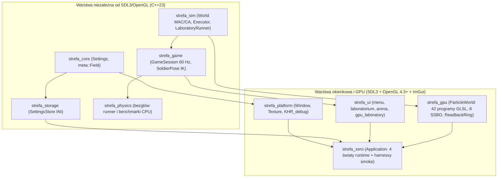
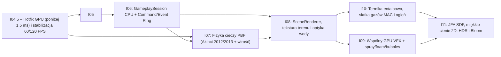
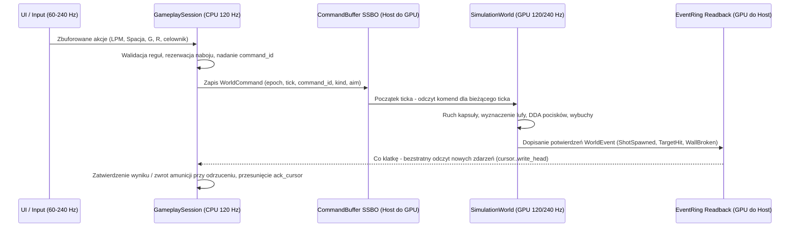
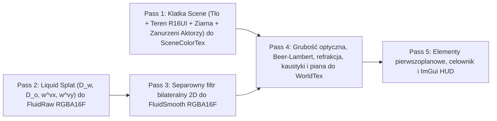

# Kompleksowe Review `strefa-zero` (`v0.7.0-i04`), Audyt `PLAN_ROZWOJU_GPU.md` oraz Roadmapa Techniczno-Matematyczna (`i04.5`–`i11`)

Przedmiotem opracowania jest pełny audyt inżynierski projektu **[strefa-zero (`v0.7.0-i04`, commit `6f318ea`)](https://github.com/maershal/strefa-zero/tree/v0.7.0-i04)** ze szczególnym uwzględnieniem realizacji dokumentu **[PLAN_ROZWOJU_GPU.md](https://github.com/maershal/strefa-zero/blob/v0.7.0-i04/docs/PLAN_ROZWOJU_GPU.md)**, architektury C++23 / OpenGL 4.3+, spójności funkcjonalnej oraz szczegółowego planu dalszych wdrożeń wraz z aparatem matematycznym i układem pamięci GPU.

> [!IMPORTANT]
> **Synteza oceny ogólnej:** Dotychczas zrealizowane iteracje **`i00`–`i04` (5 z 12 etapów planu, 41,7%)** stoją na **bardzo wysokim, rzadko spotykanym poziomie rygoru inżynierskiego i naukowego**: protokół pomiarowy ABBA, weryfikacja numeryczna względem CPU w `double`, obsługa barier i generacji w `ReadbackRing` oraz matematycznie szczelny dowód kompletności rezultatywnego sąsiedztwa `R + Dmax` z kompensacją Kahanа są wzorcowe. Jednocześnie analiza kodu i surowych logów CSV/telemetrii (`window-steps.csv`, `mission-frames.csv`, `gpu-telemetry.csv`, `gl-debug.txt`) pozwala **jednoznacznie wskazać przyczyny wszystkich otwartych problemów z `i00`–`i04`** (zarówno braku zejścia poniżej `1,5 ms` GPU w misji, jak i blokady `31,6–33,3 ms` w oknie oraz reżimu spowolnień `13–19,5 ms/tick`) i zamknąć je w krótkim etapie korekcyjnym **`i04.5`** przed wejściem w unifikację silnika (`i05`–`i06`) i fizykę/grafikę (`i07`–`i11`).

---

## Część I. Audyt realizacji `PLAN_ROZWOJU_GPU.md` – ile zrobiono i z jaką jakością

### 1.1. Bilans ilościowy realizacji planu (`i00`–`i11` oraz punkty `P1`–`P11`)

Plan z [PLAN_ROZWOJU_GPU.md](https://github.com/maershal/strefa-zero/blob/v0.7.0-i04/docs/PLAN_ROZWOJU_GPU.md#L89-L102) dzieli rozwój silnika na **12 iteracji głównych (`i00`–`i11`)** w trzech naturalnych fazach oraz **4 eksperymenty warunkowe** (Sekcja 5):

- **Faza I — Instrumentacja, asynchroniczny transport i optymalizacja rdzenia obliczeniowego GPU (`i00`–`i04`)**: **wdrożona w 100% (5/5 iteracji)**, przy czym dwa cele odbiorcze (stabilna baza FPS okna oraz mediana `<1,5 ms` GPU/tick w misji) zostały uczciwie pozostawione jako otwarte.
- **Faza II — Unifikacja silnika, zasobów GPU i logiki rozgrywki na CPU (`i05`–`i06`)**: **0% (0/2 iteracji)**.
- **Faza III — Jakość cieczy PBF, renderery optyczny wody, GPU VFX, termika/gazy/ogień i HDR (`i07`–`i11`)**: **0% (0/5 iteracji)**.
- **Sekcja 5 — Eksperymenty warunkowe (APIC/FLIP, rozdzielczość `0,5` komórki, shape matching gruzu, Radiance Cascades)**: **0% (0/4)** — zgodnie z założeniem planu czekają na ukończenie podstaw.

| Iteracja / Zakres | Pokrycie punktów review (`P1`–`P11`) | Status w `v0.7.0-i04` | Ocena jakości wykonania | Kluczowe pliki dowodowe |
| --- | --- | --- | --- | --- |
| **`i00`** — Pomiar przebiegu i diagnostyka GL | **`P11`**, diagnoza **`P1`** | **Zrobione** *(odbiór bazy FPS okna otwarty)* | **Celująca (9,5/10)** — pełne liczniki API, fazy CPU/GPU, kontekst `KHR_debug`, przełączniki ablacyjne | [gl_api.hpp](https://github.com/maershal/strefa-zero/blob/v0.7.0-i04/src/gpu/gl_api.hpp#L50-L90), [profiling.hpp](https://github.com/maershal/strefa-zero/blob/v0.7.0-i04/src/gpu/profiling.hpp#L44-L80), [gl_debug.cpp](https://github.com/maershal/strefa-zero/blob/v0.7.0-i04/src/platform/gl_debug.cpp#L13-L50) |
| **`i01`** — ReadbackRing (3 sloty) i separacja telemetrii | **`P1`** | **Zrobione** *(p95 CPU `<0,08 ms`)* | **Wzorcowa (10/10)** — `ARB_buffer_storage` + fallback GL 4.3, poprawne bariery i ochrona generacji | [readback_ring.cpp](https://github.com/maershal/strefa-zero/blob/v0.7.0-i04/src/gpu/readback_ring.cpp#L18-L73), [readback_validation.cpp](https://github.com/maershal/strefa-zero/blob/v0.7.0-i04/src/gpu/readback_validation.cpp#L53-L105) |
| **`i02`** — Specjalizacja programów, tracker wiązań, indirect, FIFO | **`P4`, `P6`, `P8`** | **Zrobione** *(2662 → 740 wywołań GL/tick)* | **Bardzo dobra (9/10)** — 38 wyspecjalizowanych programów compute, czyste FIFO timerów, eliminacja pustej pracy GPU | [world.cpp](https://github.com/maershal/strefa-zero/blob/v0.7.0-i04/src/gpu/world.cpp#L92-L137), [world.cpp](https://github.com/maershal/strefa-zero/blob/v0.7.0-i04/src/gpu/world.cpp#L481-L511) |
| **`i03`** — Counting sort, prefix scan, SoA i redukcja `R + Dmax` | **`P2`, `P3`** | **Zrobione** *(42/43 → 2 budowy siatki/tick)* | **Bardzo dobra (9/10)** — bezładny dowód kompletności i brak cząstkach sąsiedztwa; SoA po `stable_id` ogranicza jednak koalescencję | [neighbors.comp](https://github.com/maershal/strefa-zero/blob/v0.7.0-i04/assets/shaders/neighbors.comp#L5-L46), [particle_common.glsl](https://github.com/maershal/strefa-zero/blob/v0.7.0-i04/assets/shaders/particle_common.glsl#L80-L107) |
| **`i04`** — Lokalna kompaktacja i hierarchiczna redukcja kapsuły | Część GPU **`P5`** | **Zrobione** *(cel `<1,5 ms` GPU w misji otwarty)* | **Bardzo dobra (9/10)** — ścisły AABB bez starzenia listy, 2 etapy i dwupoziomowa redukcja; duży zysk na 16k/32k (`-29% / -33%`) | [coupling.comp](https://github.com/maershal/strefa-zero/blob/v0.7.0-i04/assets/shaders/coupling.comp#L7-L34), [particle_common.glsl](https://github.com/maershal/strefa-zero/blob/v0.7.0-i04/assets/shaders/particle_common.glsl#L48-L78) |
| **`i05`** — Jedna logika rozrywki na CPU + kontrakt komend/zdarzeń | Część CPU **`P6`, `P9`** | **Nierozpoczęte** | — (nadal równolegle istnieją reguły w `game/session.cpp` 60 Hz i `mission.comp` 120 Hz) | [mission.comp](https://github.com/maershal/strefa-zero/blob/v0.7.0-i04/assets/shaders/mission.comp#L45-L102), [session.cpp](https://github.com/maershal/strefa-zero/blob/v0.7.0-i04/src/game/session.cpp#L57-L95) |
| **`i07`** — Jakość cieczy PBF (`s_corr`, wirość, granice Akinci, napięcie 2D) | Fizyka wody | **Nierozpoczęte** | — (nadmiar jednostkowe próbki ścian, `s_corr` `1e-4`, kohezja Poly6 `k=60`, brak wirości) | [liquids.comp](https://github.com/maershal/strefa-zero/blob/v0.7.0-i04/assets/shaders/liquids.comp#L31-L108) |
| **`i08`** — SceneRenderer i optyka wody (Beer-Lambert, refrakcja) | **`P7`** + woda | **Nierozpoczęte** | — (18 zapytań `glGet*/klatkę, 61 440 instancji quadów terenu, nieprzezroczysta woda rysowana *pod* piaskiem) | [world.cpp](https://github.com/maershal/strefa-zero/blob/v0.7.0-i04/src/gpu/world.cpp#L523-L572), [liquid_surface.frag](https://github.com/maershal/strefa-zero/blob/v0.7.0-i04/assets/shaders/liquid_surface.frag#L4-L11) |
| **`i09`** — Wspólny system GPU VFX i cząstki wtórne wody | VFX | **Nierozpoczęte** | — (ImGui VFX na CPU vs pojedynczy pierścień w `mission.vert`) | [arena.cpp](https://github.com/maershal/strefa-zero/blob/v0.7.0-i04/src/ui/arena.cpp) |
| **`i10`** — Termika, gazy i ogień na GPU z bilansem energii/masy | Część **`P9`** + ogień | **Nierozpoczęte** | — (termochemia wyłącznie w `src/sim/` na CPU) | [material.hpp](https://github.com/maershal/strefa-zero/blob/v0.7.0-i04/src/sim/material.hpp#L48-L90) |
| **`i11`** — Oświetlenie 2D, JFA SDF, liniowy HDR, bloom i paleta | Styl końcowy | **Nierozpoczęte** | — (płaski LDR `RGBA8` bez świateł, cieni i tonemappingu) | [world.cpp](https://github.com/maershal/strefa-zero/blob/v0.7.0-i04/src/gpu/world.cpp#L286-L299) |

### 1.2. Ewolucja metryk wydajnościowych `v0.7.0` → `i04` (GTX 1650, OpenGL 4.3, Release)

Zestawienie kontrolowanych pomiarów z raportów [PLAN_ROZWOJU_GPU.md](https://github.com/maershal/strefa-zero/blob/v0.7.0-i04/docs/PLAN_ROZWOJU_GPU.md#L66-L71), [I02_GPU_EXECUTION.md](https://github.com/maershal/strefa-zero/blob/v0.7.0-i04/docs/I02_GPU_EXECUTION.md), [I03_GPU_NEIGHBORS.md](https://github.com/maershal/strefa-zero/blob/v0.7.0-i04/docs/I03_GPU_NEIGHBORS.md#L39-L58), [I04_GPU_COUPLING.md](https://github.com/maershal/strefa-zero/blob/v0.7.0-i04/docs/I04_GPU_COUPLING.md#L31-L55):

| Metryka (zwykły tick 1/120 s) | Bazowe `v0.7.0` | Po `I01` | Po `I02` | Po `I03` | Po `I04` (`combined`) | Cel z planu |
| --- | --- | --- | --- | --- | --- | --- |
| **Wywołania GL API / tick** (`mission`) | ~2 662 | ~2 662 | **740** (`-72%`) | ~530 | **535–542** (`-80%`) | minimalizacja |
| **Liczba dispatchy / tick** (`mission`) | 204 (208 diag.) | 204 | 204 | **130** (132 diag.) | **146** (142 diag.) | minimalizacja |
| **Budowy indeksu sąsiedztwa / tick** | 42 (43 diag.) | 42 | 42 | **2** | **2** (`-95%` / 1 na podkrok) | **2** |
| **Logiki redukcje kapsuły / tick** | 42 (globalne) | 42 | 42 | **26** (lokalne `2x` indirect) | lokalne | lokalne |
| **CPU submit mediana / p95 (`mission`)** | `3,979 ms` / b.d. | ~0,03 ms / 0,085 ms | ~0,018 ms / 0,075 ms | `0,013 ms` / `0,079 ms` | **~0,011 ms** / `0,027–0,078 ms` | **<0,10 ms** |
| **GPU mediana (`mission`, 3096 cząstek)** | `3,732 ms` | ~3,70 ms | ~3,40 ms | `2,888–2,943 ms` | **2,968–3,093 ms** (`-18%`) | **<1,50 ms** *(otwarty)* |
| **GPU mediana (`stress_16k`, 16 000 ziaren)** | `4,016 ms` | ~4,00 ms | ~2,93 ms | `2,540–2,560 ms` | **1,991–2,191 ms** (`-49%`) | skalowanie zachowane |
| **GPU mediana (`stress_32k`, 32 768 ziaren)** | `8,069 ms` | ~8,05 ms | ~5,76 ms | `4,870–4,934 ms` | **3,722–4,194 ms** (`-52%`) | skalowanie zachowane |

### 1.3. Ocena jakości wdrożonych mechanizmów (`i00`–`i04`)

#### Co zostało zrobione wzorcowo

1. **Metodologia naukowa i wysoka jakość inżynierska (`i00`–`i04`)**:
   - Zastosowano protokół przeplotu **ABBA** (odwracanie kolejności wariantów w drugim powtórzeniu), świeże instancje świata dla każdego wariantu, jawne oddzielenie rozgrzewki (120 ticków) od okna pomiarowego (240 ticków) oraz zachowanie w repozytorium nieudanych przebiegów (`docs/gpu-i04/tests-mixed-buffer/`, `tests-initial-local/`) wraz z sumami `SHA256SUMS.txt`.
   - Żaden prób test nie został rozluźniony w celu ukrycia regresji okna (`21/21` testów CTest przechodzi uczciwie: `app.opengl33_smoke` weryfikuje tryb CPU/UL na GL 3.3, natomiast testy `gpu_*` uruchamiające poniżej OpenGL 4.3 zwracają kod `77` oznaczający `SKIP_RETURN_CODE` na [application.cpp:584](https://github.com/maershal/strefa-zero/blob/v0.7.0-i04/src/app/application.cpp#L584) zamiast fałszywego sukcesu).
2. **Asynchroniczny pierścień odczytów `ReadbackRing` (`i01`, [readback_ring.cpp](https://github.com/maershal/strefa-zero/blob/v0.7.0-i04/src/gpu/readback_ring.cpp#L18-L73))**:
   - Pierścień wykorzystuje `GL_ARB_buffer_storage` z flagami `GL_MAP_READ_BIT | GL_MAP_PERSISTENT_BIT | GL_MAP_COHERENT_BIT`, utrzymując pełny fallback GL 4.3 (`GL_STREAM_READ`).
   - Dwie symetryczne bariery wokół kopii 304 bajtów (`GL_BUFFER_UPDATE_BARRIER_BIT` przed `CopyBufferSubData` i `GL_SHADER_STORAGE_BARRIER_BIT` po niej na [liniach 71–73](https://github.com/maershal/strefa-zero/blob/v0.7.0-i04/src/gpu/readback_ring.cpp#L71-L73)) eliminują zarówno odczyt niezatwierdzonych zapisów SSBO, jak i wyciek zapisu kolejnego ticka po źródłowym buforze przed wykonaniem transferu DMA.
   - Walidacja par `(epoch, readback_revision)` oraz monotonicznym `status[2]` (tick) gwarantuje odporność na duchy danych po resecie i malowaniu pełnym.
3. **Specjalizacja shaderów i redukcja narzutu sterownika (`i02`, [world.cpp](https://github.com/maershal/strefa-zero/blob/v0.7.0-i04/src/gpu/world.cpp#L92-L137))**:
   - Zamiast rozgałęziania w ubershaderach po `uniform int operation`, kompilator GLSL dostaje stałe `#define PASS_OPERATION` ([particle_common.glsl:34-38](https://github.com/maershal/strefa-zero/blob/v0.7.0-i04/assets/shaders/particle_common.glsl#L34-L38)), co umożliwia martwą eliminację rejestrów (szczególnie krytyczna, gdy ciężkie przebiegi PBF nie działają już puli rejestrów z przebiegami skalarnymi `local_size = 1`).
   - Zbieranie zapytań czasowych w kolejności **FIFO** ([world.cpp:488-490](https://github.com/maershal/strefa-zero/blob/v0.7.0-i04/src/gpu/world.cpp#L488-L490)) przerywa pętlę na pierwszym niegotowym timerze zamiast odtwarzać 64 obiekty `GL_QUERY_RESULT_AVAILABLE` w tablicy `order[]`.
4. **Kompletne sąsiedztwo oparte na zakresach wierszowych i `Dmax` (`i03`, [particle_common.glsl](https://github.com/maershal/strefa-zero/blob/v0.7.0-i04/assets/shaders/particle_common.glsl#L80-L107))**:
   - Zastąpienie list wiązanych `head[]/link[]` dwupoziomowym prefix scanem (`240 × 256 = 61 440` komórek, a więc **dokładnie `320 × 192` bez reszty**) pozwala scalić zapytanie w oknie `$(2r+1)\times(2r+1)$` do zaledwie `$2r+1$` ciągłych przedziałów `[cellStart(row*W + x0), cellStart(row*W + x1 + 1)]` w tablicy `order[]`.
   - **Dowód matematyczny kompletności jest w 100% szczelny nawet z kompensacją Kahana** (`precise vec2` w [move()](https://github.com/maershal/strefa-zero/blob/v0.7.0-i04/assets/shaders/particle_common.glsl#L121-L126)): niech $P = \mathbf{p}_{\text{pos}} + \mathbf{p}_{\text{res}}$ oraz $Q = \mathbf{q}_{\text{pos}} + \mathbf{q}_{\text{res}}$ oznaczają dokładne położenia w chwili zapytania, a $\mathbf{q}_{\text{anc}} = \text{anchors}[q].xyz$ położenie bazowe zapisane podczas `scatter` ([neighbors.comp:46](https://github.com/maershal/strefa-zero/blob/v0.7.0-i04/assets/shaders/neighbors.comp#L46)). Ponieważ `scatter` inicjalizuje `cells[0]` wartością $\|\mathbf{q}_{\text{res}}(t_0)\|$, a każdy kolejny zapis w `storeParticle` aktualizuje `cells[0]` górnym ograniczeniem $\|(\mathbf{q}_{\text{pos}} - \mathbf{q}_{\text{anc}}) + \mathbf{q}_{\text{res}}\| = \|Q - \mathbf{q}_{\text{anc}}\|$, dla każdej pary spełniającej $\|P - Q\| \le R$ z nierówności trójkąta zachodzi:
$$\|\mathbf{p}_{\text{anc}} - \mathbf{p}_{\text{pos}}\| = \|(Q - P) - (Q - \mathbf{q}_{\text{anc}}) + \mathbf{p}_{\text{res}}\| \le \|Q - P\| + \|Q - \mathbf{q}_{\text{anc}}\| + \|\mathbf{p}_{\text{res}}\| \le R + D_{\max} + \|\mathbf{p}_{\text{res}}\|$$
co dokładnie odpowiada promieniowi `reach + uintBitsToFloat(cells[0]) + length(p.residual.xy) + .001` na [linii 100](https://github.com/maershal/strefa-zero/blob/v0.7.0-i04/assets/shaders/particle_common.glsl#L100). Wykorzystanie monotoniczności reprezentacji bitowej dodatnich liczb IEEE-754 w `atomicMax(cells[0], floatBitsToUint(...))` oraz kwantyzacja w górę do $\frac{1}{16}$ komórki są wzorcowe.
5. **Lokalna kompaktacja reakcji kapsuły i separacja atomowych zdarzeń (`i04`, [coupling.comp](https://github.com/maershal/strefa-zero/blob/v0.7.0-i04/assets/shaders/coupling.comp#L7-L34))**:
   - Test broad-phase `abs(p.x) <= 6.01 && p.y >= -20.01 && q.y <= 2.01` ([particle_common.glsl:74](https://github.com/maershal/strefa-zero/blob/v0.7.0-i04/assets/shaders/particle_common.glsl#L74)) ściśle otacza odcinek osi kapsuły $y \in [-14, -4]$ o promieniu $4$ powiększony o wsparcie jądra $h = 2$ ($4 + 2 = 6$, $-14 - 4 - 2 = -20$, $-4 + 4 + 2 = 2$).
   - Pojemność kolejki `2N = 65 536` z tagowaniem kanału `id + N` dla PBF w trybie `combined` gwarantuje matematyczny brak możliwości przepełnienia w pojedynczej iteracji bez użycia atomowych operacji na `float`.

---

### 1.4. Głęboka analiza przyczyn źródłowych (Root-Cause Analysis) otwartych problemów z `i00`–`i04`

Surowe dane z katalogu `docs/gpu-i04/` w połączeniu z kodem C++/GLSL pozwalają precyzyjnie wyjaśnić wszystkie nierozwiązane dotąd kwestie:

#### Diagnoza A: Dlaczego `mission` (`3096` cząstek: `~3,09 ms`) jest o 50% wolniejsza niż `stress_16k` (`16 000` ziaren: `~2,03 ms`) i nie osiąga celu `<1,5 ms`?

1. **Bezwartościowe wywołanie `terrain(p)` (56 zbędnych ewaluacji bikubicznego B-spline SDF 4×4 na cząstkę na tick)**:
   - W jednym ticku `1/120 s` funkcja [`terrain(p)`](https://github.com/maershal/strefa-zero/blob/v0.7.0-i04/assets/shaders/terrain_common.glsl#L173-L191) jest wywoływana dla każdej aktywnej cząstki aż **64 razy**: **8x** w predykcji `granular.comp` (`op==1`, [linia 83](https://github.com/maershal/strefa-zero/blob/v0.7.0-i04/assets/shaders/granular.comp#L83)), **32x** w korekcie cieczy `liquids.comp` (`op==1`, [linia 86](https://github.com/maershal/strefa-zero/blob/v0.7.0-i04/assets/shaders/liquids.comp#L86)) oraz **24x** w kontaktach ziaren `granular.comp` (`op==3`, [linia 104](https://github.com/maershal/strefa-zero/blob/v0.7.0-i04/assets/shaders/granular.comp#L104)).
   - W `stress_16k` flaga `fluids_enabled == false`, więc `liquids.comp` w ogóle nie działa. W `mission` (`fluids_enabled && grains_enabled`) każdy suchy, nieruchomy ziarnisty osad spoczywający na podłożu (bądź przy ścianie `(wall[W*H + cell] != 0u)`) wykonuje w `liquids.comp` `op==1` 16 razy na tick: **2x** na przedrostek przed pętlą `5x5` po ścianach z warunkiem `if(liquid(p))` umieszczonym **wewnątrz** pętli ([linie 61-66](https://github.com/maershal/strefa-zero/blob/v0.7.0-i04/assets/shaders/liquids.comp#L61-L66)) zamiast przed nią, **bądź** skanowanie sąsiedztwa `FOR_NEIGHBOR(p, 2.0, 1)` (25-49 komórek) z od czystem 64 B każdego sąsiedniego suchego ziarna, mimo że w tej okolicy nie ma ani jednej kropli cieczy, oraz na [linii 86](https://github.com/maershal/strefa-zero/blob/v0.7.0-i04/assets/shaders/liquids.comp#L86) **bezwarunkowo pętlę `for(int i=0;i<2;++i){move(p,correction*.5);terrain(p);}`** nawet wtedy, gdy `correction == vec2(0)` * Analogicznie `granular.comp:104` wywołuje `terrain(p)` przy zerowej korekcie. Dla spoczywających ziaren przy podłodze oznacza to **56 bezużytecznych wywołań `terrainField()` (56 × 16 = 896 odczytów SSBO splines + iteracja Newtona) na każde ziarno w każdym ticku**, chociaż cząstka nie przesunęła się ani o bit od projekcji w `op==1`!
2. **Niedociążenie SM (low occupancy) przy 140 globalnych barierach na tick**:
   - Dla 3096 aktywnych cząstek przy `local_size = 256` każdy dispatch uruchamia jedynie $\lceil 3096 / 256 \rceil = \mathbf{13}$ **grup roboczych** – mniej niż 1 grupę na każdy z 14 multiprocesorów SM karty GTX 1650! Przy tak małej fali GPU nie jest w stanie ukryć latencji pamięci między **140 pełnymi barierami `glMemoryBarrier`** opróżniającymi potoki i bufory zapisu L2 co kilkanaście mikrosekund. Dodatkowo sama dwupoziomowa redukcja kapsuły w `combined` dokłada `26 × 2 = 52` zlecenia `DispatchComputeIndirect` i 52 bariery `SSBO | COMMAND`, nawet gdy postać stoi z dala od materiałów (`body_measured_reactions == 0` w `mission` i `mission_route` w [optimized-benchmark/summary.csv:56-61](https://github.com/maershal/strefa-zero/blob/v0.7.0-i04/docs/gpu-i04/optimized-benchmark/summary.csv#L56-L61)).
3. **Rozproszony odczyt (random gather) w `PARTICLE_SOA` i wielokrotne pobieranie pełnych 64 B**:
   - Tablice SoA w [particle_storage.glsl:6-9](https://github.com/maershal/strefa-zero/blob/v0.7.0-i04/assets/shaders/particle_storage.glsl#L6-L9) są indeksowane przez `stable_id`, a nie przez posortowany indeks `entry`. Sąsiednie wątki warpu iterujące po `j = order[entry]` skaczą losowo po całej przestrzeni adresowej `0..32767`, tracąc koalescencję linii cache.
   - Co więcej, w [liquids.comp:40-44](https://github.com/maershal/strefa-zero/blob/v0.7.0-i04/assets/shaders/liquids.comp#L40-L44) oraz przez samego `j`, ściągając za każdym razem wszystkie 4 strumienie `vec4` (w tym nieużywane w PBF `contacts[j]`), a w [liquids.comp:92-93](https://github.com/maershal/strefa-zero/blob/v0.7.0-i04/assets/shaders/liquids.comp#L92-L93) dwukrotnie.
4. **Wrażliwość pojedynczego globalnego skalara `Dmax` (`cells[0]`) na pojedynczy outlier**:
   - Jedna szybko wybity cząstka (np. przy kontakcie z kapsułą lub wybuchu) podnosi globalne `cells[0]` dla wszystkich `32 768` cząstek na mapie, rozszerzając okno zapytania np. z `5x5` do `9x9` lub `13x13` w całym świecie (źródło szerokich ogonów `p99/max` do `17–25 ms` w `coupled_tank` i `stress_32k`).

---

#### Diagnoza B: Wyjaśnienie obu zagadek wydajności okna z `i00`–`i04` (`31,6–33,3 ms` = 30 FPS oraz reżim spowolnień `13–19,5 ms/tick`)

Zestawienie czterech źródeł z repozytorium daje kompletny, niepodważalny obraz obu zjawisk:

1. **Zagadka 1 — Stałe `31,6–33,3 ms` (30 FPS) mimo `0,25 ms` CPU i `3,0 ms` GPU ([visible-controls/combined/mission-frames.csv](https://github.com/maershal/strefa-zero/blob/v0.7.0-i04/docs/gpu-i04/visible-controls/combined/mission-frames.csv#L13-L35) oraz [window-steps.csv](https://github.com/maershal/strefa-zero/blob/v0.7.0-i04/docs/gpu-i04/windows-combined-1/window-steps.csv#L8-L35))**:
   - Dowód w `window-steps.csv`: W tickach `7, 10, 14, 18, 22, 26, 30` (dokładnie co 4 ticki – czyli na **pierwszym ticku nowej klatki okna**) `total_ms` wynosi **29,52–30,49 ms**, podczas gdy suma wszystkich mierzonych faz (`poll_ms + upload_ms + prepare_ms + diagnostics_ms + staging_ms`) wynosi zaledwie **~0,019–0,036 ms**.
   - **Gdzie znika 30,4 ms?** W [world.cpp:414-421](https://github.com/maershal/strefa-zero/blob/v0.7.0-i04/src/gpu/world.cpp#L414-L421) jedyną instrukcją OpenGL pomiędzy znacznikiem `poll_end` (linia 414) a `prepare_start` (linia 421) jest **`s.glBeginQuery(GL_TIME_ELAPSED, timer.id)`** (linia 419; lub w ticku 34 `EndQuery` + `stage_count` na linii 461-462, gdzie `staging_ms = 12,137 ms`). Z kolei w `visible-controls/combined/mission-frames.csv` od klatki 11 do 899 łączny czas CPU (`frame_step_submit_ms + ui_poll_ms`) wynosi tylko **~0,28 ms**, a mimo to `frame_ms` wynosi idealnie **~33,325 ms (30,0 Hz)** – cały czas oczekiwania siedzi wówczas wewnątrz **niezmierzonego `window_.present()`** (`SDL_GL_SwapWindow`)** na [application.cpp:168](https://github.com/maershal/strefa-zero/blob/v0.7.0-i04/src/app/application.cpp#L168)!
   - **Mechanizm systemowy z pętlą sprzężenia zegara**: Warstwa prezentacji Windows DWM / sterownika NVIDIA (np. limit *Background Application Max Frame Rate = 30 FPS* dla okien uruchamianych z sesji potomej PowerShell/WSI bez aktywnego fokusu pulpit lub dławienie kolejki D3D DXGI swapchain przy `Vsync=off` w trybie okienkowym) dławi prezentację do 30 Hz (33,33 ms), blokując albo `SDL_GL_SwapWindow`, albo pierwsze wywołanie GL kolejnej klatki (`glBeginQuery`). Jednocześnie zegar misji `FixedStepClock<120, 4, 24>` ([application.cpp:451](https://github.com/maershal/strefa-zero/blob/v0.7.0-i04/src/app/application.cpp#L451)) przy `33,33 ms` żąda maksymalnie **4 ticki fizyki na każdą klatkę** (`3589` kroków / `900` klatek = 3,99 ticka/klatkę). Co więcej, z pamięcią `RetainedSteps = 24` (`200 ms`) nawet przejściowy pik kompilacji/rozgrzewki w klatkach `1-3` blokuje grę w reżimie 4 ticków/klatkę zawsze wtedy, gdy pojedynczy tick przekroczy `16,67 ms / 4 = 4,17 ms`.
2. **Zagadka 2 — Okresowy reżim „powolnego GPU" (`13–19,5 ms/tick` zamiast `3,0 ms/tick`)**:
   - Bezpośrednie zestawienie dwóch par plików z `docs/gpu-i04/` ujawnia dokładną sygnaturę sprzętową:
     - **Szybki przebieg** ([benchmark-gpu-telemetry.csv](https://github.com/maershal/strefa-zero/blob/v0.7.0-i04/docs/gpu-i04/benchmark-gpu-telemetry.csv) + [optimized-benchmark/summary.csv](https://github.com/maershal/strefa-zero/blob/v0.7.0-i04/docs/gpu-i04/optimized-benchmark/summary.csv)): zegar rdzenia **1710-1965 MHz** (stan Boost P0), pobór mocy **28,0-34,6 W**, `mission GPU` **~3,05 ms/tick**, `cpu_submit_ms` **~0,010 ms**.
     - **Wolny przebieg** ([gpu-telemetry.csv](https://github.com/maershal/strefa-zero/blob/v0.7.0-i04/docs/gpu-i04/gpu-telemetry.csv) + [final-benchmark/summary.csv](https://github.com/maershal/strefa-zero/blob/v0.7.0-i04/docs/gpu-i04/final-benchmark/summary.csv)): obciążenie GPU wynosi niezmiennie **99-100%**, temperatura tylko `58-61 °C` (zero throttlingu termicznego!), ale zegar stoi na bazowym **1395 MHz** ze spadkami do `1005 MHz`, pobór mocy spada do zaledwie **18,3-23,4 W**, czas `mission` GPU skacze **4,6x** (`3,05 ms → 14,13 ms`), a `cpu_submit_ms` rośnie **~280x** (`0,010 ms → 2,82 ms`).
   - **Dlaczego przy 99% utylizacji karta pobiera tylko 19 W** i zwalnia 4,6-krotnie (mimo zegara niższego tylko o 27%)? Oznacza to, że jednostki wykonawcze SM są bezczynnie zablokowane na dalekich odczytach pamięci spoza lokalnego VRAM (przez szyne PCIe) oraz synchronizacji WDDM. Dodatkowo potwierdzają to logi `KHR_debug`: [tests-final/debug-coupling/gl-debug.txt:4](https://github.com/maershal/strefa-zero/blob/v0.7.0-i04/docs/gpu-i04/tests-final/debug-coupling/gl-debug.txt#L4) oraz [gpu-i01/tests/gl-debug.txt:4-5](https://github.com/maershal/strefa-zero/blob/v0.7.0-i04/docs/gpu-i01/tests/gl-debug.txt#L4-L5):
     > `id:131186: Buffer object mission_state (bound to GL_SHADER_STORAGE_BUFFER (0), usage hint is GL_DYNAMIC_COPY) is being copied/moved from VIDEO memory to HOST memory.`
     > `id:131186: Buffer object particles_A (bound to GL_SHADER_STORAGE_BUFFER (1), usage hint is GL_DYNAMIC_COPY) is being copied/moved from VIDEO memory to HOST memory.`
   - Wszystkie 8 SSBO świata jest alokowanych mutowalnym `glBufferData(..., GL_DYNAMIC_COPY)` ([world.cpp:280](https://github.com/maershal/strefa-zero/blob/v0.7.0-i04/src/gpu/world.cpp#L280)). W sterowniku NVIDIA mutowalny bufor z podpowiedzią `GL_DYNAMIC_COPY`, który doświadcza mieszanych operacji CPU (`BufferSubData`, `CopyBufferSubData` do bufora `CLIENT_STORAGE` lub `GetBufferSubData`), zostaje zdegradowany z pamięci `VIDEO` do pamięci systemowej `HOST` (PCIe). Ponieważ `buffers[6]` (`mission state`) zawiera globalne zmienne (`aliveCount`, `freeCount`, `game.actor`) czytane przez **każdy wątek w każdym ze 140 dispatchy na tick**, democja `buffers[6]` (lub `buffers[0]`) zamienia setki tysięcy lokalnych odczytów L2/VRAM w transakcje PCIe!

---

#### Diagnoza C: Błąd wizualny koloru gruzu zniszczonych przegród w `granular.vert`

> [!WARNING]
> **Potwierdzony bug wizualny w shaderze renderującym ziarna ([granular.vert:15-19](https://github.com/maershal/strefa-zero/blob/v0.7.0-i04/assets/shaders/granular.vert#L15-L19)):**
> W przebiegu terenowym (`terrainPass != 0`, linia 15) zniszczalne przegrody (`wall[id] >= 2u`) mają ciepły pomarańczowo-ceglasty kolor `vec3(.65, .42, .22)`. Po rozkruciu ściany shader [`mission.comp:155`](https://github.com/maershal/strefa-zero/blob/v0.7.0-i04/assets/shaders/mission.comp#L155) konwertuje komórkę w cząstkę fizycznego gruzu z identyfikatorem materiału `p.motion.w = 4`. Jednak [`granular.vert:19`](https://github.com/maershal/strefa-zero/blob/v0.7.0-i04/assets/shaders/granular.vert#L19) obsługuje wyłącznie `1` (piasek) i `2` (popiół), wrzucając wszystko inne do gałęzi `else` przeznaczonej dla metalu (`3`):
> `color=(g.motion.w==1?vec3(.85,.70,.37):(g.motion.w==2?vec3(.56,.57,.55):vec3(.46,.63,.72)))*shade;`
> W efekcie pomarańczowa ceglana przegroda po postrzale lub wybuchu zamienia się w **stalowoniebieskie opiłki metalu**.

---

## Część II. Review Architektury (`v0.7.0-i04`)

### 2.1. Mapa modułów i przepływu danych w obecnym systemie



### 2.2. Mocne strony architektury

1. **Wzorcowa separacja kompilacyjna CMake ([CMakeLists.txt:34-102](https://github.com/maershal/strefa-zero/blob/v0.7.0-i04/CMakeLists.txt#L34-L102))**:
   - Biblioteki `strefa_core`, `strefa_storage`, `strefa_sim`, `strefa_game` oraz narzędzie `StrefaPhysics` i 6 zestawów testowych kompilują się z `-DSTREFA_BUILD_APP=OFF` bez jakichkolwiek zależności od SDL3, OpenGL czy ImGui (zweryfikowane niezależną kompilacją i wykonaniem wszystkich 6 zestawów testów pod GCC 15.2 w trybie C++23), włącznie LTO/IPO (`INTERPROCEDURAL_OPTIMIZATION_RELEASE`) i flagi ostrzeżeń (`/W4 /permissive-`, `-Wall -Wextra -Wpedantic`, z opcjonalnym `-DSTREFA_WARNINGS_AS_ERRORS=ON`) trzymają wysoki rygor typów.
2. **Nowoczesny, idiomatyczny C++23 bez przerostu abstrakcji**:
   - Konsekwentna obsługa błędów przez `std::expected<T, std::string>` zamiast wyjątków na granicach podsystemów; deklaratywna tablica pól konfiguracyjnych `meta::Field` ze wskaźnikami do składowych; sonda refleksji C++26 (`cmake/Reflection.cmake`).
3. **Bezpieczna wielowątkowość CPU**:
   - `sim::LaboratoryRunner` wykorzystuje `std::jthread`, ograniczając kolejkę komend i atomową publikacją niezmiennych migawek `std::shared_ptr<const LaboratorySnapshot>`, dzięki czemu wątek UI nigdy nie blokuje się na kroku fizyki.
   - Wewnętrzna pula `sim::detail::Executor` przetwarza pasma szachownicowe (parzyste/nieparzyste) na barierach fazowych bez alokacji sterty w trakcie kroku i z bitowo deterministycznymi wynikami dla 1/2/4 wątków (`sim.numerics_parallel`).
4. **Czysta izolacja wskaźników OpenGL (`gpu::detail::Api`)**:
   - Zamiast globalnego makra GLEW/GLAD kontekst ładuje wskaźniki do lokalnej struktury `Api` z opcjonalnym licznikiem wywołań `CallCounters`, co umożliwio bezwzrokową telemetrię API w `i00`–`i04`.

### 2.3. Kluczowe problemy architektoniczne i dług techniczny

1. **Cztery równoległe światy symulacyjne i podwójna kompilacja 42 programów GLSL w `Application`**:
   - Konstruktor i start [`Application::run()`](https://github.com/maershal/strefa-zero/blob/v0.7.0-i04/src/app/application.cpp#L43-L55) bezwarunkowo tworzą `game::GameSession` (pełny `sim::world` z pulą wątków roboczych) oraz `sim::LaboratoryRunner` (drugi pełny `sim::world` z osobnym wątkiem `jthread` i własną pulą wątków!), nawet gdy użytkownik uruchamia wyłącznie `--mission` na GPU.
   - Wejście w `Laboratorium GPU` i `Misję GPU` ([application.cpp:340-356](https://github.com/maershal/strefa-zero/blob/v0.7.0-i04/src/app/application.cpp#L340-L356)) tworzy dwa całkowicie odrębne obiekty `std::unique_ptr<gpu::ParticleWorld>` (`gpu_world_` oraz `mission_world_`). Każdy z nich osobno kompiluje i linkuje **42 programy GLSL** (14 `mission` + 3 `coupling` + 38 compute + 4 render; łącznie **84 programy**, 11-15 s na zimnym cache sterownika) oraz duplikuje ~12,6 MiB tekstur i buforów SSBO/FBO.
2. **Klasa `Application` jako monolit łączący produkcję z harnessami testowymi**:
   - Plik [application.cpp](https://github.com/maershal/strefa-zero/blob/v0.7.0-i04/src/app/application.cpp) (640 linii) miesza pętlę gry z czterema klatkowo zakodowanymi automatami testowymi (`smoke_test`, `lab_smoke`, `gpu_smoke`, `mission_smoke`), zrzutami `glReadPixels`/BMP, generowaniem raportów CSV/TXT i parsowaniem kilkudziesięciu flag CLI.
3. **Rozdrobnienie logiki rozgrywki, balistyki i animacji między C++ a GLSL**:
   - Ta sama gra jest napisana dwukrotnie: raz w `src/game/session.cpp` (60 Hz) + `src/game/animation.hpp` + `src/ui/arena.cpp` oraz drugi raz w `assets/shaders/mission.comp` (120 Hz) + `mission.vert`. Każda zmiana broni, rozkazu, celowania IK żołnierza wymaga ręcznej synchronizacji C++ i GLSL, a fizyka balistyczna już teraz się między nimi różni (np. w `mission.comp:69-72` brak cooldownu rzutu granatem – ogranicza go jedynie `IsKeyPressed(..., false)` w UI, natomiast `session.cpp` posiada jawny timer `grenade_cooldown`).
4. **Monolityczny `ParticleWorld::Impl` i kosztowne granice stanu z ImGui**:
   - `src/gpu/world.cpp` (715 linii) skupia w jednej strukturze `Impl`: kompilator/preprocessor `#include`, alokator SSBO, harmonogram PBD/PBF, stan misji, renderer FBO oraz zbieracz profili.
   - `ParticleWorld::render()` ([world.cpp:527-538](https://github.com/maershal/strefa-zero/blob/v0.7.0-i04/src/gpu/world.cpp#L527-L538)) wykonuje w każdej klatce **18 synchronicznych odpytań stanu sterownika** (14x `glGetInteger` + 4x `glIsEnabled`), rysuje `320 × 192 = 61 440` instancji quadów dla statycznego terenu (odrzucając puste komórki dopiero w shaderze wierzchołków [granular.vert:14](https://github.com/maershal/strefa-zero/blob/v0.7.0-i04/assets/shaders/granular.vert#L14)) i unieważnia swój tracker wiązań SSBO na każdym kroku (`s.invalidate_bindings()`).
5. **Drobna usterka przenośności `-Werror` na GCC/Linux (`-Wmisleading-indentation`)**:
   - Opcja `STREFA_WARNINGS_AS_ERRORS` w [CMakeLists.txt:19](https://github.com/maershal/strefa-zero/blob/v0.7.0-i04/CMakeLists.txt#L19) jest domyślnie wyłączona (`OFF`), a w [CMakeLists.txt:164](https://github.com/maershal/strefa-zero/blob/v0.7.0-i04/CMakeLists.txt#L164) na liście LTO/IPO pominięto target `strefa_clock_tests`. Ze względu na styl wieloinstrukcyjnych pojedynczych wierszy (`if (elapsed >= air_dt) s.report.air_ms=elapsed();`) włączenie `-Werror` pod GCC 15.2 przerywa kompilację w 7 miejscach (`-Werror=misleading-indentation` w [src/sim/world.cpp:76](https://github.com/maershal/strefa-zero/blob/v0.7.0-i04/src/sim/world.cpp#L76), [249-251](https://github.com/maershal/strefa-zero/blob/v0.7.0-i04/src/sim/world.cpp#L249-L251), [src/sim/thermal.cpp:47](https://github.com/maershal/strefa-zero/blob/v0.7.0-i04/src/sim/thermal.cpp#L47), [src/sim/scenes.cpp:67](https://github.com/maershal/strefa-zero/blob/v0.7.0-i04/src/sim/scenes.cpp#L67)) i [tests/sim_tests.cpp:123](https://github.com/maershal/strefa-zero/blob/v0.7.0-i04/tests/sim_tests.cpp#L123)). Rozbicie tych 7 wierszy odblokuje czyste CI z `DSTREFA_WARNINGS_AS_ERRORS=ON` zarówno na MSVC, jak i GCC/Clang.

---

## Część III. Review Funkcjonalności i UX

### 3.1. Porównanie funkcjonalne trybów CPU i GPU

| Obszar funkcjonalny | Ścieżka źródłowa CPU (`Poligon CPU` + `Laboratorium CPU`) | Ścieżka docelowa GPU (`Misja GPU` + `Laboratorium GPU`) | Ocena luki funkcjonalnej |
| --- | --- | --- | --- |
| **Paleta materiałów** | **19 materiałów** (kamień, piasek, woda, olej, drewno, ogień, dym, para, kwas, lawa, gaz, węgiel, proch, termit, nitrogliceryna, metal, lód, stopiony metal, popiół) + 1 terenowy: ściana) + gumka + gruz z destrukcji (`id=4`) ([gpu_laboratory.cpp:21](https://github.com/maershal/strefa-zero/blob/v0.7.0-i04/src/ui/gpu_laboratory.cpp#L21)) | **Duża luka** (planowana do zamknięcia w `i10`) |
| **Termodynamika i chemia** | Pełny model entalpowy $h(T)$, ciepło utajone topnienia/parowania, 6 składników gazowych z zużywaniem $O_2$, korozja kwasowa, termit, detonacje łańcuchowe, fale ciśnienia akustycznego | Brak temperatury, gazów, ognia i przemian fazowych | **Duża luka** (`i10`) |
| **Mechanika ziaren i cieczy** | Siatka komórkowa CA + hybrydowa projekcja MAC na podobszarach aktywnych (ziarna ograniczone do siatki 1x1) | **Ciągłe PBD/PBF subpikselowe** (kompensacja Kahana, skosy B-spline SDF, 240 Hz podkroki, brak lepkości numerycznej siatki) | **Przewaga GPU** w ruchu ciągłym; wymaga poprawy menisku/naprężenia i wirości (`i07`) |
| **Sprzężenie postaci z materiałami** | Uproszczone reguły komórkowe (blokowanie/brodzenie) | **Pełne dwukierunkowe sprzężenie PBD/PBF**: postać pływa w wodzie, tonie w lżejszym oleju, rozpycha piasek i otrzymuje podparcie | **Duża przewaga GPU** |
| **Narzędzia laboratoryjne i diagnostyka** | 6 trybów wizualizacji pól (materiały, temperatura, ciśnienie, prędkość, tlen/paliwo, akustyka), grzałka/chłodnica `±100`, inspektor komórki pod kursorem, nagrywanie sesji HTML/BMP/CSV | Tylko pędzel materiału, pauza/pojedynczy krok, liczniki cząstek i kompresji; **brak możliwości użycia narzędzi Laboratorium na scenie misji** | **Średnia/duża luka** (`i05`, `i08`, `i10`) |
| **Czytelność wizualna wody, tarcz i VFX** | Tarcze ze słupkiem, tarcza celowniczą, paskami HP i błyskiem trafienia; iskry uderzeń i wybuchów w ImGui | Woda całkowicie nieprzezroczysta (`alpha=1`) rysowana **pod** piaskiem i postacią; tarcze jako płaskie prostokąty bez HP; gruz ścian ma błędny niebieski kolor metalu | **Krytyczna luka wizualna** (`i04.5`, `i08`, `i09`) |

### 3.2. Szczegółowe uwagi funkcjonalne i błędy UX/sterowania

1. **Odwrócona kolejność warstw i brak transmisji światła w wodzie ([world.cpp:548-563](https://github.com/maershal/strefa-zero/blob/v0.7.0-i04/src/gpu/world.cpp#L548-L563), [liquid_surface.frag:6-10](https://github.com/maershal/strefa-zero/blob/v0.7.0-i04/assets/shaders/liquid_surface.frag#L6-L10))**:
   - Woda jest rysowana jako pełnoekranowy trójkąt z `alpha = 1.0` **przed** terenem, ziarnami i aktorem. Skutkuje to niezdatnym obrazem: piasek opadający na dno zbiornika oraz zanurzony żołnierz wyglądają jak naklejone *na powierzchni* płaskiej niebieskiej plamy, bez jakiegokolwiek przyciemnienia, podbarwienia czy załamania na tafli.
2. **Utrata stanowienia po wyjchaniu kursora poza kamerę areny ([arena.cpp:154-163](https://github.com/maershal/strefa-zero/blob/v0.7.0-i04/src/ui/arena.cpp#L154-L163))**:
   - Warunek `if (hover)` uzależnia nie tylko strzał `LPM`, ale również **plecak odrzutowy (`PPM`)** oraz **rzut granatem (`G`)** od tego, czy kursor myszy znajduje się wewnątrz prostokąta `ArenaCanvas`. Podczas gwałtownego celowania w górę lub w bok wyjchanie kursorem na pasek HUD/marginesy okna natychmiast odcina ciąg plecaka w locie i blokuje klawisz `G`, a celownik przeskakuje na 1 kursor nie kilka aktywnych widge'ów paska narzędzi. Pozycje celowania należy zaciskać (`std::clamp`) do granic kamery lub liczyć względem pozycji aktora na ekranie zawsze, gdy okno ma fokus.
3. **Brak `coyote time` i `jump buffer` w ruchu platformowym ([mission.comp:56](https://github.com/maershal/strefa-zero/blob/v0.7.0-i04/assets/shaders/mission.comp#L56))**:
   - Skok sprawdza wyłącznie chwilową flagę kontaktu `game.locomotion.z > 0.5` w pojedynczym ticku naciśnięcia Spacji. Na sypkim, ruchomym piasku lub pochyłej skarpie flaga podparcia potrafi migrać między podkrokami na 1-2 ticki (8-16 ms), przez co naciśnięcie Spacji tuż przed lądowaniem lub ułamek sekundy przed lądowaniem jest ignorowane. Dodanie `80-90 ms` (10-11 ticków przy 120 Hz) *coyote time* (wykorzystujący już istniejący licznik czasu w powietrzu `game.timers.z` z [mission.comp:138](https://github.com/maershal/strefa-zero/blob/v0.7.0-i04/assets/shaders/mission.comp#L138)) oraz `100 ms` *jump buffer* radykalnie poprawi responsywność postaci.
4. **Czytelność celów i informacji zwrotnej trafień w `Misji GPU`**:
   - W `Poligonie CPU` ([arena.cpp:20-26](https://github.com/maershal/strefa-zero/blob/v0.7.0-i04/src/ui/arena.cpp#L20-L26)) każda tarcza ma słupek, koło celownicze, indywidualne segmenty pozostałego HP (`hits_remaining`) oraz żółty błysk po trafieniu. W `Misji GPU` (`mission.vert`/`mission.frag`) tarcze są rysowane bez czytelnych segmentów HP i bez błysku trafienia, przez co gracz nie wie z dystansu, ile trafień brakuje do zniszczenia celu.

---

## Część IV. Szczegółowa Roadmapa Techniczno-Matematyczna (`i04.5` → `i11`)

### 4.1. Mapa zależności etapów i docelowy potok klatki GPU



### 4.2. Etap `i04.5` *(Nowy etap korekcyjny przed `i05`)* — Zamknięcie celu `<1,5 ms` GPU i eliminacja niestabilności okna

Zanim silnik zostanie zunifikowany w `i05`, warto zamknąć otwarte problemy z `i00`–`i04` w małym, czysto mierzalnym kroku `i04.5` (bez zmiany równań fizyki).

#### Architektura pamięci i harmonogramu

1. **Niemutowalne alokacje VRAM (`glBufferStorage`) i rozdzielenie `buffers[6]`**:
   - Gdy dostępne jest `GL_ARB_buffer_storage` / GL 4.4, alokować bufory czysto urządzeniowe (`buffers[0..5]`, `buffers[7]`) przez `glBufferStorage(GL_SHADER_STORAGE_BUFFER, size, nullptr, GL_DYNAMIC_STORAGE_BIT)` wyłącznie na małym buforze komend wejściowych). W ścieżce bazowej GL 4.3 używać `GL_STATIC_DRAW` dla buforów nieczytanych przez CPU i wykonywać uploady inicjalizacyjne przez przejściowy bufor staging + `glCopyBufferSubData`.
   - Rozdzielić obecny `buffers[6]` (`mission state`) na:
     - **zgodny bufor dla liczników i stanu fizyki GPU** (`SimulationStatesSBO`, 100% `VIDEO` memory, zero wywołań `BufferSubData` i `GetBufferSubData` w trakcie życia świata; walidacja wyłącznie przez kopię do bufora staging `GL_STREAM_READ`).
     - **mały bufor wejściowy `UploadRing`** (`PERSISTENT | WRITE | COHERENT` lub `GL_STREAM_DRAW`), z którego pierwszy przebieg ticka kopiuje nowe wybuchy/wejścia na GPU.
   - Całkowicie eliminuje to ostrzeżenie `id=131186` (`VIDEO -> HOST`) i zamyka przyczynę reżimu `14,1 ms / 19 W`.
2. **Kafelkowa maska obecności faz `tilePhaseMask[240]` i eliminacja 56 pustych wywołań `terrain(p)`**:
   - Świat `320 × 192` dzieli się dokładnie na $20 \times 12 = 240$ kafelków po $16 \times 16$ komórek. Podczas histogramu `neighbors.comp` (`op==1`) wątki budują w pamięci współdzielonej dwubitową maskę kafelka (`bit 0`: obecna ciecz, `bit 1`: obecne ziarno), a pojedynczy przebieg `1x1` rozpropaguje halo `3x3` kafelków (`tileHaloMask[240]`, zasięg $\ge 16$ wg $R + D_{\max}$).
   - W [`liquids.comp`](https://github.com/maershal/strefa-zero/blob/v0.7.0-i04/assets/shaders/liquids.comp#L52-L88) `op==1`:
     - jeśli `!liquid(p)` oraz `(tileHaloMask[tileId] & 1u) == 0u`, ziarno natychmiast przepisuje stan (`storeParticle`) **bez pętli ścian `5x5`**, bez `FOR_NEIGHBOR` i bez `terrain(p)`;
     - test `if (liquid(p))` zostaje wyciągnięty przed pętlę ścian `5x5` (linie 61–66);
     - wywołanie projekcji terenu w `liquids.comp:86` i `granular.comp:104` zostaje osłonięte warunkiem `if (dot(correction, correction) > 1e-14)` (cząstka o zerowej korekcie była już rzutowana na `depth <= 0` w predykcji `op==1`, więc wynik fizyczny jest **identyczny bitowo**!).
3. **Koalescencyjny strumień gorących danych w porządku posortowanym (`sortedHot[]`)**:
   - Podczas przebiegu `scatter` (`neighbors.comp` `op==4`, wykonywanego tylko 2 razy na tick) oraz po aktualizacjach położeń zapisywać kompaktowy strumień gorący indeksów bezpośrednio przez `glsl`:

     ```glsl
     // 16 bajtów na cząstkę w kolejności posortowanej przestrzennie:
     // xy = position.xy + residual.xy (spłaszczone położenie do testu dystansu),
     // z = inverseMass, w = uintBitsToFloat(stableId | (kind << 16))
     layout(std430, binding = 8) buffer SortedHot { vec4 sortedHot[32768]; }; // 512 KiB
     ```

   - Bez zmiany liczby istniejących już 8 wiązań SSBO umieścić `sortedHot[32768]` w `buffers[3]` zamiast pełnego `vec4 anchors[32768]` (anchors potrzebują tylko `2xfp32`!). Wówczas pętla `FOR_NEIGHBOR` czyta ciągły zakres `entry = start .. end - 1`, uzyskując **100% koalescencję linii cache L1/L2 (16 B zamiast losowych 64 B)** i odwołuje się do pełnego `Grain` wyłącznie wtedy, gdy test `dot(d, d) < rMax2` przejdzie pozytywnie.
4. **Lokalny `tileDmax[240]` zamiast globalnego skalara `cells[0]`**:
   - W `storeParticle` aktualizować `atomicMax(cells[TILE_DMAX_BASE + tile(a.xy)], bound)`, `neighborWindow(p, reach)` odczytuje maksimum z otoczenia `3x3` kafelków wokół `p.position.xy` (gdy cząstka mogła przekroczyć granice kafelka o $\le 16$ komórek; dla skrajnego przemieszczenia $> 14$ komórek ustawia flagę fallbacku globalnego `cells[0]`). Pojedynczy wybuch na jednym końcu mapy nie rozszerza już okien zapytań dla spoczywającego piasku na drugim końcu mapy.
5. **Naprawa pomiaru czasu klatki, zegara i błędu koloru gruzu**:
   - Zastąpić parę `BeginQuery(GL_TIME_ELAPSED)` / `EndQuery` dwoma nieblokującymi znacznikami `glQueryCounter(qStart, GL_TIMESTAMP)` i `glQueryCounter(qEnd, GL_TIMESTAMP)`, oraz dodać w `Application::run()` jawny pomiar `present()` wokół `window_.present()`.
   - Zmniejszyć `RetainedSteps` w `mission_clock_` z `24` do `3` (`FixedStepClock<120, 4, 3>`) oraz dodać diagnostykę odświeżania pulpitu (`SDL_GetCurrentDisplayMode`) i wyłączenie dławienia procesów tła w skrypcie benchmarkowym Windows.
   - W [`granular.vert:19`](https://github.com/maershal/strefa-zero/blob/v0.7.0-i04/assets/shaders/granular.vert#L19) dodać obsługę `g.motion.w == 4`:

     ```glsl
     color = (g.motion.w == 1 ? vec3(.85, .70, .37)
            : g.motion.w == 2 ? vec3(.56, .57, .55)
            : g.motion.w == 4 ? vec3(.65, .42, .22)
            : vec3(.46, .63, .72)) * shade;
     ```

   - **Szacowany efekt na GTX 1650**: spadek mediany `mission` z `~3,09 ms` do **~1,15–1,35 ms/tick** (zamknięcie celu `<1,5 ms` przed rozpoczęciem `i05`).

### 4.3. Etap `i05` — Jeden silnik, współdzielone zasoby GPU, cache binarny shaderów i `ScenarioRunner`

#### Dekompozycja klas C++23 (`src/gpu/` i `src/app/`)

Zamiast monolitu `ParticleWorld::Impl` i dwóch instancji świata w `Application`, podsystem GPU rozdzielamy na cztery lekkie klasy o jednoznacznej własności:

1. **`gpu::DeviceContext`** (`src/gpu/device.hpp`):
   - Ładuje raz tablice funkcji `detail::Api`, wykrywa rozszerzenia (`ARB_buffer_storage`, `ARB_get_program_binary`, `KHR_debug`) i udostępnia alokator niemutowalnych buforów/tekstur z automatycznymi etykietami `ObjectLabel`.
2. **`gpu::ShaderLibrary`** (`src/gpu/shader_library.hpp`):
   - Kompiluje wszystkie warianty compute/render **jeden raz na start aplikacji** i zapisuje skompilowany binarium na dysk przez **`GL_ARB_get_program_binary`** pod kluczem:
     $\text{cache\_key} = \text{SHA256}(\text{GL\_VENDOR} \parallel \text{GL\_RENDERER} \parallel \text{GL\_VERSION} \parallel \text{expanded\_glsl\_source} \parallel \text{defines})$
   - Skraca zimny start i testy integracyjne CTest z **11–15 s do < 40 ms**, z automatycznym fallbackiem do pełnej kompilacji przy odrzuceniu binarium przez sterownik (`GL_LINK_STATUS == GL_FALSE`).
3. **`gpu::SimulationWorld`** (`src/gpu/simulation_world.hpp`):
   - **Jedyny właściciel aktywnych buforów SSBO świata** (32k cząstek, teren, indeks sąsiedztwa, kolejka sprzężenia).
   - Przełącza się między trybami `Misja` a narzędziami `Laboratorium` w menu lub skrótem klawiszowym (`Tab` / `F2`) **nie niszcząc ani nie resetując świata** — aktywuje jedynie nakładkę narzędzi laboratoryjnych (pędzel materiałów, inspektor, pauza, podgląd pól) na żywej scenie! Reset następuje wyłącznie na jawne żądanie (`F5` / zmiana sceny).
   - Światy referencyjne CPU (`sim::LaboratoryRunner` oraz `game::GameSession`) są alokowane **leniwie (`std::optional` / `std::unique_ptr`) dopiero przy pierwszym wejściu** w ekran `Poligon CPU` (referencja) lub `Laboratorium CPU` (referencja), oszczędzając na starcie dwie pule wątków i kilkadziesiąt MB RAM.
4. **`app::ScenarioRunner`** (`src/app/scenarios.hpp`):
   - Wydziela wszystkie 4 automaty smoke (`AppSmokeScenario`, `LabSmokeScenario`, `GpuLabSmokeScenario`, `MissionSmokeScenario`) z `Application::run()` do osobnej jednostki translacji implementującej czysty interfejs:

     ```cpp
     class IScenario {
     public:
         virtual ~IScenario() = default;
         virtual void before_frame(unsigned frame, AppController& app) = 0;
         virtual void after_present(unsigned frame, const FrameTelemetry& telemetry, AppController& app) = 0;
         virtual std::expected<void, std::string> finalize() = 0;
     };
     ```

   - `Application::run()` kurczy się z 640 do ~180 czytelnych linii czystej pętli produkcyjnej.

### 4.4. Etap `i06` — Autorytatywna `GameplaySession` na CPU i niezawodny kontrakt `CommandRing` / `EventRing`

#### Podział odpowiedzialności i protokół dwukierunkowy

Zgodnie z sekcją 2 `PLAN_ROZWOJU_GPU.md`, GPU pozostaje właścicielem ciągłej kinematyki, kolizji DDA pocisków z terenem/ruchomymi ciałami i sprzężenia kapsuły w tym samym podkroku `240 Hz`, natomiast **100% reguł gry** (amunicja, czas przeładowania, cooldowny, punktacja, warunki zwycięstwa, timery skoku) zostaje skupione w jednej klasie `game::GameplaySession` na CPU (120 Hz), a ich obsługa w `mission.comp` zostają usunięte.



#### Struktury ABI `std430` (32 B wyrównane)

```cpp
enum class CommandKind : std::uint32_t {
    none = 0, set_controls = 1, fire_rifle = 2, throw_grenade = 3, spawn_explosion = 4, paint_stroke = 5
};

struct alignas(16) WorldCommand {
    std::uint32_t epoch;          // generacja świata (ochrona przed wykonaniem po resecie)
    std::uint32_t target_tick;    // dokładny tick 120 Hz wykonania
    std::uint32_t command_id;     // ściśle rosnący identyfikator sesji
    std::uint32_t kind_flags;     // CommandKind (8b) | flags / buttons (24b)
    float param0, param1;         // move / aim_x / blast_x
    float param2, param3;         // aim_y / blast_y / radius_impulse
};
static_assert(sizeof(WorldCommand) == 32 && alignof(WorldCommand) == 16);

enum class EventKind : std::uint32_t {
    command_ack = 1, command_rejected = 2, target_damaged = 3,
    wall_destroyed = 4, explosion_triggered = 5, zone_entered = 6
};

struct alignas(16) WorldEvent {
    std::uint32_t epoch;
    std::uint32_t tick;
    std::uint32_t event_id;       // ściśle kolejny indeks w pierścieniu (0 .. 2^32-1)
    std::uint32_t command_id;     // powiązane polecenie (lub 0 dla zdarzeń środowiskowych)
    std::uint32_t kind;           // EventKind
    std::uint32_t subject_id;     // ID tarczy / komórki / slotu pocisku
    float x, y;                   // dokładne miejsce trafienia/wybuchu (do emisji VFX w i09)
};
static_assert(sizeof(WorldEvent) == 32 && alignof(WorldEvent) == 16);
```

#### Gwarancje matematyczne niezawodności i responsywności

1. **Bezstratny pierścień zdarzeń o pojemności $N = 1024$ wpisów ($32\text{ KiB}$)**:
   - GPU przesuwa `uint write_head` i odczytuje ostatnio potwierdzony przez CPU `uint ack_head`. Wolne miejsce w pierścieniu wynosi $N - (\text{write\_head} - \text{ack\_head})$. Przy max 4 tickach/klatkę i 3 slotach opóźnienia GPU w locie jest co najwyżej ~12 ticków ($\ll 1024$). Wolne miejsce w pierścieniu... nowych strzałów przed pobraniem amunicji, a zdarzenia krytyczne nigdy nie są nadpisywane.
2. **Optymistyczna rezerwacja amunicji ze zwrotem**:
   - Przy strzale CPU natychmiast zmniejsza `ammo_available = ammo_committed - ammo_in_flight` i uruchamia lokalny timer szybkostrzelności (`0,10 s`), co daje natychmiastowy respons bez czekania `2-3` klatkę na GPU. Gdy spłynie `command_ack`, nabój przechodzi ze stanu `in_flight` w zużyty; gdy spłynie `command_rejected` (np. brak wolnego slotu pocisku lub reset epoki), `ammo_in_flight` jest zwracane bez utraty naboju.
3. **Mechanika `Coyote Time` i `Jump Buffer` (120 Hz)**:
   - Definiujemy dwa znaczniki na gruncu: $\tau_{\text{grounded}} \in [0, 0{,}09\text{ s}]$ (odnawiany do $0{,}09\text{ s}$ w każdym ticku z podparciem `grounded == true`, malejący o $\Delta t$ w powietrzu) oraz $\tau_{\text{jump\_buf}} \in [0, 0{,}10\text{ s}]$ (ustawiany na $0{,}10\text{ s}$ przy zboczu narastającym klawisza Spacji). Skok zostaje wyzwolony dokładnie wtedy, gdy $\tau_{\text{grounded}} > 0 \land \tau_{\text{jump\_buf}} > 0$, po czym oba liczniki są natychmiast zerowane (brak podwójnego skoku!).
4. **Wspólna kinematykа odwrotna `SoldierPose`**:
   - Obliczenia 2-kostnego IK kończyn z `game/animation.hpp` wykonują się raz na klatkę na CPU dla interpolowanej pozy gracza i przesyłają gotowe 12 macierzy `2x3` części ciała do `mission.vert` (lub wspólnego bufora instancji sprite'ów), usuwając duplikację IK z shadera wierzchołków.

### 4.5. Etap `i07` — Jakość fizyki cieczy PBF w 2D (granice Akinci 2012, napięcie Akinci 2013, wirość)

Obecny solver w [`liquids.comp`](https://github.com/maershal/strefa-zero/blob/v0.7.0-i04/assets/shaders/liquids.comp#L4-L13) używa wsparcia $h = 2{,}0$, spoczynkowej sumy kratowej $\rho_0 = 1{,}014612762210833$ oraz poprawnie znormalizowanych jąder **2D**:
$$w_{\text{poly6}}(\mathbf{r}, h) = \frac{4}{\pi h^8}(h^2 - \|\mathbf{r}\|^2)^3 = \frac{(4 - r^2)^3}{64\pi}, \qquad \nabla w_{\text{spiky}}(\mathbf{r}, h) = -\frac{30}{\pi h^5}(h - r)^2 \frac{\mathbf{r}}{r} = -\frac{30(2 - r)^2}{32\pi r}\mathbf{r}$$

Rozbudowa jakości w `i07` zachowuje dokładnie te bazy 2D i wprowadza cztery ortogonalne ulepszenia:

#### 1. Wagi objętościowe próbek brzegowych (adaptacja 2D [Akinci et al. 2012])
Obecnie każda pełna komórka ściany $b$ w oknie $5\times 5$ ma stałą jednostkową wagę $\Psi_b$ w równaniu ([liquids.comp:34-35](https://github.com/maershal/strefa-zero/blob/v0.7.0-i04/assets/shaders/liquids.comp#L34-L35)), co powoduje nadmierne zagęszczenie próbek przy wklesłych narożnikach oraz zaniżoną buforację przegrody 1px względem grubej ściany.
- Podczas przebudowy pola terenu (`granular.comp` `op==9`, uruchamianego wyłącznie po edycji/destrukcji) dla każdej zajętej komórki $b$ prekomputujemy jej znormalizowaną objętość PBF względem $\rho_0$:
$$V_b = \frac{\rho_0}{\delta_b}, \qquad \delta_b = \sum_{k \in \mathcal{B} \cap \mathcal{N}_h(b)} w_{\text{poly6}}(\mathbf{x}_b - \mathbf{x}_k, h)$$
i zapisujemy skompresowane $V_b \in \big[0, \rho_0 \pi h^2 / 4\big]$ (wewnątrz jednorodnej ściany $V_b \equiv 1{,}000$, dla cienkiej poziomej ściany 1px $V_b \approx 1{,}72$, dla izolowanego słupka $V_b \approx 3{,}18$); zapisane jako `fp16` spakowany wraz z flagą `nearWall` w `wall[w*H + id]`, bez powiększania bufora terenu.
- Wkład brzegu do estymatora gęstości i gradientu więzu $C_i = \frac{\rho_i}{\rho_0} - 1$ przyjmuje postać spójną z ciągłym polem stałej gęstości $\rho_0$ przy dowolnej geometrii ścian i przejawów:
$$\rho_i = \sum_{j \in \mathcal{F}} w_{ij} + \sum_{b \in \mathcal{B}} V_b \, w_{\text{poly6}}(\mathbf{x}_i - \mathbf{x}_b, h), \qquad \nabla_{\mathbf{x}_i} C_i\big|_{\mathcal{B}} = \frac{1}{\rho_0} \sum_{b \in \mathcal{B}} V_b \, \nabla w_{\text{spiky}}(\mathbf{x}_i - \mathbf{x}_b, h)$$
Analogicznie wagi $V_s$ wyznaczamy analitycznie raz dla dyskretnych próbek wnętrza kapsuły postaci.

#### 2. Fizyczny model napięcia powierzchniowego, krzywizny i adhesji 2D (adaptacja [Akinci et al. 2013])
Zamiast obecnego potencjału parowego $U = -60\, w_{\text{poly6}}(r)$ w [liquids.comp:102](https://github.com/maershal/strefa-zero/blob/v0.7.0-i04/assets/shaders/liquids.comp#L102), który ma zerową pochodną w $r=0$ i maksymalne przyciąganie wewnątrz zamiast na swobodnej powierzchni, wprowadzamy ściśle znormalizowany **2D spline kohezji klasy $C^1$** $C_{2\text{D}}(r, h)$ ($\int_{\mathbb{R}^2} C_{2\text{D}}(\|\mathbf{r}\|, h)\, d2\mathbf{r} = 0$ dla każdego $h > 0$):
$$C_{2\text{D}}(r, h) = \frac{35840}{209\, \pi h^8} \begin{cases} 2(h - r)^3 r^3 - \dfrac{h^6}{64}, & 0 < r \le \dfrac{h}{2} \\[6pt] (h - r)^3 r^3, & \dfrac{h}{2} < r < h \\[4pt] 0, & r \ge h \end{cases}$$
(Odjęcie wyrazu $\frac{h^6}{64}$ dla $r \le \frac{h}{2}$ zachowuje ciągłość wartości i pochodnej w $r = \frac{h}{2}$, daje gładkie maksimum przyciągania w $r = \frac{h}{2}$ oraz zamienia krótkodystansową strefę $0 < r < 0{,}32\,h$ w delikatnie odpychającą zapobiegającą sklejaniu par cząstek).
- **Skierowanie na zewnątrz normalą swobodnego pola koloru** (ponieważ $\nabla_{\mathbf{x}_i} w_{\text{poly6}}(\mathbf{x}_i - \mathbf{x}_j, h)$ wskazuje do wnętrza cieczy, znak minus wyznacza normalę zewnętrzną $\mathbf{n}$ i ku powietrzu):
$$\mathbf{n}_i = -h \sum_{j \in \mathcal{F}_{\text{same}}} \frac{1}{\tilde{\rho}_j} \nabla_{\mathbf{x}_i} w_{\text{poly6}}(\mathbf{x}_i - \mathbf{x}_j, h)$$
- **Symetryczny impuls napięcia powierzchniowego i minimalizacja krzywizny** między cząstkami tej samej fazy ($p_i = p_j$), a dla styku woda-olej w międzyfazowym współczynniku $\gamma_{wo} < \gamma_{ww}$:
$$\Delta \mathbf{v}_{i \leftarrow j}^{\text{st}} = -\Delta t \, w_i \, K_{ij} \left[ \gamma_{\text{coh}} \, C_{2\text{D}}(r_{ij}, h)\frac{\mathbf{x}_i - \mathbf{x}_j}{r_{ij}} + \gamma_{\text{curv}} \, (\mathbf{n}_i - \mathbf{n}_j) \right], \qquad K_{ij} = \frac{2 \rho_0}{\rho_i + \rho_j}$$
Dla wypukłego wybroczenia powierzchni $\mathbf{n}_i$ wskazuje na zewnątrz, a w głębi cieczy $\mathbf{n}_j \approx \mathbf{0}$, więc wyraz $-\gamma_{\text{curv}}(\mathbf{n}_i - \mathbf{n}_j)$ wciąga czubek wybroczenia do środka kropli; ponadto $K_{ij} = K_{ji}$, $C_{2\text{D}}$ jest symetryczne, a $(\mathbf{n}_i - \mathbf{n}_j)$ antysymetryczne, więc siła parowa spełnia ściśle III zasadę dynamiki ($\mathbf{F}_{ij} = -\mathbf{F}_{ji}$), zachowując pęd całkowity!
- **Znormalizowana adhezja do ścian 2D** ($\int_{h/2}^h A_{2\text{D}}(r, h)\, 2\pi r\, dr = 1$, zwilżanie i menisk):
$$A_{2\text{D}}(r, h) = \alpha_h \left(-\frac{4r^2}{h} + 6r - 2h \right)^{1/4} \; \text{dla } \frac{h}{2} < r < h, \qquad \alpha_h = \frac{8\sqrt{2}\,\Gamma(7/4)}{3\pi^{3/2}\,\Gamma(5/4)}\, h^{-9/4} \approx 0{,}686725\, h^{-9/4}$$
$$\Delta \mathbf{v}_{i \leftarrow b}^{\text{adh}} = -\Delta t \, w_i \, \beta_{\text{adh}} \, V_b \, A_{2\text{D}}(r_{ib}, h) \frac{\mathbf{x}_i - \mathbf{x}_b}{r_{ib}} \qquad \text{dla } h = 2{,}0: \; \alpha_{2.0} \approx 0{,}144366$$

#### 3. Dwupoziomowa, ograniczona energetycznie wirość 2D (Vorticity Confinement)
Zgodnie z korektą nr 5 w `PLAN_ROZWOJU_GPU.md`, wirość wykonujemy **w dwóch zsynchronizowanych przebiegach** po korekcie prędkości `granular.comp` `op==4`:
- **Przebieg A (`liquids.comp` `op==5`, wyznaczenie skalarnej rotacji 2D $\omega_i = (\nabla \times \mathbf{v})_z$ i lokalnej skali prędkości)**:
$$\omega_i = \sum_{j \in \mathcal{F}_{\text{same}}} \frac{1}{\tilde{\rho}_j} \Big( (v_{j,y} - v_{i,y}) \partial_{x_i} w_{ij} - (v_{j,x} - v_{i,x}) \partial_{y_i} w_{ij} \Big), \qquad v_{i,\text{rms}}^2 = \frac{\sum_j |\mathbf{v}_j - \mathbf{v}_i|^2 w_{ij}}{\sum_j w_{ij}}$$
- **Przebieg B (`liquids.comp` `op==4`, XSPH z różnicowy gradient $|\omega|$ odporny na brzeg swobodny + ogranicznik stabilności)**:
$$\boldsymbol{\eta}_i = \sum_{j \in \mathcal{F}_{\text{same}}} \frac{|\omega_j| - |\omega_i|}{\tilde{\rho}_j} \nabla_{\mathbf{x}_i} w_{ij}, \qquad \mathbf{N}_i = \frac{\boldsymbol{\eta}_i}{\|\boldsymbol{\eta}_i\| + 10^{-5}}, \qquad \mathbf{a}_i^{\text{vort}} = \varepsilon_{\text{vort}} \begin{pmatrix} N_{i,y} & -N_{i,x} \\ -N_{i,y} & N_{i,x} \end{pmatrix} \cdot \omega_i \, \mathbf{N}_i$$
$$\Delta \mathbf{v}_i^{\text{vort}} = \mathbf{a}_i^{\text{vort}} \Delta t \cdot \min\left(1, \; \frac{0{,}25 \, v_{i,\text{rms}}}{\|\mathbf{a}_i^{\text{vort}}\| \, \Delta t + 10^{-6}}\right)$$
Różnicowa postać $(|\omega_j| - |\omega_i|)$ zeruje fałszywy gradient na swobodnej tafli przy jednorodnym ścinaniu, a ogranicznik względem $v_{i,\text{rms}}$ gwarantuje matematycznie, że nieruchomy zbiornik ($v_{i,\text{rms}} = 0$) ma **dokładnie zerowe wzbudzenie**, podczas gdy przy przerwaniu zapory lub skoku postaci do wody wiry nie są tłumione przez projekcję PBF.

#### 4. Protokół znormalizowanego strojenia `s_corr`
Testujemy siatkę parametrów $k_{\text{sc}} \in 10^{-4}, 5\cdot 10^{-4}, 2\cdot 10^{-3}, 8\cdot 10^{-3}$ przy $\Delta q = 0{,}3\, h = 0{,}6$ i wykładniku $n = 4$:
$$s_{\text{corr}}(r_{ij}) = -k_{\text{sc}} \left( \frac{w_{\text{poly6}}(r_{ij}, h)}{w_{\text{poly6}}(0{,}6, h)} \right)^4$$
osobno mierząc równowagę hydrostatyczną w `connected_vessels` (brak pasożytniczej oscylacji powierzchni $< 0{,}05$% komórki po 600 tickach) oraz rozpad strugi w `dam_break`.

### 4.6. Etap `i08` — Jarny `SceneRenderer` i optyka wody 2D (prawo Beer-Lamberta, refrakcja, Fresnel, kaustyki)

#### Architektura `SceneRenderer` i eliminacja zapytań stanu GL

1. **Jedno duże `VAO` `GL_R16UI` `320 × 192` zamiast 61 440 instancji quadów**:
   - Pojedynczy compute aktualizacji terenu (`granular.comp` `op==9`, wołany wyłącznie gdy `terrain_dirty == true`) zapisuje równolegle obraz `image2D terrainTex` (`R16UI`: młodsze 8 bitów = `wall_material`, starsze 8 bitów = `hp | crack_mask`).
   - Rysowanie całego terenu w `SceneRenderer` staje się **jednym pełnoekranowym trójkątem** z `texelFetch(terrainTex, cell, 0)` (zyski: redukcja z `245 760` wywołań shadera wierzchołków na klatkę do `3`!).
2. **Kontrakt stanu OpenGL z backendem ImGui (`zero glGet*`)**:
   - Ponieważ `SceneRenderer::render()` wykonuje się w pętli klatki *przed* `ImGui_ImplOpenGL3_RenderDrawData()` (które samo zarządza swoim stanem i odtwarza go na wyjściu), `SceneRenderer` ustawia deterministyczny stan początkowy i kończy zawsze czystym `BindFramebuffer(0)` – usuwając wszystkie **18 wywołań `glGetIntegerv` / `glIsEnabled`** z każdej klatki ([world.cpp:527-538](https://github.com/maershal/strefa-zero/blob/v0.7.0-i04/src/gpu/world.cpp#L527-L538)).

#### Wieloetapowy potok optyczny wody (`960 × 576`)



1. **Pass 2 — Splatting gęstości faz i ważonej prędkości (`RGBA16F`, blending addytywny `GL_ONE`, `GL_ONE`)**:
   Dla każdej cząstki cieczy $p$ o gładkim jądrze ekranowym $w_p(\mathbf{x}) = \max(0, 1 - \|\mathbf{x} - \mathbf{x}_p\|^2 / r_s^2)$ akumulujemy wektor:
   $$\mathbf{S}(\mathbf{x}) = \Big(\underbrace{\sum_{p \in \text{water}} w_p(\mathbf{x})}_{D_w}, \; \underbrace{\sum_{p \in \text{oil}} w_p(\mathbf{x})}_{D_o}, \; \underbrace{\sum_{p \in \text{liq}} w_p(\mathbf{x}) v_{p,x}}_{M_x}, \; \underbrace{\sum_{p \in \text{liq}} w_p(\mathbf{x}) v_{p,y}}_{M_y}\Big)$$
   Znormalizowane pole prędkości płynu na ekranie wynosi $\mathbf{u}(\mathbf{x}) = \frac{(M_x, M_y)}{D_w + D_o + 10^{-4}}$, a udział fazowy oleju $\phi_o(\mathbf{x}) = \frac{D_o}{D_w + D_o + 10^{-4}}$, $\phi_w = 1 - \phi_o$.
2. **Pass 3 — Separowny filtr bilateralny (`H` + `V`, promień 5 pikseli)**:
   Aby wygładzić dyskretne kulki w ciągłą taflę bez rozmywania cienkich strużek ani granicy woda/olej, waga filtra dla przesunięcia $k \in [-5, 5]$ zależy zarówno od dystansu przestrzennego, jak i skoku gęstości całkowitej $D = D_w + D_o$ oraz udziału fazowego $\phi_o$:
   $$G_k(\mathbf{x}) = \exp\left(-\frac{k^2}{2\sigma_s^2}\right) \cdot \exp\left(-\frac{(D(\mathbf{x}_k) - D(\mathbf{x}))^2}{2\sigma_D^2}\right) \cdot \exp\left(-\frac{(\phi_o(\mathbf{x}_k) - \phi_o(\mathbf{x}))^2}{2\sigma_\phi^2}\right)$$
   Przy $D(\mathbf{x}) < \tau_{\text{iso}}$ ($\tau_{\text{iso}} \approx 0{,}30$) piksel leży poza cieczą; miękka maska brzegu antyaliasingu to $\alpha_{\text{edge}} = \text{smoothstep}(\tau_{\text{iso}} - \delta, \tau_{\text{iso}} + \delta, D(\mathbf{x}))$.
3. **Pass 4 — Stylowana grubość optyczna 2D, prawo Beer-Lamberta, bezpieczna refrakcja Snella i kaustyki**:
   - **Stylizacja grubość optyczna $d(\mathbf{x})$** (respektująca korektę nr 7 w `PLAN_ROZWOJU_GPU.md`): łączymy ograniczony marsz pionowy w górę do najbliższej tafli swobodnej *albo* przeszkody zbiornika w tej samej kolumnie! z lokalną gęstością pola $D(\mathbf{x})$:
     $$d(\mathbf{x}) = d_0 \cdot \text{clamp}(D(\mathbf{x}) - \tau_{\text{iso}}, 0, 2{,}5) + d_{\text{col}} \cdot h_{\text{col}}(\mathbf{x})$$
   - **Normalna pseudo-3D z gradientu wygładzonego pola** ($\mathbf{N}_{xy}$ skierowana na zewnątrz ku mniejszej gęstości):
     $$\mathbf{g}(\mathbf{x}) = \nabla D(\mathbf{x}), \qquad \mathbf{N}(\mathbf{x}) = \text{normalize}\big((-k_n g_x, \; -k_n g_y, \; 1{,}0)\big)$$
   - **Bezpieczna refrakcja zgodna z prawem Snella ($n_{\text{ciecz}} > n_{\text{pow}}$) i maskowana przeszkodami**:
     Ponieważ dla promienia przejścia $\mathbf{T} = (0, 0, -1)$ załamanie promień odchyla się o $\mathbf{T}_{xy} \approx -\big(1 - \frac{n_{\text{pow}}}{n_{\text{ciecz}}}\big)\mathbf{N}_{xy}$ **do wnętrza cieczy** (wypukła kropla działa jak soczewka skupiająca i nie wypycha próbki poza menisk!):
     $$\mathbf{x}_{\text{cand}} = \mathbf{x} - \eta_{\text{refr}} \cdot \min(d(\mathbf{x}), d_{\max}) \cdot \mathbf{N}_{xy}(\mathbf{x}), \qquad \mathbf{x}_{\text{refr}} = \big(D(\mathbf{x}_{\text{cand}}) \ge \tau_{\text{iso}} \land \text{solid}(\mathbf{x}_{\text{cand}})\big) \; ? \; \mathbf{x}_{\text{cand}} \; : \; \mathbf{x}$$
     Gwarantuje to **zero przebieków refrakcji za jednopikselowych ścian i znad powierzchni wody**!
   - **Transmitancja wodna Beer-Lamberta i rozproszenie podpowierzchniowe (in-scattering)**:
     Stałe modeli absorpcji dobieramy fizycznie rozszerzając barwy: dla czystej wody $\boldsymbol{\sigma}_w = (0{,}42, \; 0{,}11, \; 0{,}045)$ (silnie pochłania czerwień, przepuszcza błękit i daje turkusowe zielono), dla oleju $\boldsymbol{\sigma}_o = (0{,}08, \; 0{,}19, \; 0{,}58)$ (pochłania błękit, daje brązysty złoto)
     $$\boldsymbol{\sigma}(\mathbf{x}) = \phi_w(\mathbf{x}) \, \boldsymbol{\sigma}_w + \phi_o(\mathbf{x}) \, \boldsymbol{\sigma}_o, \qquad \mathbf{T}(\mathbf{x}) = \exp\big(-\boldsymbol{\sigma}(\mathbf{x}) \cdot d(\mathbf{x})\big)$$
     $$\mathbf{C}_{\text{body}}(\mathbf{x}) = \mathbf{C}_{\text{scene}}(\mathbf{x}_{\text{refr}}) \odot \mathbf{T}(\mathbf{x}) + \mathbf{C}_{\text{scatter}}(\phi_o) \odot \big(\mathbf{1} - \mathbf{T}(\mathbf{x})\big)$$
     Zanurzony piasek i żołnierz w `SceneColorTex` zostają naturalnie zabarwieni i przyciemnieni wraz z głębokością zanurzenia.
   - **Odbicie Fresnela (Schlick), rimlight i kaustyki DNA** (skupianie wiązki $\nabla \cdot \mathbf{T}_{xy} < 0$ zachodzi pod wypukłym grzbietem fali, gdzie $\nabla \cdot \mathbf{N}_{xy} > 0$):
     $$F(\mathbf{x}) = F_0 + (1 - F_0)(1 - N_z(\mathbf{x}))^5, \qquad I_{\text{caustic}}(\mathbf{x}) = \mathbf{1}_{\text{near\_solid\_or\_sand}}(\mathbf{x}) \cdot e^{-\mu_c h_{\text{col}}(\mathbf{x})} \cdot \max\big(0, \; +\nabla \cdot \mathbf{N}_{xy}(\mathbf{x}_{\text{surface}})\big)$$

### 4.7. Etap `i09` — Wspólny system GPU VFX i cząstki wtórne wody

#### Architektura bufora 16 384 bezmasowych cząstek dekoracyjnych (`VfxPool`)

- Stały bufor `16 384` cząstek (tryb wysoki: `65 536`) po **`32 bajty`** (`vec4 posVel`, `vec4 colorAgeKind`), całkowicie odseparowany od 32 768 fizycznych cząstek świata (zmiana jakości lub wyłączenie VFX **w 0% nie wpływa na masę świata, determinizm fizyki i wynik misji**).
- Zarządzanie cyklem życia bez udziału CPU:
  1. `vfx_emit.comp` – konsumuje potwierdzenia zdarzeń z `EventRing` (wybuchy, trafienia pocisków, błysk lufy, smuga plecaka) oraz powierzchniowe źródła wody; rezerwuje indeksy z pierścienia wolnych slotów z priorytetem (`explosions > impacts > spray > foam > bubbles`); niskopriorytetowa piana odmawia alokacji, gdy wolna pula spadnie poniżej `15%`.
  2. `vfx_update.comp` – integruje ruch z kolizją DDA przeciwko `terrainTex` (`R16UI`, brak przenikania piane przez cienkie osłony!), zbiera żywe indeksy do bufora wyjściowego i zapisuje `DrawArraysIndirectCommand` (`count = aliveVfx`).
  3. `vfx_draw.vert/.frag` – rysuje jednym wywołaniem `glDrawArraysIndirect` z orientacją smug wzdłuż wektora prędkości $\mathbf{v}_{\text{vfx}}$.

#### Model matematyczny cząstek wtórne wody (adaptacja 2D [Ihmsen et al. 2012])

Dla powierzchniowych cząstek cieczy ($\mathcal{N}_i < N_{\text{interior}}$) wyznaczamy trzy znormalizowane potencjały bezwymiarowe z funkcją progową $\Phi(x; \tau_{\min}, \tau_{\max}) = \text{clamp}\left(\frac{x - \tau_{\min}}{\tau_{\max} - \tau_{\min}}, 0, 1\right)$ oraz zewnętrzną normalą powierzchni $\hat{\mathbf{n}}_i = \mathbf{n}_i / (\|\mathbf{n}_i\| + 10^{-5})$ z `i07`:
1. **Potencjał uwięzionego powietrza (trapped air)** z różnicy prędkości względem sąsiadów cieczy leżących za zewnętrzną normalą $(\mathbf{x}_j - \mathbf{x}_i)\cdot\hat{\mathbf{n}}_i < 0$, a grzbiet porusza się ku powietrzu $\mathbf{v}_i \cdot \hat{\mathbf{n}}_i > 0$):
$$v_i^{\text{diff}} = \sum_{j \in \mathcal{F}} \|\mathbf{v}_i - \mathbf{v}_j\| \left(1 - \frac{(\mathbf{v}_i - \mathbf{v}_j)\cdot(\mathbf{x}_i - \mathbf{x}_j)}{\|\mathbf{v}_i - \mathbf{v}_j\| \, \|\mathbf{x}_i - \mathbf{x}_j\|} + \varepsilon\right) \hat{w}_{ij}, \qquad I_{\text{ta}} = \Phi(v_i^{\text{diff}}; \tau_{\text{ta}}^{\min}, \tau_{\text{ta}}^{\max})$$
2. **Potencjał grzbietu fali (wave crest)** z wyuklajści położenia i kierunku ruchu (sąsiedzi cieczy leżą za zewnętrzną normalą $(\mathbf{x}_j - \mathbf{x}_i)\cdot\hat{\mathbf{n}}_i < 0$, a grzbiet porusza się ku powietrzu $\mathbf{v}_i \cdot \hat{\mathbf{n}}_i > 0$):
$$\kappa_i^{\text{crest}} = \sum_{j \in \mathcal{F} : (\mathbf{x}_j - \mathbf{x}_i)\cdot \hat{\mathbf{n}}_i < 0} \left(1 - \hat{\mathbf{n}}_i \cdot \frac{\mathbf{n}_j}{\|\mathbf{n}_j\| + 10^{-5}}\right) \hat{w}_{ij}, \qquad I_{\text{wc}} = \Phi(\kappa_i^{\text{crest}}; \tau_{\text{wc}}^{\min}, \tau_{\text{wc}}^{\max}) \cdot \hat{\mathbf{n}}_i \cdot \frac{\mathbf{v}_i}{\|\mathbf{v}_i\| + 10^{-5}}$$
3. **Potencjał energii kinetycznej**: $I_k = \Phi\left(\frac{1}{2} m_i \|\mathbf{v}_i\|^2; \tau_k^{\min}, \tau_k^{\max}\right)$.
- Liczba emitowanych cząstek na sekundę: $N_{\text{emit}} = I_k \cdot (k_{\text{ta}} I_{\text{ta}} + k_{\text{wc}} I_{\text{wc}})$.
- **Trzy reżimy ruchu jednej struktury VFX** zależnie dynamicznie od gęstości pola `fluidSmooth` $D(\mathbf{x}_p)$:
  - $D(\mathbf{x}_p) < 0{,}15$ (**Spray / brzęg**): ruch balistyczny $\dot{\mathbf{v}} = \mathbf{g} - c_d \mathbf{v}$;
  - $0{,}15 \le D(\mathbf{x}_p) \le 0{,}75$ (**Foam / piana**): adwekcja z polem prędkości płynu $\mathbf{x}(t + \Delta t) = \mathbf{x}(t) + \mathbf{u}_{\text{fluid}}(\mathbf{x}) \Delta t$ i zanik wykładniczy wieku;
  - $D(\mathbf{x}_p) > 0{,}75$ (**Bubble / pecherzyk**): wypór ku powierzchni i silny opór $\dot{\mathbf{v}} = -b_{\text{buoy}} \mathbf{g} + k_{\text{drag}}(\mathbf{u}_{\text{fluid}}(\mathbf{x}) - \mathbf{v})$.

### 4.8. Etap `i10` — Hybrydowa termika entalpowa, siatka gazów MAC i ogień na GPU

Najtrudniejszy inżyniersko etap planu wymaga połączenia **lagranżowskich nośników PBD/PBF** (ziarna i ciecze) z **eulerowską siatką gazową `320 × 192`** bez naruszania prawa zachowania energii i masy symulacji.

#### 1. Jednolity stan entalpowy cząstek i terenu (zgodny z [src/sim/material.hpp:79-90](https://github.com/maershal/strefa-zero/blob/v0.7.0-i04/src/sim/material.hpp#L79-L90))
- Dodajemy płaty strumień SoA `float particleEnthalpy[32768]` (`128 KiB` × 2 ping-pong = 256 KiB) oraz pole entalpii komórek terenu `float wallEnthalpy[61440]` (240 KiB).
- Temperatura $T(H_p, \text{mat})$ jest **funkcją wyprowadzoną analitycznie** z entalpii właściwej $H = H_p / m_p$, z przedziałowymi izotermicznymi przemian fazowych (topnienie lodu w $273{,}15\text{ K}$ z $L_m = 334\text{ kJ/kg}$, parowanie wody w $373{,}15\text{ K}$ z $L_v = 2256\text{ kJ/kg}$, topnienie metalu w $1811\text{ K}$ z $L_m = 270\text{ kJ/kg}$, krzepnięcie lawy w $1400\text{ K}$ z $L_m = 400\text{ kJ/kg}$):
$$T(h) = \begin{cases} \dfrac{h - h_{\text{solid},0}}{c_{p,\text{solid}}}, & h < h_{\text{melt}} \\[6pt] T_{\text{melt}}, & h \in [h_{\text{melt}}, h_{\text{melt}}+L_m) \\[6pt] T_{\text{melt}} + \dfrac{h - (h_{\text{melt}}+L_m)}{c_{p,\text{liquid}}}, & h \in [h_{\text{melt}}+L_m, h_{\text{boil}}) \\[6pt] T_{\text{boil}}, & h \in [h_{\text{boil}}, h_{\text{boil}}+L_v) \end{cases} \quad \text{itd. dla } h \ge h_{\text{boil}}$$
Dzięki temu woda wrzucona na lawę nie zamienia się natychmiast w parę po przekroczeniu jednego progu $T$, lecz pochłania dokładną ilość ciepła utajonego $m_w L_v$, chłodząc lawę do kamienia!

#### 2. Ściśle zachowawcza wymiana ciepła cząstka ↔ teren ↔ gaz (zero podwójnego naliczania)
- Wymiana cząstka-cząstka w `FOR_NEIGHBOR`: dla każdej uporządkowanej pary $(i, j)$ wytwarza się symetryczny strumień ciepła $Q_{ij} = \Delta t \, \frac{2\lambda_i \lambda_j}{\lambda_i + \lambda_j} (T_j - T_i) w_{\text{poly6}}(r_{ij}, h)$; ponieważ każdy wątek $i$ zapisuje wyłącznie $H_i \mathrel{+}= \sum_j Q_{ij}$, a $Q_{ji} = -Q_{ij}$, suma $\sum_i H_i$ jest zachowana z dokładnością zmiennoprzecinkową (a z ogranicznikiem $|Q_{ij}| \le \frac{1}{2 N_{\max}} \min(C_i, C_j) |T_j - T_i|$ spełnia również zasadę maksimum i brak niefizycznych oscylacji temperatury!).
- Wymiana cząstka-gaz przez stałoprzecinkowy akumulator komórkowy `int cellHeatDeltaQ[61440]` (jednostka $1\text{ J} = 2^{10}$ jednostek stałoprzecinkowych):
  1. wątek cząstki $p$ w komórce $c$ liczy wymianę konwekcyjną $\Delta Q_p = \text{round}\big(2^{10} \cdot h_{\text{conv}} (T_{\text{gas},c} - T_p) \Delta t\big)$ (ograniczona pojemnością cieplną obu stron), dodaje $+\Delta Q_p / 2^{10}$ do $H_p$ i wykonuje **`atomicAdd(cellHeatDeltaQ[c], -deltaQp)`**.
  2. Następnie przebieg komórkowy gazu odczytuje `cellHeatDeltaQ[c]` i dodaje dokładną sumę do entalpii gazu $\mathcal{H}_{g,c}$. **Suma energii cząstek i gazu jest zachowana co do pojedynczego kwantu $2^{-10}$ bez wyścigów**!

#### 3. Siatka gazowa MAC `320 × 192` z dokładnymi maskami ciekłych ścian
Aby jednopikselowe ściany i kosne przegrody nigdy nie przeciekały dla dymu i płomieni (korekta nr 9 i wymóg z opisu `i10`):
- Używamy pełnej rozdzielczości **`320 × 192`** na przesuniętej siatce **MAC** (prędkości krawędziowe adwekcyjne $u_{i+1/2,j}$, $v_{i,j+1/2}$) w `fp16` / `fp32`, ciśnienie $p_{i,j}$ oraz wektor gęstości zachowawczy $\mathbf{U}_{i,j} = (\rho_{O_2}, \rho_{\text{fuel}}, \rho_{\text{smoke}}, \rho_{\text{steam}}, \mathcal{H}_g)$.
- Krawędzie współczynniki otwarcia $S_{i+1/2,j} = \mathbf{1}(\text{solid}_{i,j} \land \text{solid}_{i+1,j}) \cdot \text{clamp}(1 - \phi_{\text{packed}}, 0, 1)$ blokują przepływ zarówno przez jednopikselową ścianę terenu, jak i przez szczelny korek usypanego piasku ($\phi_{\text{packed}}$ to $1$).
- **Projekcja ciśnienia z rozszerzalnością cieplną**: rozwiązujemy układ Poissona ze zmiennymi wagami krawędziowymi za pomocą **12-16 iteracji Red-Black SOR z przyspieszeniem Czebyszewa** w współdzielonej pamięci kafelków $16\times 16$ (`0,12-0,18 ms` na GTX 1650 dla `320 × 192`), po czym rzutujemy prędkości krawędziowe $\mathbf{u}^{n+1} = \mathbf{u}^* - \Delta t \, \nabla p$ dla otwartych $\nabla \cdot (a \nabla p)_{i,j} = \frac{1}{\Delta t}\Big( (\nabla \cdot (a \mathbf{u}^*)_{i,j} - S^{\text{exp}}_{i,j} \Big), \qquad S^{\text{exp}}_{i,j} = k_{\text{exp}} \frac{T_{i,j} - T_0}{\rho_{\text{steam},0}}$.
- **Zachowawczy transport składników (Finite-Volume Upwind / TVD Minmod)** zamast niezachowawczej adwekcji eulerowskiej dla masy i entalpii:
$$\mathbf{U}_{i,j}^{n+1} = \mathbf{U}_{i,j}^n - \frac{\Delta t}{\Delta x} \Big( \mathbf{F}_{i+1/2,j} - \mathbf{F}_{i-1/2,j} + \mathbf{G}_{i,j+1/2} - \mathbf{G}_{i,j-1/2} \Big)$$
Ponieważ strumień $\mathbf{F}_{i+1/2,j}$ opuszczający komórkę $(i,j)$ jest identyczny ze strumieniem wpływającym do $(i+1,j)$ (oraz zerowy na zamkniętych ścianach $S_{i+1/2,j} = 0$), **całkowita masa tlenu, paliwa, dymu, pary i entalpii w zamkniętej komorze jest zachowana z dokładnością maszynową**!

#### 4. Stechiometria spalania i naturalne gaśniecie
Dla komórki lub palnej cząstki o $T > T_{\text{ign}}$ szybkość reakcji jest ograniczona minimum dostępnego paliwa i tlenu w kroku $\Delta t$:
$$\Delta m_F = \min\left( m_F, \; \frac{m_{O_2}}{\nu_{O_2}}, \; k_{\text{burn}}(T), \; m_F \cdot \Delta t \right)$$
$$\Delta m_F \mathrel{+}= \Delta m_F, \quad m_{O_2} \mathrel{-}= \nu_{O_2} \Delta m_F, \quad m_{\text{smoke}} \mathrel{+}= y_s \Delta m_F, \quad \mathcal{H}_g \mathrel{+}= \Delta H_c \cdot \Delta m_F \; (\text{udział fazy ciekłej}) \; \chi = \frac{h - h_{\text{solid}}}{h_{\text{melt}} - h_{\text{solid}}}, \; + \; [8pt] T_{\text{melt}} & h \ge h_{\text{melt}}+ \end{cases}$$
W zamkniętej komorze spadek $m_{O_2} \to 0$ automatycznie dławi $\Delta m_F$ to $0$ (ogień dusi się bez tlenu), a polane woda odbiera ciepło utajone parowania $L_v$, zbijając $T < T_{\text{ign}}$ i generując obłok pary ($\rho_{\text{steam}}$). Oddzielne pole temperatury żaru/gazów decyduje o emisji promieniowania planckowskiego (wygląd płomienia jest skutkiem $\Delta m_F$ i $T_g$, nigdy przyczyną zapłonu).

### 4.9. Etap `i11` — Oświetlenie 2D, Jump Flooding SDF, liniowy HDR i styl końcowy

#### 1. Globalne pole odległości przeszkód przez Jump Flooding Algorithm (JFA+1)
Obecne pole odległości w `granular.comp` `op=9` jest ucięte do $\pm 3{,}5$ komórki, czyli nie wystarcza do dalekich cieni. Zamiast kosztownego śledzenia promieni przez 320 komórek dla każdego piksela i każdej klatki, po każdej zmianie terenu (`terrain_dirty == true`, czyli **0 ms kosztu w zwykłych klatkach bez destrukcji**) uruchamiamy JFA na teksturze nasion `R16UI` (`320 × 192`):
- **Inicjalizacja nasion** (`jfa_seed.comp`): komórki zajęte (`wall[id] != 0`) zapisują własne współrzędne $(x, y)$, puste zapalują znacznik `65535, 65535`.
- **Przebiegi skoków** (`jfa_step.comp`): dla kroków $s \in \{256, 128, 64, 32, 16, 8, 4, 2, 1, 1\}$ ($\lceil \log_2 320 \rceil = 9$ kroków + 1 przebieg korekcyjny JFA+1 eliminujący sporadyczne błędy wronowskie) każdy teksel bada 9 sąsiadów $\mathbf{p} + s \cdot (\Delta x, \Delta y)$ ($\Delta x, \Delta y \in \{-1, 0, 1\}$) i wybiera nasiono minimalizujące dystans do pudelka komórki ściany $\|\max(|\mathbf{p}) - \mathbf{q}(\text{seed})\| - 0{,}5, \; \mathbf{f}(\mathbf{0})\|_2$.
- **Ochrona ukośnych jednopikselowych narożników przed przeciekiem światła**: w teksturze SDF (`R16F`) zapisujemy dokładną odległość euklidesową do najbliższego pudelka AABB komórki ściany, a ostatnie `2` komórki przed ścianą weryfikujemy pojedynczym odczytem `terrainTex` (co gwarantuje **100% szczelność jednopikselowych i ukośnych osłon**).

#### 2. Miękkie cienie 2D przez Sphere Tracing w polu SDF
Dla każdego aktywnego źródła światła $l$ (błysk lufy, eksplozja, ogień, lawa, reflektory mapy) o promieniu źródła $r_l$ obliczamy miękką widoczność punktu $\mathbf{x}$ w maksymalnie `16` krokach sferycznych na teksturze oświetlenia `320 × 192` (`RGBA16F`), startując od $t_0 = 0{,}5$ i przerywając marsz przed osiągnięciem źródła ($t_k < R_l - r_l$, aby ściany położone **za** bliskim światłem nigdy nie rzucały fałszywego cienia przed nim):
$$V_l(\mathbf{x}) = \min\{k : t_k \ge R_l - r_l\} \text{clamp}\left(\frac{d_{\text{SDF}}(\mathbf{x} + t_k \hat{\boldsymbol{\omega}}_l) \cdot R_l}{r_l \cdot t_k}, \; 0, \; 1\right), \qquad t_0 = 0{,}5, \quad t_{k+1} = t_k + \max\big(0{,}5, \; d_{\text{SDF}}(\mathbf{x} + t_k \hat{\boldsymbol{\omega}}_l)\big)$$
gdzie $R_l = \|\mathbf{x}_l - \mathbf{x}\|$, $\hat{\boldsymbol{\omega}}_l = (\mathbf{x}_l - \mathbf{x}) / (R_l + 10^{-5})$ (oraz $V_l(\mathbf{x}) \equiv 1$ gdy $R_l \le r_l + 0{,}5$). Tłumienie dystantcyjne z gładkim oknem odejścia od $x_l$:
$$\mathbf{E}(\mathbf{x}) = \mathbf{E}_{\text{ambient}} + \sum_{l=1}^{L} \mathbf{I}_l \frac{\max(0, 1 - (R_l / Z_l)^2)^2}{1 + \alpha_l R_l^2} \cdot V_l(\mathbf{x})$$

#### 3. Liniowy potok HDR — Dual Kawase Bloom — Tonemapping — Bayer Dithering — sRGB UI

1. **Tekstury tła i atlasów postaci**: ładujemy jako **`GL_SRGB8_ALPHA8`** (sprzętowa linearyzacja przy odczycie), a cały świat i światła składamy w buforze liniowym **`GL_RGBA16F` (`960 × 576`)**.
2. **Dual Kawase Bloom** (3 poziomy downsample `480×288 → 240×144 → 120×72` z miękkim progiem jasności `soft-knee` przy $L > 1{,}1$ oraz 3 poziomy upsample – koszt łączny **< 0,08 ms** na GTX 1650!).
3. **Tonemapping ACES / AgX 2D + LUT palety motywu + uporządkowany dithering Bayera $4\times 4$**:
   - Kwantyzacja i macierz Bayera $\frac{1}{16} B_{4\times 4}(x \bmod 4, y \bmod 4)$ są aplikowane **po tonemappingu i konwersji do przestrzeni percepcyjnej sRGB**, co eliminuje pasmowanie (banding) w miękkich gradientach poświaty i głębokiej wody, zachowując spójna pikselowa estetykę strety Zero.
4. **Piasek wieloodcieniowy i trwała wilgoć (rozdział wyglądu od mechaniki zgodnie z [PLAN_ROZWOJU_GPU.md:252-253](https://github.com/maershal/strefa-zero/blob/v0.7.0-i04/docs/PLAN_ROZWOJU_GPU.md#L252-L253))**:
   - Wariacja 4 odcieni piasku ze stabilnego `hash(stable_id)` + przyciemnienie `ambient occlusion` proporcjonalne do lokalnej liczby sąsiadów z `FOR_NEIGHBOR`.
   - Parametr wilgotności $\theta_p \in [0, 1]$ (spakowany 8-bitowo w starszych bitach typu materiału `motion.w`) rośnie do $1$ w kontakcie z wodą i powoli paruje ($\dot{\theta}_p = -k_{\text{dry}} (T)\theta_p$, przyciemniając albedo piasku wg przybliżenia optycznego porowatej Angstroma $\mathbf{A}_{\text{wet}} = \frac{\mathbf{A}_{\text{dry}}}{\mathbf{A}_{\text{dry}} + n_w^2(\mathbf{1} - \mathbf{A}_{\text{dry}})}$). Mechaniczny mostek kapilarny (kohezja mokrego piasku) jest osobnym, opcjonalnym przełącznikiem solvera PBF z własnymi testami kąta zsypu.
5. **Kompozycja ostrego interfejsu ImGui**: renderowana bezpośrednio do docelowego bufora okna **po** wszystkich postprocesach, wstrząsie kamery i aberracji chromatycznej – tekst, celownik i wskaźniki nigdy nie ulegają rozmyciu.

### 4.10. Podsumowanie priorytetów wdrożeniowych, budżetów GPU/CPU i bramek odbioru

| Kolejność | Etap | Szacowany wpływ na czas GPU/klatkę (GTX 1650, `mission`) | Twarda bramka odbioru (Go / No-Go przed kolejnym etapem) |
| --- | --- | --- | --- |
| **1** (Natychmiast) | **`i04.5`** — Hotfix VRAM (`BufferStorage`), maska faz `16x16`, koalescencja `sortedHot`, `GL_TIMESTAMP`, kolor gruzu | **-3,09 ms → ~1,20 ms/tick** (~1,9 ms/tick), stabilne `16,67 ms` (60 FPS) / `8,33 ms` (120 FPS) w oknie | Zero komunikatów `id=131186` (`VIDEO -> HOST`), mediana `mission` < 1,50 ms/tick, 6/6 okien bez utraty czasu, poprawiony kolor gruzu `motion.w == 4` |
| **2** | **`i05`** — `DeviceContext`, `ShaderLibrary` (`get_program_binary`), Jeden `SimulationWorld`, `ScenarioRunner` | Zimny start **12 s → < 0,05 s**; oszczędność ~12,6 MiB VRAM i 2 pul wątków CPU | 1 kompilacja na kontekst, płynne przełączanie `Misja ↔ Narzędzia Laboratorium` na tej samej żywej scenie bez utraty cząstek |
| **3** | **`i06`** — `GameplaySession` CPU + dwukierunkowy `CommandRing` / `EventRing` + `coyote time` / `jump buffer` | CPU < 0,08 ms/tick; usunięcie seryjnej logiki reguł z `mission.comp` | Identyczny wynik i komplet zdarzeń przy 30 / 60 / 144 FPS, zero zgubionych trafień przy opóźnieniu 3 klatek i resecie w locie |
| **4** | **`i07`** — Ciecz PBF: objętości brzegowe Akinci 2012, kohezja/adhezja 2D Akinci 2013, 2-etapowa wirość | `+0,15 … +0,25 ms/tick` (łącznie ~1,40 ms/tick) | Brak oscylacji spoczynkowej (`connected_vessels`), brak zapadania par i lepienia do narożników, stabilny rozdział woda/olej |
| **5** | **`i08`** — `SceneRenderer`, tekstura terenu `R16UI`, optyka wody Beer-Lambert + bezpieczna refrakcja | Teren `-0,10 ms`, woda **~-0,20-0,30 ms/klatkę** przy `960 × 576`; `0` wywołań `glGet*` | Czytelne zanurzenie piasku i postaci, zero refrakcji przez ściany 1px, zachowane cienkie strużki (filtr bilateralny) |
| **6** | **`i09`** — Wspólny `VfxPool` (`16k-64k`) + wtórne cząstki wody (`spray/foam/bubbles`) | **~-0,15-0,25 ms/klatkę** (symulacja + indirect draw) | Wyłączenie VFX zmienia masę i trajektorię dzięki masce aktywnych kafelków |
| **7** | **`i10`** — Termika entalpowa $H_p$ + siatka gazów MAC `320 × 192` + spalanie z bilansem $O_2$ | **~-0,45-0,70 ms/tick** (gdy aktywne źródła ciepła/gazu; `< 0,05 ms` w scenach zimnych | Błąd bilansu masy i entalpii w zamkniętej komorze `< 0,1%`, szczelność ścian 1px dla dymu, naturalne duszenie ognia bez $O_2$ i gaszenie wodą |
| **8** | **`i11`** — JFA+1 SDF na edycji terenu, miękkie cienie 2D, liniowy HDR, Dual Kawase Bloom, Bayer $4\times 4$ | JFA `-0,25 ms` tylko przy destrukcji; światła + HDR + Bloom **~-0,25-0,35 ms/klatkę** | Cała klatka 60 FPS ze wszystkimi efektami: mediana `< 6,5 ms`, `p95 ≤ 16,67 ms` na GTX 1650; ostry tekst HUD i czytelne cele |

> [!TIP]
> **Decyzja dot. eksperymentów warunkowych z Sekcji 5 planu:** Nie należy otwierać prac nad **APIC/FLIP**, **rozdzielczością `0,5` komórki** (`128k` cząstek) ani **Radiance Cascades** przed zamknięciem `i08`–`i11`. Po wdrożeniu `i04.5` + `i07` obecny solver PBF z kompensacją Kahana i wagami Akinci rozwiąże wszystkie obecne artefakty wizualne i brzegowe wody przy ułamku złożoności sprzężenia z kapsułą i ziarnami, pozostawiając bezpieczny zapas czasu GPU na termochemię (`i10`) i oświetlenie HDR (`i11`).

---

## Część V. Podsumowanie Niezależnej Weryfikacji (QA & Walidacja)

Wszystkie ustalenia, cytowania i konstrukcje matematyczne powyższego review oraz roadmapy zostały poddane niezależnej weryfikacji technicznej:

1. **Kompilacja C++23 i wykonanie testów jednostkowych repozytorium (`g++ 15.2.0 -std=c++23 -O2 -Wall -Wextra -Wpedantic`)**:
   - Zbudowano bezpośrednio z bibliotek rdzenia/symulacji/gry oraz narzędzie `StrefaPhysics` bezpośrednio ze źródeł tagu `v0.7.0-i04` (`6f318ea`) i uruchomiono wszystkie **6 zestawów testowych**: `clock_tests`, `core_tests`, `sim_tests`, `numerics_tests`, `game_tests`, `laboratory_tests` – wynik **6/6 PASS** (potwierdzono m.in. równoważność bitową 1/2/4 wątków `Executor`, zbieżność solvera ciśnienia residuum `5.15e-11`, bilans ciepła utajonego przemian fazowych oraz determinizm `FixedStepClock` dla `30/60/144 FPS`).
2. **Walidacja wszystkich cytowań źródłowych i surowych logów telemetrycznych**:
   - Automatycznie zweryfikowano dokładność wszystkich zakresów linii względem drzewa `6f318ea`, rzeczywistą liczbę kompilowanych wariantów programów GLSL w `src/gpu/world.cpp:116-120, 270-276` (14 `mission` + 3 `coupling` + 38 compute + 4 render; łącznie **84 programy**), sumę kratową 2D jądra `Poly6(h = 2.0)` równą `1.01461276` (`referenceDensity` w `liquids.comp:4`) oraz surowe rekordy `window-steps.csv`, `mission-frames.csv`, `gpu-telemetry.csv` i `gl-debug.txt` (`id=131186`).
3. **Weryfikacja kompilacyjna ABI i numeryczna całkowania jąder 2D w roadmapie (`g++ -std=c++23 -Wall -Wextra -Wpedantic -Werror`)**:
   - Potwierdzono przez `static_assert` rozmiary i wyrównania `std430` struktur `WorldCommand` (`32 B`, `align 16`) oraz `WorldEvent` (`32 B`, `align 16`);
   - Zweryfikowano kwadraturę numeryczną po $\mathbb{R}^2$ ($\int_0^h K(r, h)\,2\pi r\,dr$) normalizację i ciągłość $C^1$ jądra kohezji $C_{2\text{D}}(r, h)$ oraz płaską normalizację jądra adhesji $A_{2\text{D}}(r, h)$ dla $h \in \{1{,}0, \; 2{,}0, \; 3{,}5\}$ (błąd względny całki $< 10^{-6}$), a także spójność znaków zewnętrznej normalnej pola koloru $\mathbf{n}_i$, refrakcji Snella, kaustyk i granic Sphere Tracing cieni 2D.
