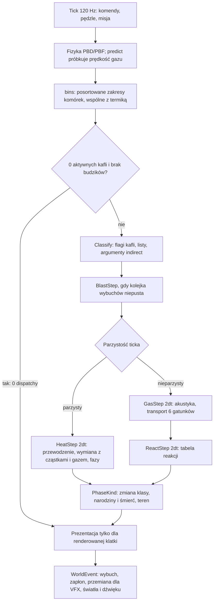
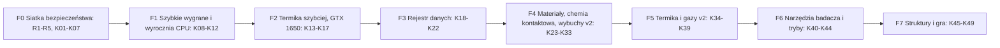

# Review Strefa Zero v2: architektura, wydajność, testy, funkcje, PR-y i plan laboratorium materiałów

Stan na 2026-11-03. Repozytorium `maershal/strefa-zero`, `main` @
[`e12c39a`](https://github.com/maershal/strefa-zero/tree/e12c39a72ce17c24dc8439c3c66f482f152af396) (po PR #22).

> [!IMPORTANT]
> **Migawka na `e12c39a`.** Treść opisuje stan sprzed PR #24, #27, #36 i #42; część pozycji jest już zrobiona.
> Aktualny status, rozstrzygnięcia i to, co przyjęto do realizacji, są w
> [REVIEW_V2_STATUS.md](../REVIEW_V2_STATUS.md). Numery linii (`plik:linia`) odnoszą się do `e12c39a`.
> Zalecenia są treścią autora review, nie poleceniem właściciela ani wynikiem testów.
> Dokument towarzyszący: [architecture_v2.md](architecture_v2.md).

> [!NOTE]
> **Co sprawdzono.**
> - Pięć równoległych analiz: PR-y #13–#22 i proces, build z testami i obrazami symulacji, termika i gazy GPU (model
>   kosztu operacja po operacji), laboratorium i funkcje, architektura z bibliotekami. Raporty cząstkowe: §13.
> - Build rdzenia i aplikacji (GCC 15.2, `-Werror`): testy CPU, `ci-smoke` i 8 testów termiki i laboratorium na Mesa
>   llvmpipe, `StrefaPhysics` dla 15 scen.
> - 17 arkuszy obrazów scen CPU i GPU (0–20 s) oraz harnessy na niezmienionym `src/sim`, którymi ponownie
>   zweryfikowano błędy z 2 listopada.
> - GitHub tylko do odczytu (`gh` w trybie GET). Niczego nie publikowano.
>
> **Czego nie sprawdzono.** Nie było prawdziwego GPU: koszty GPU to liczby z raportów projektu albo model kosztu
> oznaczony „szac.”. Nie sprawdzano buildu MSVC ani ręcznej gry w GUI.

---

## 0. TL;DR

### Odpowiedzi w skrócie

1. **Co się zmieniło od 2 listopada.**
   - Poprawił się proces i CI. P01–P06 dały szablon PR, recenzenta-agenta, sanitizery, Clang, MSVC `/WX`, 16 testów
     GPU na Mesa w każdym PR i nocny pełny zestaw.
   - Poprawiła się wydajność CPU. Po P06 sceny ciepła są szybsze o 31–37%, a łańcuch wybuchów skrócił się ze
     162–216 do 23 ms na krok.
   - Usunięto Poligon CPU (#22).
   - **W laboratorium, materiałach i termice GPU nie zmieniło się nic.** `material.hpp`, `thermal*` i wszystkie
     shadery mają zerowy diff.
   - Architektura stoi albo lekko się cofnęła: z problemów A1–A12 żaden nie jest naprawiony, 3 częściowo, 6 bez zmian,
     a 3 się pogorszyły.
   - `main` nadal nie ma ochrony. Jedyny przebieg nocnego zestawu GPU jest czerwony z prawdziwym błędem
     (`gpu.granular_physics`), którego nikt nie zgłosił.
2. **„Termika i gazy na GPU nie działają dobrze”: częściowo prawda, ale winny nie jest GPU.**
   - Fizyka jest poprawna: bilans mieści się w 0,1%, pióropusze gorącego gazu się unoszą, lawa krzepnie, a woda wrze.
   - Problemem jest koszt: +3,3 ms na tick nawet w zimnym świecie. Na tick przypada ok. 66 zależnych dispatchy
     i ok. 220–245 MB ruchu pamięci [szac.], a moduł nie ma aktywnych obszarów.
   - Problemem jest chemia: lawa jest „olejem” i pływa po wodzie, a zastygła lawa to lekkie drobiny.
   - Problemem jest ogień: szeroka powierzchnia pali się tylko na krawędziach, a tlenu w całym świecie starcza na
     jedną belkę.
   - Problemem jest obraz: płomieni prawie nie widać, a dym to lite, szare plamy.
   - Wszystko to wynika z decyzji tej implementacji. Siatka 320×192 to dla GPU łatwa praca: po przeprojektowaniu
     gorąca scena kosztowałaby ok. 0,15–0,4 ms, a zimny świat ok. 0 ms [szac.].
3. **Architektura: pięć zmian w tej kolejności.**
   1. Jeden rejestr danych (materiały, przemiany, reakcje, wybuchy, sceny, wymiary świata), z którego generuje się
      C++ i GLSL.
   2. Jeden stan materiału na GPU: ID materiału w cząstce i w komórce terenu oraz zmiana rodzaju cząstki przy
      przemianie.
   3. Aktywne kafle 16×16 dla wszystkich systemów siatkowych.
   4. Rozbiór `ParticleWorld` (magazyn buforów, tabela przebiegów, systemy) i wyprowadzenie QA z gry.
   5. Jedno laboratorium GPU, a model CPU jako wyrocznia testów.
4. **Laboratorium: najważniejsza decyzja to oddzielić chemię kontaktową od termiki.**
   - Kwas, ziemia, błoto, sól, ług, obsydian (lawa + woda), proch, C4, lont i emitory nie potrzebują pola temperatury.
   - Wystarczą cztery mechanizmy: ID materiału w cząstce, materiały terenu, reakcje parami z tabeli i wybuchy v2.
   - Termika v2 dołoży później przemiany zależne od temperatury i gazy: H₂, CO₂, szkło, ciekły azot.
5. **Biblioteki.**
   - Teraz: Tracy (tylko w buildach deweloperskich), glslang (tylko w CI), doctest (dla nowych testów).
   - Razem z laboratorium: ImGui docking, ImPlot, zstd.
   - PNG przez wbudowane w SDL 3.4 `SDL_LoadPNG` i `SDL_SavePNG_IO`, bez stb.
   - Nie: Box2D (bryły zrobimy jako klastry PBD), Lua (wystarczy deklaratywny DSL), JSON, Catch2.
6. **UI.**
   - Dokowany układ laboratorium.
   - Paleta jak w TPT: kategorie, wyszukiwarka, skróty klawiszowe.
   - Karta materiału i inspektor działający bez termiki.
   - Legendy map, slow-mo, undo z przewijaniem.
   - „Kodeks odkryć” reakcji.
   - Ustawienia obrazu poza panelem narzędzi.
7. **Kolejność prac.**
   1. Siatka bezpieczeństwa (tydzień).
   2. Szybkie wygrane w laboratorium GPU i naprawa wyroczni CPU.
   3. Ta sama termika, tylko szybsza (bitowo neutralnie).
   4. Rejestr danych.
   5. Materiały i chemia kontaktowa, wybuchy v2.
   6. Termika i gazy v2.
   7. Narzędzia badacza.
   8. Struktury i gra.

### Ocena obszarów

| Obszar | 2026-11-02 | 2026-11-03 | Najważniejsze |
| --- | --- | --- | --- |
| Proces PR | słaby | średni | Jest szablon i recenzent, merge dopiero po CI. Brakuje rulesetu, recenzje nie mogą blokować, a uwagi giną |
| CI | średni | dobry | Sanitizery, Clang, MSVC, 16 testów GPU w każdym PR. Nocny przebieg GPU jest czerwony i nikogo nie powiadamia |
| Architektura | średni | średni (bez postępu) | A1–A12: 0 naprawionych / 3 częściowo / 6 bez zmian / 3 gorzej. Benchmark w binarce gracza. Scena ma 4 reprezentacje |
| Wydajność CPU | słaby | średni | P06 działa. Sceny z cieczami nadal przekraczają 16,7 ms (sekwencyjny PCG) |
| Wydajność termiki GPU | słaby | słaby | Koszt nie zależy od aktywności. Diagnoza i plan są gotowe (§3) |
| Poprawność | dobry | dobry | Nowy błąd: liczba cząstek z pędzla zależy od historii świata (`gpu.granular_physics`) |
| Laboratorium GPU | słaby | słaby | Piaskownica mechaniczna z 6 materiałami. Wybuchy działają tylko w misji |
| Laboratorium CPU | słaby | słaby | Wszystkie 5 błędów nadal występuje. Ogień się tli, dym stoi w miejscu |

---

## 1. Fakty z uruchomień

| Co | Wynik |
| --- | --- |
| Build rdzenia, na zimno | 12,0 s, 0 ostrzeżeń |
| Build aplikacji | 47,5 s plus 45 s konfiguracji (SDL 3.4.18 i ImGui 1.93.0 pobierane z SHA-256), 0 ostrzeżeń w kodzie projektu |
| Testy CPU (`ctest -j8`) | **15/15 PASS**, 20,2 s |
| `ci-smoke` na llvmpipe (`STREFA_REQUIRE_GL43=1`) | **16/16 PASS**, 133 s |
| Termika i laboratorium (8 testów `graphics`) | **5/8**. PASS: `gpu.thermal`, `gpu.thermal_edges` (bilans < 0,1%). FAIL: `gpu.thermal_ui` i `gpu.laboratory_ui` na stałym progu p95 ≤ 100 ms, bez wyjątku dla renderera programowego (`scenario_runner.hpp:248`). FAIL: `gpu.granular_physics`, „Free slot reuse failed”: ten sam pędzel daje 103, 112 albo 106 cząstek, zależnie od historii świata |
| `StrefaPhysics`, 2 wątki, 240 ticków (mediana) | `wood-fire` 26,3 → **16,0** ms, `melting-metal` 26,0 → **16,4**, `smoke-vent` 16,0 → **11,1**, `extinguish` 78,3 → **64,7**, `dam-break` 50,9 → **44,3**, `chain` **23** (przed P06: 162–216). 7 z 15 przypadków przekracza 16,7 ms |
| Błędy laboratorium CPU z 2 listopada | **5/5 nadal występuje**, z liczbami identycznymi co do cyfry: wisząca skorupa, grzałka zależna od FPS bez limitu (50 293 K po 10 kliknięciach), „mgiełka” cieczy (45% komórek), kwas zamieniający się w wodę i lód (−85,6 °C), gaz opisany jako unoszący się, który opada |
| CI na GitHubie (od #14) | Linux: mediana 7,8 min, ścieżkę krytyczną wyznacza `tsan`. Windows: 5,8 min. Brak testów flaky. `nightly-gpu`: jeden przebieg, 50/60 |
| Binarka gracza `StrefaZero` | ok. 76 KB symboli benchmarku scen i `ScenarioRunner` (39 trafień `nm`) |

---

## 2. Zmiany od 2 listopada, PR-y #13–#22 i proces

### 2.1 Co zrobiono z poprzedniego planu

| Pozycja | Stan na `e12c39a` |
| --- | --- |
| R1: ochrona `main` | **Nie.** `protected: false`, rulesety: `[]` |
| R2: sprzątanie gałęzi | **Nie.** Na serwerze jest 19 gałęzi po merge, w tym `tmp/p04-acceptance` |
| R3: dług w issues | Jest tylko jedno issue (#15). Ostatni tag pochodzi z 31.10 |
| P01: proces | #14. Działa, ale `CODEOWNERS` wskazuje tylko autora, więc niczego nie blokuje |
| P02: CTest i CI | #16. Trzy uwagi recenzji pominięto (m.in. `--no-renames` w `ci-changes.sh`) |
| P03: sanitizery | #17. Wzorowy: zgoda na limity jest zapisana komentarzem w PR |
| P04: GPU na Mesa | #18 i #19. Nocny zestaw nikogo nie powiadamia, a jego jedyny wynik nie trafił do PR |
| P05: poprawki #13 | Częściowo: 8 uwag naprawionych, 6 częściowo, 12 nie. Nowy major N1: na Windows minimalizacja okna nie unieważnia pomiaru |
| P06: CPU-01 i CPU-02 | #21. Kod poprawny, ale bez przypadku golden „chain” |
| #22: usunięcie Poligonu CPU | Resztki: martwe płótno VFX (4,4 MB), `ui/arena` jako HUD misji, `strefa_game` linkuje `sim`. GL 3.3 daje teraz wyłącznie laboratorium CPU |
| Laboratorium (P12–P20) i architektura (P21–P29) | 0 zrobionych |

### 2.2 PR-y

| PR | Werdykt | Najważniejsze |
| --- | --- | --- |
| #13 benchmark scen | OK z uwagami, 1 major | Na Windows klatki przy zminimalizowanym oknie omijają `record_benchmark_frame` (`application.cpp:250-264`), a SDL 3.4.18 nie wysyła tam `OCCLUDED`. Status `invalid` obiecywany w `GPU_CHECK.md` jest więc praktycznie nieosiągalny. Kod benchmarku trafił do binarki gracza (major zaakceptowany bez issue). Poprawki scalono bez ponownej recenzji |
| #14 higiena PR | OK z uwagami | `CODEOWNERS` niczego nie blokuje. Etykietę `large-pr-approved` autor nadaje sam sobie. Niezaznaczona lista kontrolna daje tylko ostrzeżenie |
| #16 CI | OK z uwagami | `ci-changes.sh` działa bez `--no-renames`, więc przeniesienie `src/x.cpp` do `docs/` daje zielone statusy bez buildu. Cache ccache urósł do 1,92 GB w 21 h |
| #17 sanitizery | **OK** | — |
| #18 GPU na Mesa | OK z uwagami | Wynik nocnego przebiegu nie trafił do PR. Limity `TIMEOUT` wzrosły 2–3,3× bez zgody |
| #19 `--no-skip` | **OK** | — |
| #20 `--scene` | OK z uwagami | Żaden test nie uruchamia gry w wybranej scenie. Listy identyfikatorów w README są przepisywane ręcznie |
| #21 P06 | OK z uwagami | Alokator `CellAllocator` jest poprawny (licznik kolorów `thread_local`). Brakuje `static_assert(alignof(T) <= 64)`. Żaden checksum nie pokrywa ticku z kilkoma wybuchami. Merge przez rebase |
| #22 bez Poligonu | OK z uwagami | Martwe płótno CPU w `VfxPool` (4,4 MB). Gałąź „chip” w `projectile_hit` straciła pokrycie. Zgoda na zmianę GL 3.3 to tylko cytat z sesji |

Żaden PR nie złamał kontraktów, a wszystkie 9 merge nastąpiło po zakończonym, zielonym CI.

### 2.3 Proces: co działa, co nie, co zmienić

**Działa:**

- szablon PR;
- automatyczna recenzja, która złapała prawdziwe błędy w #13, #14, #17, #18 i #22;
- merge dopiero po CI (mediana od zakończenia CI do merge: 5 min);
- angielskie commity.

**Nie działa:**

- **Brak egzekwowania.** Nie ma rulesetu, więc wszystkie zasady są dobrowolne.
- **Recenzja za wcześnie i bez mocy.** 5 z 11 recenzji zgłasza blocker „CI w toku”. Commity z poprawkami (#13, #14,
  #20) nie przechodzą ponownej recenzji. Recenzje idą z konta właściciela tym samym modelem, więc nie mogą być
  wymagane.
- **Uwagi giną.** Pominięte uwagi „minor” i punkty z „Out of scope” nie trafiają do issues.
- **Lista kontrolna jest rytuałem.** W 6 z 9 PR lista jest odhaczana w tej samej sekundzie co merge.

**Zalecenia (w tej kolejności):**

1. **Ruleset na `main` (15 min, ręcznie).** Wymagane checki `linux-status`, `windows-status` i `hygiene`; tylko
   squash; automatyczne usuwanie gałęzi; auto-merge.
2. **Recenzja po zakończeniu CI i po każdym pushu.** Recenzent najpierw czyta diff, potem opis. Trzeba usunąć blocker
   „CI w toku” z `.claude/agents/pr-reviewer.md`. Docelowo recenzja powinna działać pod tożsamością bota i być
   wymagana.
3. **Każda pominięta uwaga i każdy punkt „Out of scope” dostaje issue.** Hygiene sprawdza też URL zgody przy
   zaznaczonym kontrakcie.
4. **Nocny zestaw GPU zgłasza błędy.** Przy porażce otwiera issue. Porażki wydajnościowe na llvmpipe dostają osobną
   etykietę. Zestaw warto podzielić na shardy.
5. **Tagi wydań i wpis w CHANGELOG** obowiązkowe w PR z kodem (brakuje ich w #19 i #21).

---

## 3. Termika i gazy na GPU: co naprawdę nie działa i dlaczego

### 3.1 Co działa

Moduł I10 jest fizycznie poprawny: testy bilansu przechodzą z błędem poniżej 0,1%, a zjawiska idą we właściwą stronę.
Gorący gaz tworzy pióropusze, które w 5–10 s docierają do sufitu i rozlewają się pod nim. Lawa i metal krzepną
w 2–5 s, woda wrze, a para się skrapla. Gazy na GPU wyglądają lepiej niż w referencji CPU, w której dym
w `smoke-vent` podnosi się o 7,7 komórki w 20 s.

### 3.2 Dlaczego to jest drogie

Termika kosztuje +3,3–3,4 ms na tick również w zimnym świecie, przy budżecie 0,05 ms
([raport I10](https://github.com/maershal/strefa-zero/blob/e12c39a72ce17c24dc8439c3c66f482f152af396/docs/reports/I10_GPU_THERMAL.md#L137)).
Moduł robi tę samą pracę niezależnie od tego, co dzieje się w scenie:

- **~66 zależnych dispatchy na tick:** 51 w
  [`ThermalSystem::tick`](https://github.com/maershal/strefa-zero/blob/e12c39a72ce17c24dc8439c3c66f482f152af396/src/gpu/thermal_system.cpp#L193-L266)
  i 15 w integracji z `world.cpp`. Po każdym dispatchu jest pełna bariera SSBO.
- **Każdy przebieg obejmuje całą siatkę** (61 440 komórek) albo całą pulę (32 768 slotów, także martwych).

**Szacowany podział kosztu w zimnej scenie** [szac., model zgodny z profilem A/B/C z raportu I10]:

| Udział | Przyczyna |
| --- | --- |
| ~44% | 10 pełnych przebiegów po 128-bajtowym rekordzie AoS `ThermalCell`. Przebiegi „w miejscu” zapisują cały rekord, choć zmieniają 1–3 pola |
| ~25% | 32 osobne dispatche Jacobiego (ok. 27 μs na iterację), co tick od zera, bez ciepłego startu |
| ~14% | ok. 5 kopii całej puli `Grain`/`ThermalParticle` na tick, wymuszonych zamianą banków fizyki |
| ~8% | Integracja: 2× bezwarunkowa przebudowa listy aktywnych, teren, prezentacja co tick (także bez renderu) |
| reszta | Listy atomowe przechodzone ok. 28 razy na komórkę (niedeterministyczne), FP64 na gorącej ścieżce |

**9,7 ms w scenach „olej” i „gaszenie” to głównie artefakt pomiaru.** Etap gazu nie zależy od cząstek, a w gaszeniu
trwa 2,36× dłużej niż w scenie zimnej. Ten sam kod liczy się wolniej z powodu stanu GPU (kolejność scen w benchmarku
jest stała, a laptop się nagrzewa). Przy nominalnym zegarze gorąca scena kosztuje ok. 3,3–4,2 ms [szac.]. To nadal
5–6× ponad budżetem.

### 3.3 Dlaczego zachowuje się gorzej, niż powinno

| Problem | Dowód | Co widzi gracz |
| --- | --- | --- |
| **Ogień płonie tylko na krawędziach** | Nad środkiem płonącej powierzchni leży nieruchoma warstwa spalin grubości 1 komórki, z O₂ ≈ 0. Nic nie łamie symetrii, wypór jest obcięty do ±40 komórek/s, a projekcja usuwa ruch jednolitej warstwy ([`thermal.comp:57`](https://github.com/maershal/strefa-zero/blob/e12c39a72ce17c24dc8439c3c66f482f152af396/assets/shaders/thermal.comp#L57)). Profil pionowy nad belką: na końcach ciąg −40 komórek/s, na środku +0,1…+6 | Belka traci 6% paliwa w 20 s (wypaliłaby się w 5–6 min); w Noicie znika w kilka sekund |
| **Zamknięte pudło i podwójna stechiometria** | Gaz nie wypływa górą, a spalanie zużywa 2,0 jednostki O₂ na jednostkę paliwa (CPU: 0,7) (`thermal.comp:37, 69, 72` vs `src/sim/air.cpp:129-151`, `reactions.cpp:245`) | Tlenu w całym świecie (ok. 290 j.) starcza na jedną belkę drewna (253 j.). Pożary gasną z braku tlenu, a dym nie ma ujścia |
| **Przemiana podmienia tylko rodzaj cząstki** | Lód staje się ziarnem metalu, lawa i stopiony metal „olejem”, a zastygła lawa nigdy nie staje się terenem ([`thermal.comp:54`](https://github.com/maershal/strefa-zero/blob/e12c39a72ce17c24dc8439c3c66f482f152af396/assets/shaders/thermal.comp#L54)) | Lawa rozlewa się po wodzie jak olej, a po zastygnięciu jej drobiny zostają przy powierzchni (średnie y 168 przy dnie na 186) |
| **Masa termiczna nadpisuje masę mechaniczną** | `motion.z = 1/m`, a PBF liczy objętość. Masy cząstek i komórek mają niespójne jednostki (`thermal.comp:54, 69`; `particle_common.glsl:208`) | Prawie odparowana kropla zajmuje pełną objętość. Pojemność cieplna wody na jednostkę objętości jest 2,65× mniejsza niż w CPU |
| **Skraplanie rodzi rój cząstek** | Każda komórka z ≥ 0,001 wody tworzy cząstkę (`thermal_condense.comp:10`) | W scenie `phases` liczba cząstek wody rośnie z 240 do 4046 w 20 s |
| **Obraz** | Krycie gazu `1-exp(-(2000·dym + 80·para + …))` (`thermal_draw.frag:20`) | Płomień to pomarańczowy obrys. Dym i para to lite szare „grzyby”, które po 10 s zasłaniają scenę |
| **Brak fali ciśnienia i sprzężeń** | Gaz nie pcha cząstek, a cząstki nie wypierają gazu. Gaz istnieje tylko przy włączonej termice (raport I10 §B; `granular.comp:91-92`) | Wybuch nie popycha dymu, popiół nie leci z dymem, a bez termiki nie ma powietrza |
| **Wąski zakres chemii** | Reagują tylko olej, drewno i paliwo gazowe (`thermal.comp:26`) | Na GPU nie ma laboratorium „kwas, woda, lawa, ziemia” |
| **Samo włączenie termiki zmienia mechanikę** | `grains_enabled = fluids_enabled = true` (`world.cpp:1025`) | Ciecz liczy się z 12 zamiast 8 iteracjami kontaktu, co kosztuje dodatkowe 0,3–2 ms |

Referencja CPU nie wypada lepiej:

- ogień się tli (0,22% drewna w 20 s);
- dym prawie stoi;
- stopiony metal i lawa wiszą nad wodą w cienkiej skorupie przez całe 20 s (błąd „wiszącej skorupy”).

### 3.4 Werdykt i projekt GPU-first

**Teza „GPU źle radzi sobie z termiką i gazami” jest fałszywa jako teza ogólna. Prawdziwa jest dla tej
implementacji.**

- Dyfuzja, adwekcja i akustyka to 5-punktowe stencile na regularnej siatce, czyli podręcznikowe obciążenie GPU.
- Pełny stan termiki i gazu zajmuje ok. 50–60 B na komórkę. Krok, który czyta i zapisuje go raz, przesuwa ok. 6–7 MB,
  czyli ok. 0,06 ms. I10 przesuwa ok. 220–245 MB na tick.
- Referencja CPU jest tania, bo śpi: ma chunki 16×16, ramkę zaburzenia i jawną akustykę bez globalnego układu równań.
  Port na GPU zgubił rzadkość, podwoił częstotliwość i zastąpił lokalną akustykę globalną projekcją.

**Projekt docelowy:**

- **Dane w SoA.** Wielkości zachowywane w fp32, prędkości i podgląd w fp16. Stan cząstki to 16-bajtowy kanał boczny
  po stabilnym ID, bez kopii co tick. Rekord 128 B zostaje tylko formatem transferu.
- **Aktywne kafle 16×16.** Ping-pong per kafel, dispatch indirect i głęboki sen: zimny świat nie zleca żadnych
  dispatchy.
- **60 Hz naprzemiennie.** Ticki parzyste liczą ciepło i fazy, nieparzyste gaz i reakcje.
- **Gaz jako port akustyki CPU.** c ≈ 40 komórek/s na drobnej siatce daje dokładną topologię 1 px i falę wybuchu „za
  darmo”, z otwartą górą i wyporem zależnym od składu. Multigrid zostaje opcjonalnym poziomem jakości. Na odrzucenie
  siatki 160×96 w I10 odpowiadają apertury ścian i ≤ 2 stopnie swobody na komórkę.
- **Wiązanie cząstek z komórkami.** Termika używa posortowanych zakresów z `neighbours.comp` zamiast list atomowych,
  co daje deterministyczne sumy.
- **Klasy mechaniczne z rejestru.** Lawa i stopiony metal mają osobne fazy PBF. Przemiany zmieniają rodzaj cząstki:
  ciecz → ziarno, ciecz → teren (lawa → kamień), ciecz → gaz. Masa termiczna jest oddzielona od mechanicznej.
- **Reakcje z tabeli w UBO.** Prawdopodobieństwo 1 − e^(−k·dt) z deterministycznym hashem, pary dobierane przez
  `atomicMin`.
- **Jedna kolejka wybuchów.** Do 16 na tick, z ciepłem, falą ciśnienia, udarem, wytrzymałością materiału, gruzem
  z prędkością i reakcją łańcuchową.



Budżet [szac., z marginesem ×2–3]: gorąca scena 0,15–0,4 ms na tick, cała domena aktywna 0,25–0,6 ms, zimny świat
0 ms w uśpieniu. Typowy tick ma 4–6 dispatchy zamiast 66.

Migracja w trzech fazach (prompty K13–K17 i K34–K39):

1. **Ten sam model, szybciej.** Bitowo neutralne szybkie zyski. Samo blokowanie Jacobiego (4 dispatche zamiast 32)
   daje −0,6…−0,8 ms. Pominięcie etapu reakcji bez paliwa: −0,45…−0,55 ms. Przebiegi cząstek tylko po żywych ID:
   −0,3…−0,4 ms. Razem zimny świat spada z ok. 3,4 do ok. 0,8–1,4 ms [szac.].
2. **Model rzadki i wieloczęstotliwościowy.** Kafle, akustyka, 60 Hz i stałe takie jak w CPU, sprawdzane testami
   konformacji z CPU (10 scen z progami ustalonymi przed pomiarem).
3. **Laboratorium materiałów.** Rejestr, przemiany, reakcje, wybuchy i sprzężenia.

> [!IMPORTANT]
> Ryzyko: port akustyki z CPU przeniesie też jej ospałość, bo dym CPU prawie stoi. Przed przełączeniem gazu GPU na
> akustykę trzeba więc dostroić wypór i tłumienie we wspólnym rejestrze tak, żeby `smoke-vent` na CPU spełniał
> asercje (np. ≥ 50% dymu nad y = 100 po 10 s). Potem trzeba porównać obrazy z dzisiejszym I10 w tych samych tickach.
> Jeśli akustyka wypadnie gorzej, zostaje poziom jakości z multigridem.

### 3.5 Strategia: chemia kontaktowa najpierw, termika równolegle

Większość materiałów z wizji nie potrzebuje pola temperatury: kwas, ziemia, błoto, sól, ług, obsydian, proch, C4,
lont i emitory. Wystarczy reakcja przy kontakcie cząstek i komórek terenu, liczona co 2–4 ticki tylko w kaflach
z materiałem reaktywnym (szac. ≤ 0,1 ms). Dlatego laboratorium może rosnąć na GPU od razu, a termika v2 idzie osobnym
torem, który wymaga pomiarów na GTX 1650. Gdy termika v2 będzie gotowa, reakcje termiczne przejmą pierwszeństwo przed
izotermicznym skrótem i nic nie będzie liczone podwójnie.

---

## 4. Architektura

### 4.1 Stan na `e12c39a`

| ID | Problem | Status od 11-02 | Dowód |
| --- | --- | --- | --- |
| A1 | Gra i QA niedomknięte | gorzej | 8 plików `*.inl` z walidacjami w `world.cpp`. Benchmark scen z #13 trafił do biblioteki gracza (`strefa_launch`). `application.cpp` urósł z 1206 do 1360 linii |
| A2 | Materiały rozproszone | bez zmian | `sim::Material` (20), `gpu::Material` (7), dwa mapowania rodzaj → materiał, literały w GLSL. Laboratorium GPU udaje lawę, lód i drewno, malując `oil`/`metal`/`wall` (`gpu_laboratory.cpp:215-226`) |
| A3 | `ParticleWorld` jako god-object | gorzej (lekko) | Jednostka kompilacji z `.inl` ma 4217 linii, a klasa 88 deklaracji publicznych, w tym 31 haków testowych. `step()` ma 202 linie i nadal zawiera prezentację |
| A5 | Surowe `std::array<GLuint, 8>` i `unsigned&` | bez zmian | 27 wystąpień. `ThermalSystem` przełącza bank świata |
| A9 | Kruche nagrania, magiczne indeksy | bez zmian | `material > 6`, `tool > 8`, `scene = 12`. Scena ma 4 reprezentacje i 5 list nazw |
| A10 | Zduplikowana infrastruktura GPU | gorzej (lekko) | #13 dopisał kolejne własne timery zamiast `GpuTimerRing` |
| A11 | Shadery | bez zmian | `thermal.comp` jest zminifikowany (80 linii, 18,7 KB), nie ma `#line` ani hot-reload |
| N3 | Resztki po #22 | nowe | `strefa_game` linkuje `strefa_sim`, „arena” oznacza HUD misji, a menu „04 Podgląd areny” pokazuje tylko tło |
| N5 | GL 3.3 daje tylko laboratorium CPU | nowe | Wymaga osobnego testu, osobnego przebiegu CI i parytetu UI |
| N8 | Brak aktywnych obszarów w termice | potwierdzone | §3.2 |
| N9 | Zdarzenia nie trafiają do UI i dźwięku | nowe | Niezawodne zdarzenia GPU czyta tylko `GameplaySession`. Nie ma drogi do dziennika, kodeksu ani audio |

Wymiary świata są wpisane na sztywno: 105 wystąpień w 23 plikach C++ i 94 w 31 z 65 shaderów, do tego 38 wystąpień
960/576 i 5 niezależnych definicji. Szczegóły: [architecture_v2.md](architecture_v2.md).

### 4.2 Architektura docelowa

Diagram warstw: [architecture_v2.md §3.2](architecture_v2.md#32-warstwy). Pięć filarów:

1. **Rejestr danych.**
   - Źródłem są `data/registry/*.toml`. Generator w Pythonie (`tomllib`, tylko biblioteka standardowa) tworzy C++
     `constexpr`, nagłówek GLSL i UBO z tabelą materiałów.
   - Wygenerowane pliki są commitowane, a CI sprawdza je przez `--check`. Dzięki temu MSVC nie potrzebuje Pythona,
     a diff tabel widać w recenzji.
   - Pierwszy krok jest bitowo identyczny: golden master się nie zmienia, a `material_defines()` daje bajt w bajt ten
     sam tekst, więc klucze cache shaderów zostają.
2. **Jeden stan materiału na GPU.**
   - Kanał boczny `ParticleMaterial` po stabilnym ID. `motion.w` to klasa mechaniczna, a `motion.z` odwrotność masy
     mechanicznej z rejestru.
   - Teren: kod ściany ≥ 16 oznacza komórkę z materiałem.
   - Zmiana rodzaju cząstki to narodziny albo śmierć w jednym `BirthDeathPass`, kompaktowanym sumą prefiksową, żeby
     zachować determinizm.
   - ABI 64 B i SSBO 0–7 zostają bez zmian.
3. **`TileGrid` 16×16** wspólny dla termiki, gazu, reakcji, oświetlenia i SDF. To warunek budżetu termiki i większych
   map.
4. **Rozbiór `ParticleWorld`:**
   - `ParticleStore` z `BufferLayout`;
   - `PassTable`/`PassRunner`: deklaratywne wiązania, bariery wynikające z dostępu, ≤ 8 SSBO na program sprawdzane
     testem CPU;
   - solvery i systemy jako osobne moduły;
   - QA przez nagłówek w stylu attorney-client w osobnym targecie.

   Nowe systemy (reakcje, wybuchy) od początku piszemy poza `world.cpp`.
5. **Jedno laboratorium GPU.**
   - Model CPU zostaje wyrocznią: golden master, konformacja, prototypy reguł nowych materiałów, `StrefaPhysics`.
   - Laboratorium CPU zostaje w menu jako „Model referencyjny”, dopóki laboratorium GPU nie dogoni go narzędziami.
     Potem trafia tylko do StrefaQA.
   - GL 3.3 zamrażamy teraz, a usuwamy za zgodą właściciela.
   - P57 („dwa silniki w jednym ekranie”) zawężamy do wąskiego `lab::Backend`, potrzebnego tylko do porównań
     w StrefaQA.

**Bryły sztywne: klastry PBD z dopasowaniem kształtu (shape matching), nie Box2D.** Klastry siedzą w tym samym
solverze co ciecze i ziarna, więc sprzężenie jest automatyczne i dwustronne. Topnienie, pękanie i spalanie to po
prostu odłączenie cząstki od klastra. Box2D wymagałby rasteryzacji do siatki i odczytów GPU↔CPU co tick, a to łamie
kontrakt. Kolejne etapy: skrzynie i deski pływające po wodzie, pękanie przez podział klastra, ragdoll po śmierci
postaci (Soldat).

**Strażnicy w CI.** `check_architecture.py` sprawdza graf `#include` i linków z listą znanych naruszeń, która może
tylko maleć. Do tego plik budżetów z wartościami z `e12c39a`:

- `world.cpp` 2157 linii;
- 88 deklaracji publicznych `ParticleWorld`;
- 31 haków testowych;
- 105/94 literałów wymiarów (C++/GLSL);
- 39 symboli QA w `StrefaZero`.

CI pada, gdy któraś z tych wartości wzrośnie.

---

## 5. Wydajność i optymalizacja

### 5.1 CPU (model referencyjny)

Mediana ms na krok, 2 wątki:

| Scena | 11-02 | 11-03 | Uwagi |
| --- | --- | --- | --- |
| `wood-fire` | 25,3 | 16,0 | P06: układ pamięci SoA (−37%) |
| `melting-metal` | 26,0 | 16,4 | −37% |
| `smoke-vent` | 16,0 | 11,1 | −31% |
| `extinguish` | 78,3 | 64,7 | p95 ok. 110 ms; ogranicza sekwencyjny PCG |
| `dam-break` | 50,9 | 44,3 | jw. |
| `chain` (proch) | 162–216 | 23 | CPU-02: jedno odświeżenie termiki na partię wybuchów |

Drugi wątek daje na tej maszynie 0–10%, na i5-9300HF 5–30%.

**Rekomendacja:** nie inwestować w czas rzeczywisty cieczy na CPU (P53 zostaje odłożony). CPU ma być poprawne, nie
szybkie, bo jest wyrocznią. Wyjątek: łączenie edycji pędzla w transakcje, bo dziś każda edycja kosztuje 10–13 ms.

### 5.2 GPU: mechanika

Według raportu 0.7.0 (`GPU_MISSION_070.md`), czyli sprzed optymalizacji I01–I04, fizyka 16 tys. cząstek kosztowała
ok. 4,0 ms na tick, a 32 768 cząstek ok. 8,1 ms. Przy 120 Hz to 2 ticki na klatkę 60 FPS. Misja po I04 mieści się
w ok. 2,9 ms na tick.

Laboratorium materiałów będzie potrzebowało dużo cząstek. Zanim dojdą nowe przebiegi, trzeba odzyskać stały narzut.
Bitowo neutralne zyski z poprzedniego review (P37) są nadal aktualne:

- „ostatnia grupa finalizuje”: −26 dispatchy na tick;
- zdjęcie `coherent` z `Cells`;
- maska ścian 5×5 skracająca DDA;
- tańsze redukcje.

### 5.3 GPU: termika

Patrz §3. Kolejność zmian:

1. Bitowo neutralne szybkie zyski: zimny świat z ok. 3,4 do ok. 0,8–1,4 ms [szac.].
2. Deterministyczne wiązanie cząstek z komórkami. To nowa rewizja nagrań I10.1, która daje bitową wyrocznię.
3. SoA i scalanie przebiegów: pełna siatka ok. 1,0–1,4 ms [szac.].
4. Kafle, akustyka i 60 Hz: gorąca scena ≤ 0,4 ms, zimna ok. 0 ms [szac.].

> [!WARNING]
> **Pomiar przed optymalizacją.** Dzisiejsze liczby z gorących scen są zawyżone ok. 2,4× przez stan GPU. Benchmark
> termiki musi:
> - losować kolejność scen;
> - logować zegar i temperaturę
>   (`nvidia-smi --query-gpu=clocks.sm,clocks.mem,temperature.gpu,power.draw,clocks_throttle_reasons.active --format=csv -lms 100`);
> - dyskwalifikować segment, w którym etap gazu (niezależny od sceny) odbiega od mediany o więcej niż 10%.
>
> Benchmark scen z #13 musi na Windows unieważniać pomiar przy zminimalizowanym oknie (N1). Inaczej ok. 1,5-godzinny
> pomiar z `GPU_CHECK.md` może pójść na marne.

### 5.4 Build i CI

- Build na tej maszynie: rdzeń 12 s, aplikacja 47,5 s.
- CI Linux: mediana 7,8 min, ścieżkę krytyczną wyznacza `tsan` (7,6 min).
- Cache ccache rośnie o ok. 1,9 GB na dobę. Zapis powinien odbywać się tylko na `main`, a PR-y powinny cache tylko
  odtwarzać.
- Nocny GPU trwa 152 min. Po podziale na 3–4 shardy zajmie ok. 45 min.

---

## 6. Testy i CI

| Luka | Dowód | Co zrobić |
| --- | --- | --- |
| Golden master nie pokrywa ticku z kilkoma wybuchami ani gałęzi „chip” | Sceny golden mają 0/0/0/0/0/1 wybuchów (`golden_master_tests.cpp:23-30`) | Dodać przypadki „chain” (1 i 4 wątki) i „chip”, z hashem policzonym też na `5eec70c` (sprzed #21) |
| Golden master wyłączony na MSVC (#15) | `build.ps1:53` | Referencje osobno dla każdego toolchainu (P11) |
| Nocny GPU jest zawsze czerwony | `gpu.thermal_ui` i `gpu.laboratory_ui` mają próg czasu ściany bez wyjątku dla llvmpipe (`scenario_runner.hpp:248` vs `:230-232`) | Na rendererze programowym raportować p95 bez oceny, tak jak w misji. To polityka progów, więc wymaga zgody właściciela |
| `gpu.granular_physics` | Ten sam pędzel daje 103/112/106 cząstek po `load()`/`reset()` (`world.cpp:839-867`) | Znaleźć przyczynę w listach wolnych i aktywnych slotów, test na llvmpipe i NVIDIA |
| Brak asercji fizycznych scen | Wisząca skorupa jest utrwalona w golden master | `sim.scene_expectations`: metal pod wodą w ≤ 2 s, lawa + woda → kamień + para w ≤ 3 s, dym nad y = 100 |
| Brak konformacji CPU↔GPU | — | `StrefaQA --gpu-thermal-conformance`: 10 scen z progami ustalonymi przed pomiarem, test „reaktora” 0-D dla każdej reakcji |
| Brak obrazów fizyki w CI | Właściciel musi uruchamiać grę, żeby zobaczyć zachowanie | Tryb QA zapisujący arkusze PNG scen (jak w tym review) jako artefakt nocnego przebiegu |
| Własny mikroframework testów | 10 z 18 plików ma własne `check`/`require` | doctest dla nowych testów, bez masowej migracji |
| Walidacja GLSL tylko na Mesa | 16 testów `ci-smoke` | `glslangValidator` dla wszystkich wariantów `#define` w jobie CPU |

---

## 7. Funkcjonalność względem wizji

| Oczekiwanie gracza (źródło) | Strefa Zero dziś | Priorytet |
| --- | --- | --- |
| Teren z wielu materiałów, niszczalny co do piksela (Noita) | Dwa typy terenu: ściana niezniszczalna albo krucha z HP 3 (`world.cpp:730`) | P1 |
| Reakcje zapisane jako dane i alchemia (Noita) | Literały w `reactions.cpp` i `thermal.comp` | P1 |
| Ziemia, błoto, mokry piasek | Brak. Wilgoć piasku na GPU jest tylko wizualna | P1 |
| Wybuch z gruzem, krater zależny od materiału, łańcuch (Noita, TPT) | Łańcuch jest tylko na CPU. Na GPU: 1 wybuch na tick, gruz bez prędkości, w laboratorium brak wybuchów | P1 |
| Ogień, który się rozprzestrzenia | CPU: drewno się tli. GPU: ogień tylko w drogiej termice i tylko na krawędziach | P1 |
| Gazy, które unoszą się albo zalegają i płoną (TPT) | Wypór zależy tylko od T; brak H₂ i CO₂ | P2 (termika v2) |
| Przemiana zmienia mechanikę (TPT: METL → LAVA) | Zastępniki: lód to drobiny metalu, lawa to olej | P2 (termika v2) |
| Kilka cieczy układających się warstwami | Tylko dwie ciecze; lepkość jako literał | P1 |
| Narzędzia piaskownicy: kategorie, kształty, zapis, undo (TPT, Sandspiel) | Płaska lista, okrągły pędzel, brak zapisu i undo | P1 |
| Zawalanie się konstrukcji i bryły (Noita) | Brak | P3 |
| Elektryczność (TPT) | Brak | P3 |
| Soldat: ruch, plecak, wiele broni, obrażenia, ragdolle | Plecak, karabin i granaty są. Postać jest niewrażliwa, a mapa ma rozmiar jednego ekranu | P2 |
| Dźwięk | Brak (`SDL_INIT_VIDEO`) | P2 |

Zmiany funkcji, które warto zrobić od razu:

- **Wybuch w laboratorium GPU.** Dziś działa tylko w misji. Potrzebne: narzędzie „Detonator”, gruz z prędkością,
  kilka wybuchów na tick.
- **„Wejdź żołnierzem”** do bieżącej sceny laboratorium (`configure_mission` bez tarczy). Laboratorium i gra stają
  się wtedy jednym światem, jak w Noicie.
- **Porządek w laboratorium GPU.** Ustawienia obrazu, światła i VFX przenieść do sekcji „Obraz”. Dodać slow-mo
  i legendy map. Ujednolicić jednostki temperatury: dziś laboratorium CPU pokazuje °C, a GPU kelwiny.
- **Menu.** „04 Podgląd areny” pokazuje już tylko tło, więc powinno trafić do Ustawień. Laboratorium CPU przemianować
  na „Model referencyjny (CPU)”.

---

## 8. Laboratorium materiałów: co dodać i jak

### 8.1 Model danych

Szkic (nie kompiluje się: `T<`, `T>` i podobne to pola opisowe):

```cpp
// Rejestr (C++ constexpr generowany z TOML) → GLSL/UBO, UI, nagrania v4, testy
enum class Mech : std::uint8_t { none, terrain, grain, liquid, gas, energy };

struct MaterialDef {
    std::string_view key, name, hint; Category cat; Color color, glow;          // UI
    Mech mech; float density, friction, drag, viscosity, cohesion, adhesion;   // mechanika GPU
    float strength, blast_transmission, porosity;                              // teren, wybuchy
    float cp, k, spawn_K, ignition_K, burn_rate, heat_release, smoke_yield;    // termika
    MaterialId residue, solid_form, liquid_form, gas_form; TagSet tags;        // acid, base, salt, organic, flammable...
    std::optional<Explosive> explosive;
};

struct Reaction {  // Noita: pary z selektorami (ID albo tag), tempo w 1/s
    Selector a, b; MaterialId out_a, out_b; float rate_per_s; Cond when;       // T, udar, kontakt z terenem
    float heat_per_mass; GasYield gas; EventKind event; Mode mode;             // contact | thermal
};

struct Transition {  // TPT
    MaterialId from, to; /* T<, T>, p>, wiek>, mokry/suchy */ Trigger on; float threshold, latent, hysteresis;
};
```

Zasady:

- **Tempo zawsze w 1/s.** Prawdopodobieństwo w ticku wynosi p = 1 − e^(−k·dt), więc CPU (60 Hz) i GPU (120 Hz) mają
  to samo tempo makroskopowe.
- **Losowość z deterministycznego hasha** (seed, tick, min(id), max(id), reguła).
- **Selektory z tagami zamiast macierzy N×N**, kompilowane do gęstej tablicy `reaction_index[64][64]`.
- **Stan dyskretny jako wariant materiału** (mokry piasek, płonące drewno, zużyty kwas), bo `Grain` nie ma wolnych
  pól.

### 8.2 Mechanizmy silnika, które odblokowują najwięcej

| ID | Mechanizm | Odblokowuje | Wysiłek | Wymaga termiki? |
| --- | --- | --- | --- | --- |
| E1 | ID materiału cząstki z rejestru; klasa, masa, tarcie, lepkość i kolor z tabel zamiast literałów (`particle_common.glsl:181, 208`, `liquids.comp:159`) | N cieczy i ziaren, warstwy, lawa tonie, lód pływa | M–L | nie |
| E2 | Materiał komórki terenu (kod ≥ 16), HP i transmisja wybuchu z rejestru | ziemia, kamień, cegła, metal, szkło, lód, C4, lont, rośliny | S–M | nie |
| E3 | Reakcje parami: wybór z posortowanych zakresów, wzajemne potwierdzenie (`atomicMin`), co 2–4 ticki, tylko w kaflach z materiałem reaktywnym | kwas, ług, solanka, błoto, mokry piasek, obsydian, rdza | S–M | nie; ≤ 0,1 ms [szac.] |
| E4 | Automat komórkowy na terenie co N ticków | lont, tani ogień (poziom 0), rośliny, później elektryczność | S–M | nie |
| E5 | Osadzanie cząstki w teren (odwrotność gruzu) | obsydian, zamarzanie w blok, beton | S–M | nie |
| E6 | Wybuchy v2 (§8.6) | proch, nitrogliceryna, C4, H₂ | M | nie (z termiką: ciepło i fala) |
| E7 | Kohezja w PBD, adhezja per materiał | mokry piasek, glina, szlam | S–M | nie |
| E8 | Przemiany z tabeli ze zmianą rodzaju cząstki | lód, szkło, wosk, topniejący metal, lawa → bazalt, LN₂ | M | tak |
| E9 | Do 8 gatunków gazu z rejestru, wypór zależny od masy molowej | H₂, CO₂, dym, para, gazy toksyczne | M–L | tak |

> [!NOTE]
> Identyfikatory E1–E9 w tej sekcji to mechanizmy silnika. Fazy roadmapy E1–E6 w
> [architecture_v2.md §5](architecture_v2.md#5-roadmapa-i-strażnicy-ci) to co innego.

### 8.3 Nowe materiały

| Fala | Materiały | Kluczowe interakcje |
| --- | --- | --- |
| 1: bez termiki (E1–E7) | ziemia i luźna ziemia, błoto, mokry piasek, kwas (GPU), zużyty kwas, ług, sól, solanka, lawa jako prawdziwa ciecz (ρ 2,4), obsydian i bazalt, lód i śnieg (kontaktowo), szlam, proch, nitrogliceryna, C4, lont, emiter, odpływ i klon, cegła, kamień, metal i szkło jako teren, rdza | ziemia + woda → błoto; błoto → ziemia + woda (sedymentacja); szybki nurt → erozja; piasek + woda → mokry piasek (pionowe skarpy); kwas + {kamień, piasek, drewno, ziemia} → ∅ ze skończoną pojemnością; kwas + ług → solanka + ciepło; sól + woda → solanka (układa się pod wodą); lawa + woda → obsydian + para; lawa + lód → woda; nitrogliceryna wybucha od uderzenia (‖Δv‖ > 25); lont płonie 15 komórek/s i zapala ładunek |
| 2: z termiką v2 (E8–E9) | wodór, CO₂, szkło (piasek > 1900 K), glina → cegła, wosk, śnieg (topnienie), ciekły azot, termit na GPU | kwas + metal → H₂; H₂ + O₂ + iskra → para i deflagracja; CO₂ wypiera O₂, gasi i zalega w dołach; LN₂ wrze w 77 K i mrozi wodę; metal < 150 K kruszeje |
| 3: później | rośliny i mech, toksyczny szlam, beton, rtęć | rośliny rosną przy wodzie i płoną, giną od soli, ługu i kwasu; cement + woda → beton po 10 s |

### 8.4 Interakcje rdzenia wizji

> [!NOTE]
> Macierz odtworzona z rozsypanej tabeli oryginału; komórki dopasowano do kolumn według sensu i interakcji z §8.3.
> Puste pole = brak wpisu w oryginale.

| A \ B | woda | ziemia | piasek | kamień | metal | drewno | rośliny | lód, śnieg | sól |
| --- | --- | --- | --- | --- | --- | --- | --- | --- | --- |
| **kwas** | rozcieńczenie | → ∅ | → ∅ | → ∅ (wolno) | H₂ + sól (termika v2) | → ∅ (wolno) | | topi | — |
| **ług** | rozcieńczenie | — | — | — | H₂ z aluminium (termika v2) | → ∅ (wolno) | — | — | — |
| **woda** | — | błoto | mokry piasek | erozja przy szybkim nurcie | rdza (bardzo wolno) | gasi, nasiąka | | zamarza (termika v2) | solanka |
| **lawa** | obsydian + para | wypala; cegła (termika v2) | szkło (termika v2) | topi (termika v2) | topi (termika v2) | zapala | | woda + para | topi (termika v2) |

Do tego kwas + ług → solanka + ciepło (neutralizacja).

**Wyrocznia CPU dla chemii:** test „reaktora”, czyli dobrze wymieszane pudło 0-D dla każdej reakcji, w którym CPU
i GPU liczą tempo i stechiometrię z tolerancją ±5–15%. Pełne sceny się do tego nie nadają, bo mechanika MAC/PCG
i PBF/PBD jest różna.

### 8.5 Fizyka, którą gracz zobaczy

| Zjawisko | Implementacja | Termika? | Priorytet |
| --- | --- | --- | --- |
| Mechanika per materiał: lód się ślizga, szlam się ciągnie, błoto płynie wolno | E1 | nie | P1 |
| Warstwy wielu cieczy (olej / woda / solanka / błoto) | odwrotna masa per materiał, test stabilności PBF | nie | P1 |
| Gruz z prędkością po wybuchu | prędkość z kierunku wybuchu w kernelu gruzu (`mission.comp:197`) | nie | P0 |
| Ogień poziomu 0: drewno płonie komórka po komórce, zostaje popiół | E4 + istniejące VFX iskier | nie | P1 |
| Erozja i zawalanie się podciętych półek | E3; CCL od kotwic → gruz | nie | P2 |
| Bryły: kawałek muru spada w całości, skrzynia pływa | klastry PBD | nie | P3 |
| Przemiana zmienia mechanikę (metal topi się i płynie, lawa zastyga w teren) | E8 | tak | P2 |
| Gazy według składu (H₂ ucieka w górę, CO₂ zalega w dołach) | E9 | tak | P2 |
| Świecenie gorących materiałów | emisja z rejestru (CPU już to ma) | tak | P2 |
| Wiatr i wentylator porywające piasek i dym | siła w prostokącie; po termice v2 opór gazu | nie / tak | P2 |
| Elektryczność | E4 na metalu i solance | nie | P3 |

### 8.6 Wybuchy v2

Profil w rejestrze (kolejno: proch / NG / C4 / H₂+O₂ / granat):

| Pole | Znaczenie | Przykład (szac.) |
| --- | --- | --- |
| `energy_per_mass` | energia | 3000 / 4500 / 6000 / 10000 / stała |
| `brisance` 0–1 | udar wobec pchania, czyli krater wobec podmuchu | 0,2 / 0,9 / 1,0 / 0,3 / 0,6 |
| `gas_yield`, `incendiary` | produkty i dym; udział energii jako ciepło i zapłon | — |
| `fragments` | mnożnik prędkości gruzu | 0,5 / 1 / 1,2 / 0,3 / 1,5 |
| `sensitivity` | próg zapłonu: T, udar, ‖Δv‖ | 650 K + udar 10 / 500 K + udar 4 + ‖Δv‖ 25 / tylko udar 30 / iskra / zapalnik |
| `delay_ticks` | opóźnienie łańcucha | 2–6 / 0–1 / 0 / 0 / — |

Przebieg w ticku:

1. **Kolejka.** `BlastQueue` przyjmuje do 16 wybuchów na tick. Nadmiar czeka na następny tick i nigdy nie jest
   gubiony.
2. **Łączenie w kaflu 16×16:** energię sumujemy, a środek ważymy energią. Dzięki temu 2000 ziaren prochu nie daje
   2000 wybuchów.
3. **Jeden przebieg po cząstkach i jeden po komórkach** dla wszystkich wybuchów w kolejce:
   - zasłanianie liczy DDA z tłumieniem przez materiał: metal 0,035, kamień 0,24, drewno 0,7, jak w CPU;
   - krater: d = E·w·transmisja / wytrzymałość, więc ziemia daje duży krater, kamień mały, a metal prawie żaden;
   - gruz dostaje prędkość, a impuls jest skalowany masą;
   - udar trafia do terenu i do cząstek wybuchowych, więc łańcuch rusza po `delay_ticks`.
4. **Termika v2:** ciepło i źródła ciśnienia trafiają do akustyki (fala pcha dym), a gazy produktów do siatki gazu.
5. **Zdarzenie `WorldEvent`** (typ 4 już istnieje) z energią i materiałem zasila VFX, błysk, wstrząs ∝ E/odległość,
   dźwięk i dziennik laboratorium.
6. **Te same parametry na CPU** (`reactions.cpp:61-64, 96, 232-234`), co jest warunkiem konformacji.

Misja i nagrania v1–v3 zostają na dotychczasowej ścieżce `game.blast`.

---

## 9. UI/UX laboratorium

Docelowy układ (ImGui docking, bez multi-viewport; układ zapisywany do profilu przez `SaveIniSettingsToMemory`, bo
dziś `io.IniFilename = nullptr`):

```text
▶ ▶▶  tempo 0,1-4×   ↶ cofnij  ↷ ponów   oś czasu ———•———   zapisz  wczytaj
-------------------------------------------------------------------------------
PALETA           | PŁÓTNO                       | INSPEKTOR
[Proszki]        |  (zoom, przesuwanie,         | materiał, T, p,
[Ciecze]         |   podgląd pędzla)            | skład gazu, HP
[Gazy]           |                              |
[Teren]          |                              | SONDY / WYKRESY
[Wybuchowe]      |                              | (ImPlot)
[Specjalne]      |                              |
🔍 szukaj        |                              | KODEKS ODKRYĆ
★ 1-0            |                              | ??? + ??? → …
                 |                              |
PĘDZEL           |                              |
kształt/tryb     |                              |
promień, T       | DZIENNIK: zapłon (120,44) · obsydian ×12 · wybuch E=4500 …
                 | legenda mapy ■■■■■
```

| # | Zmiana | Rodzaj | Kiedy |
| --- | --- | --- | --- |
| U1 | Ustawienia obrazu, światła i VFX przenieść z panelu narzędzi (`gpu_laboratory.cpp:79-96`) do sekcji „Obraz” | czysty UI | od razu |
| U2 | Skróty przez `Shortcut()` / `SetNextItemShortcut`, chronione `WantTextInput` (dziś `IsKeyPressed`) | czysty UI | od razu |
| U3 | Slow-mo 0,1–1×. Zegar interaktywny dopuszcza najwyżej 4 ticki na klatkę, więc przyspieszenie kończy się na 2× przy 60 FPS | UI + zegar | od razu |
| U4 | Legendy map, wspólna paleta (viridis/inferno), zakres auto, stały albo preset; jedna jednostka temperatury z przełącznikiem K/°C | czysty UI | od razu |
| U5 | Paleta jak w TPT: kategorie z rejestru, próbki kolorów, `ImGuiTextFilter`, ulubione 1–0 | UI + rejestr | po rejestrze |
| U6 | Karta materiału w podpowiedzi: ρ, przemiany, „reaguje z”, dostępność na GPU | UI + rejestr | po rejestrze |
| U7 | Inspektor bez termiki: materiał, liczba cząstek, prędkość, HP (asynchroniczna próbka 5×5) | silnik | z E1 |
| U8 | Pędzel: kształty (koło, kwadrat, spray), tryby (dodaj, zastąp, usuń tylko X), temperatura; linia, prostokąt, wypełnianie, pipeta | silnik | faza 6 |
| U9 | Undo/redo i przewijanie: pierścień migawek GPU→GPU przez `glCopyBufferSubData`, bez odczytu na CPU (ok. 3,5 MiB na migawkę, z termiką ok. 13 MiB) | silnik | faza 6 |
| U10 | Zapis i odczyt piaskownicy z miniaturą; import i eksport mapy materiałów jako PNG (`SDL_LoadPNG`) | silnik | faza 6 |
| U11 | Sondy i wykresy (T, p, liczby w obszarze), eksport CSV (ImPlot) | silnik + UI | faza 6 |
| U12 | Dziennik reakcji i „Kodeks odkryć”: wpis po pierwszej obserwacji, podpowiedzi „??? + ???”, opcjonalne odblokowania (alchemia jak w Noicie) | silnik (liczniki E3) + UI | z E3 |
| U13 | Detonator i „Wejdź żołnierzem” do sceny | silnik (mały) | od razu |
| U14 | Tryb eksperymentu z celami („zrób obsydian”, „zneutralizuj kwas”) na deklaratywnym DSL | silnik + treść | później |

---

## 10. Biblioteki

Każda nowa zależność wchodzi przez `strefa_cached_archive` (URL + SHA-256), z licencją w `licenses/` i krótkim ADR.
Linkujemy statycznie, więc zasada „bez nowych zależności runtime” z `ARCHITECTURE.md:48` zmienia się w „statycznie,
z licencją”.

| Biblioteka | Licencja | Do czego | Werdykt | Kiedy |
| --- | --- | --- | --- | --- |
| Tracy v0.14.1 | BSD-3 | oś czasu CPU+GPU (`TracyOpenGL.hpp`), „wolny reżim” GPU, termika | TAK, opcja `STREFA_TRACY=OFF`, tylko StrefaQA i buildy deweloperskie | faza 0 |
| glslang (`glslang-tools`) | BSD/MIT/Apache | walidacja offline wszystkich wariantów `#define` w CI | TAK, tylko CI | faza 2 |
| doctest v2.5.3 | MIT | nowe testy (rejestr, codegen, `PassTable`, nagrania, migawki) | TAK, bez migracji starych testów | faza 3 |
| Dear ImGui v1.93.0-docking (tag istnieje) | MIT | dokowany układ laboratorium | TAK, tylko `DockingEnable` | faza 6 |
| ImPlot v1.1 (2026-10-25) | MIT | sondy, wykresy, skala kolorów | TAK; najpierw sprawdzić build z ImGui 1.93 | faza 6 |
| PNG wbudowane w SDL 3.4 (`SDL_LoadPNG`, `SDL_SavePNG_IO`) + zlib (już jest) | zlib | import i eksport map materiałów, obrazy QA zamiast BMP | TAK, bez nowej zależności | faza 6 (obrazy QA wcześniej) |
| zstd | BSD | migawki, undo, zapisy | TAK, razem z `WorldSnapshot` | faza 6 |
| audio SDL3 (`SDL_AudioStream`) | zlib | efekty dźwiękowe ze strumienia zdarzeń | TAK | faza 7 |
| SDL3_mixer / miniaudio | zlib / MIT-0 | muzyka, dekodowanie, DSP | później | — |
| toml++ | MIT | nadpisania materiałów i mody w runtime | później; generator używa Pythona (`tomllib`) | — |
| FastNoiseLite | MIT | proceduralne jaskinie | później, przy większych mapach | faza 7 |
| RenderDoc, Nsight Graphics | MIT / freeware | narzędzia, przechwytywanie compute i klatek na GTX 1650 | TAK (skrót w StrefaQA, opis w `GPU_CHECK.md`) | faza 0 |
| Box2D v3 | MIT | ciała sztywne | NIE: sprzężenie CPU↔GPU co tick; zamiast tego klastry PBD | — |
| Lua/sol2 | MIT | skrypty | NIE: determinizm i sandbox; zamiast tego deklaratywny DSL | — |
| stb_image/_write, Catch2, lz4, nlohmann::json | — | — | NIE: dublują to, co już jest | — |

---

## 11. Kolejność prac (roadmapa)



> [!NOTE]
> Treść promptów K01–K49 i R1–R5 nie jest częścią tego pliku (była w osobnym dokumencie autora review, nieobecnym
> w repozytorium).

| Faza | Czas (szac.) | Co daje graczowi | Bramka wyjścia |
| --- | --- | --- | --- |
| F0 | ~1 tydz. | nic widocznego; chroni przed regresjami | ruleset aktywny; nocny GPU zielony albo z jawnymi, znanymi porażkami; golden z łańcuchem i „chip”; benchmark unieważnia pomiar przy zminimalizowanym oknie |
| F1 | 1–2 tyg. | wybuch w laboratorium, widoczny ogień i dym, slow-mo, legendy, żołnierz w scenie; laboratorium CPU bez absurdów (50 000 K, wisząca lawa) | asercje scen CPU zielone; golden zaktualizowany z raportem |
| F2 | 2–3 tyg., równolegle | termika tańsza ok. 3×, bez zmiany wyniku | bajty stanu identyczne; A/B ABBA na GTX 1650 |
| F3 | 2–3 tyg. | nic widocznego; materiał dodaje się w jednym pliku danych | golden bez zmian; `material_defines()` bajt w bajt; licznik literałów maleje |
| F4 | 4–6 tyg. | laboratorium z wizji: kwas, ług, sól, ziemia, błoto, mokry piasek, lawa → obsydian, proch, NG, C4, lont, emitory, kodeks odkryć, paleta jak w TPT | test „reaktora” CPU↔GPU dla każdej reakcji; reakcje ≤ 0,15 ms/tick; 16 wybuchów ≤ 0,3 ms [szac.] |
| F5 | 4–6 tyg. | ogień, który się rozprzestrzenia; gazy według składu; przemiany zmieniają mechanikę; H₂, CO₂, szkło, LN₂; termika domyślnie włączona w laboratorium | konformacja 10 scen; gorąca scena ≤ 0,7 ms, zimna ≤ 0,05 ms na GTX 1650 |
| F6 | 3–4 tyg. | jedno laboratorium z dokowaniem, undo i przewijanie, zapis, PNG, sondy z wykresami | `run()` ≤ 120 linii; migawka daje to samo co ciągły bieg |
| F7 | kwartał | zawalanie się, bryły i ragdolle, obrażenia od materiałów, broń materiałowa, dźwięk, większe mapy | testy przy dwóch rozmiarach świata |

**Ścieżka minimalna do „laboratorium z wizji”:** R1 → K01 → K02 → K08 → K09 → K18 → K19 → K20 → K23 → K24 → K25 →
K26 → K27 → K28 → K29 → K30 → K31 (16 promptów). Jeśli masz pod ręką GTX 1650, przeplataj ją z K05, K13 i K14
(termika ok. 3× tańsza bez zmiany wyniku).

---

## 12. Decyzje dla właściciela

1. **Ruleset na `main` i auto-merge** (R1, 15 min ręcznie). Bez tego wszystkie zasady z `CLAUDE.md` są dobrowolne.
2. **Zmiany kontraktów** (każda w osobnym PR, ze zgodą wpisaną jako komentarz z linkiem):
   - nagrania v4 z hashem rejestru i kluczami materiałów, potrzebne dla nowych materiałów i termiki v2;
   - rewizja termiki I10.1, czyli deterministyczna kolejność sum, ze ścieżką odtwarzania I10.0;
   - doprecyzowanie: „≤ 8 SSBO na program, tabele w UBO”.
3. **GL 3.3:** zamrozić teraz, a usunąć, gdy laboratorium GPU dogoni narzędziami laboratorium CPU.
4. **Laboratorium CPU:** przemianować na „Model referencyjny (CPU)”. Nie rozwijać jego narzędzi; poprawić tylko błędy
   wyroczni.
5. **Ujednolicenie stałych** (ADR, dawne P56), ustalane razem ze strojeniem dymu:
   - stechiometria O₂: CPU 0,7 vs GPU 2,0;
   - udział dymu: 15% vs 10%;
   - gęstość piasku: 1,6 vs 2,65;
   - semantyka wyporu gazu palnego.
6. **Progi czasu ściany na llvmpipe:** testy UI raportują p95 bez oceny na rendererze programowym, tak jak misja.
   Progi dla sprzętowego GPU zostają bez zmian.
7. **Model gazu:** akustyka jak w CPU (tania, z falą wybuchu) zamiast projekcji. Decyzja po porównaniu obrazów w tych
   samych tickach; poziom jakości z multigridem jako opcja.
8. **Większe, przewijane mapy** (Soldat, Noita): teraz czy później? Decyzja zmienia priorytet `TileGrid`
   i `WorldDims`.
9. **Biblioteki:** Tracy, glslang, doctest, ImGui docking, ImPlot i zstd, każda z krótkim ADR.

---

## 13. Załączniki

Raporty cząstkowe autora review (po polsku, z dowodami `plik:linia` na `e12c39a`). Poza
[architecture_v2.md](architecture_v2.md) i początkiem [lab_features.md](lab_features.md) nie ma ich w repozytorium:

- `pull_requests_v2.md`: PR-y #13–#22, stan uwag do #13, CI, proces, follow-upy F1–F11.
- `build_test.md`: buildy, testy, czasy CPU, 17 arkuszy obrazów, diagnoza ognia GPU, ponowna weryfikacja błędów.
- `gpu_thermal_gas.md`: model kosztu operacja po operacji, ograniczenia zachowania, projekt GPU-first, 12 PR-ów
  migracji, 15 szybkich zysków.
- [lab_features.md](lab_features.md) (do §3.1): inwentarz, luki względem wizji, 30 kandydatów na materiały, wybuchy, UI, gra.
- [architecture_v2.md](architecture_v2.md): delta A1–A12, N1–N10, architektura docelowa, biblioteki, roadmapa A–E,
  budżety CI.

Materiały pomocnicze autora w `scratch/` (też poza repozytorium): `reports/img/` (arkusze obrazów),
`gpu_thermal/thermal.comp.glsl` (zdeminifikowany shader termiki), `gpu_thermal/cost_model.py` (model kosztu),
`wt-qa/qa_local/` (sondy GPU i CPU), `lab_features_harness/` (harness błędów laboratorium).
