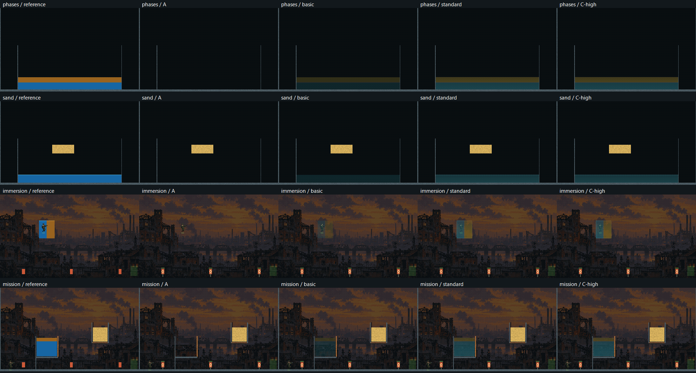

# I08 — renderer sceny i optyka cieczy

Data: 2026-10-31. Fizyka pozostaje I07.1; domyślny profil fizyki `legacy`.

## Kontrakt renderowania

Jeden `SceneRenderer` obsługuje grę i narzędzia. Właścicielem kontekstu pozostaje wątek okna. Wspólny tracker obejmuje program, SSBO, bufor rysowania indirect, framebuffer, VAO i tekstury; stan obcy unieważnia cache. Każdy render jawnie ustawia viewport, rasteryzację, maskę zapisu, samplery i blending, a na wyjściu wiąże framebuffer 0. ImGui zachowuje własne zarządzanie stanem.

Render produkcyjny ma stale 960 × 576. Zmiana wielkości okna nie zmienia rozdzielczości symulacji ani buforów obrazu. Diagnostyka sprawdza także 1600 × 960. Odczyty obrazów i buforów występują wyłącznie w jawnej diagnostyce/eksporcie.

| Przebieg | Wejście → wyjście | Format / stan |
| --- | --- | --- |
| Przygotowanie terenu | Autorytatywny Terrain → mapa materiału | R16UI 320 × 192; imageStore w istniejącym dirty preprocess; HP pozostaje w SSBO |
| Scena | Tło, teren, ziarna, aktorzy → SceneColor i Receiver | RGBA16F liniowe + R8UI klasy odbiornika |
| Splat | Cząstki i przeszkody → FluidRaw | RGBA16F: Dw, Do, suma(w·vx), suma(w·vy); blending ONE/ONE |
| Filtr X/Y | FluidRaw → Temporary → Smooth | RGBA16F; osobne tekstury źródłowe/docelowe |
| Grubość | FluidRaw i teren → Thickness | R16F; pionowe segmenty w komórkach świata |
| Kompozycja | Scena, ciecz, grubość, odbiorniki → World | RGBA8, konwersja do przestrzeni obrazu i Bayer 4 × 4 |
| Pierwszy plan | Oznaczenia tarcz, HP, błysk, wyjście → World | Alpha blending; później HUD ImGui |

Mapa terenu nie pakuje HP do materiału. Render HP odczytuje istniejącą płaszczyznę Terrain, więc częściowe uszkodzenie jest widoczne bez wymuszania ponownej budowy danych kolizji. Po zapisie obrazu GPU stosowana jest bariera dla odczytów tekstur i obrazów.

## Optyka i jakość

Splat używa interpolowanej pozycji i radialnego jądra o promieniu 1,35 komórki. Odcinek od środka splatu do próbki musi być wolny od terenu. Prędkość pola jest ilorazem ważonej sumy i sumy gęstości, a nie surową sumą prędkości.

Bilateral działa separowalnie, po pięć próbek na kierunek. Wagi uwzględniają odległość, gęstość i udział fazy; teren blokuje próbki. Surowe pole określa nośność maski, dzięki czemu filtr nie wymazuje pojedynczych kropli i strug. Zwykły filtr przestrzenny pozostaje wyłącznie wariantem porównawczym diagnostyki.

Grubość jest stylizacją 2D: `0,65·clamp(D−0,15,0,2,5) + 0,075·h_segment`. Pionowa głębokość jest ograniczona do 32 komórek; suche fragmenty i teren zerują segment. Nie jest to długość fizycznego promienia w objętości 3D.

Absorpcja używa `T=exp(−sigma·grubość)` w liniowej przestrzeni barw. Sigma wody to (0,42; 0,11; 0,045), oleju (0,08; 0,19; 0,58); udziały faz mieszają współczynniki i barwę rozproszenia. Wartości mają jednostki stylizacji gry.

Refrakcja przesuwa próbkę do wnętrza cieczy, maksymalnie o 1,5 komórki na oś. Supercover DDA sprawdza teren, także boczne komórki przy przekroczeniu narożnika. Osobny supercover po pikselach pola sprawdza cały odcinek maski cieczy i dominującą fazę. Przekroczenie limitu, ściana, suchy fragment lub inna faza wymusza próbkę bez przesunięcia.

| Poziom | Efekty |
| --- | --- |
| basic | Splat, miękki brzeg, lokalna grubość, absorpcja i bezpieczna refrakcja |
| standard | Dodatkowo bilateral, grubość segmentowa, Fresnel, połysk i rimlight |
| high | Dodatkowo powierzchniowa piana oraz stylizowane kaustyki na zanurzonych ziarnach i przy brzegu dna |

Piana wymaga powierzchni i krzywizny; prędkość tylko moduluje intensywność. Kaustyki wymagają obecności cieczy i odbiornika. Cząstki dekoracyjne należą do I09, HDR do I11. HP i błysk tarcz pochodzą z potwierdzonego stanu GameplaySession; duplikat zdarzenia nie odnawia błysku, reset usuwa starą prezentację.

Opcje `RenderOptions` są oddzielone od fizyki i kontraktu nagrań. `--gpu-render-quality basic|standard|high` i wybór w narzędziach działają bez resetowania świata. Brak automatycznej zmiany jakości w trakcie gry.

## Odtwarzanie kontroli

```powershell
./StrefaZero.exe --gpu-render-check --gl-debug --profile wyniki-jakosci
./StrefaZero.exe --gpu-render-benchmark --profile wyniki-pomiarow
python scripts/profiling/analyze-render.py wyniki-pomiarow
./scripts/profile-render.ps1 -Executable ./StrefaZero.exe -Output wyniki-okien -Suite windows -Quality basic
```

Diagnostyka kopiuje osiem buforów świata GPU → GPU i renderuje kolejne warianty z tej samej kopii, bez kroków fizyki. Porównuje wszystkie bajty stanu przed i po, tick oraz statystyki zdarzeń. Referencja zachowuje dawny porządek rysowania i dawny nieprzezroczysty shader cieczy; tło jest już wspólne. Nie jest osobnym silnikiem gry.

Analityczny orakl CPU sprawdza splat i prędkość. Niezależne przecięcia odcinków z prostokątami sprawdzają DDA terenu i maski cieczy. Testy obejmują sceny fizyczne, kroplę, strugę, ścianę jednej komórki, narożnik, odłączone segmenty, krawędzie oraz zanurzonego aktora. Test wspólnej sesji przeplata prawdziwy backend ImGui, zmianę jakości, pauzę, reset i nagrania.

W benchmarku są trzy bloki ABBA dla każdej jakości, sceny i rozmiaru: 120 renderów rozgrzewki i 240 próbek na segment. Znaczniki GL_TIMESTAMP są odczytywane dopiero po dostępności wyników; synchronizacja diagnostyczna co 16 renderów jest poza mierzonym CPU submit. Woda obejmuje splat, filtry, grubość i cały przebieg kompozycji; raport nie odejmuje kosztu kopiowania sceny. Oddzielnie podawane są rysowanie terenu i pełne dirty preprocess terenu, zawierające także istniejące obliczenia danych kolizji.

Domyślna jakość musi przejść testy obrazu i limit mediany 0,30 ms w obu próbach kandydata każdego z trzech bloków, we wszystkich trzech scenach przy 960 × 576. Przy braku takiego poziomu zostaje basic z otwartym budżetem. Koszt całej klatki jest oceniany oddzielnie.

## Wyniki końcowe

Wdrożono pełne A/B/C. **Domyślnie basic; budżet wody odebrany w kontrolowanej macierzy GTX 1650.** Standard i high pozostają dostępne jako droższe poziomy jakości. Ustawienia i równania fizyki I07 pozostają bez zmian.

Środowisko: Intel Core i5-9300HF, 4 rdzenie / 8 wątków; NVIDIA GeForce GTX 1650, sterownik 610.47, OpenGL 4.3; Windows Release/MSVC z ostrzeżeniami jako błędami. Sprawdzenie CPU GCC: 8/8.

- Windows CTest **59/59 PASS**, bez pominięć. Nowy test renderera i rozszerzony test wspólnej sesji przeszły. Jedna sesja nadal tworzy jeden świat, teraz z 48 programami; oba modele CPU pozostają leniwe.
- 12 checkpointów: pięć wariantów oraz porównanie filtrów na dokładnych kopiach GPU; wszystkie bajty ośmiu buforów fizyki, tick i kanał zdarzeń zachowane.
- Niezależne orakle: splat, prędkość, segmenty, **512 odcinków terenu i 512 odcinków maski cieczy**; potwierdzone HP, deduplikacja błysku i reset.
- Kontrakt obcego stanu, eksporty i większy render zaliczone. KHR_debug nie zgłosił błędów GL; zachowano ostrzeżenia wydajności dotyczące synchronicznych eksportów i specjalizacji shaderów. Końcowy test jakości ma 308 komunikatów i 0 utraconych. Regularny render nie odpytuje stanu GL; lokalizacje uniformów są buforowane przy inicjalizacji.

[CTest](../measurements/i08/ctest.log), [JUnit](../measurements/i08/ctest.xml), [GCC](../measurements/i08/gcc-tests.log), [testy obrazu](../measurements/i08/final-quality/render-tests.txt), [KHR_debug](../measurements/i08/final-quality/gl-debug.txt), [audyt źródeł](../measurements/i08/source-audit.json), [podsumowanie](../measurements/i08/final-validation.json).

### Obraz i filtry



Średni bezwzględny błąd udziału oleju względem surowego pola, wyłącznie w nośności cieczy:

| Scena | Filtr przestrzenny | Bilateral |
| --- | ---: | ---: |
| phases | 0.002930 | 0.000437 |
| immersion | 0.002335 | 0.000354 |
| mission | 0.001966 | 0.000297 |

To miara rozmycia granicy faz, nie miara dokładności fizyki. [Wszystkie wyniki](../measurements/i08/final-quality/filter-comparison.csv); oryginalne obrazy BMP są w tym samym katalogu.

### Koszt wody i wybór jakości

Dla każdego bloku podano największą medianę pojedynczego segmentu kandydata spośród misji, piasku z wodą i wody z olejem, przy 960 × 576. Każdy segment ma 240 próbek.

| Blok | basic [ms] | standard [ms] | high [ms] | Limit |
| --- | ---: | ---: | ---: | ---: |
| 1 | 0.172896 | 0.456672 | 0.464896 | 0,300 |
| 2 | 0.173488 | 0.460016 | 0.464896 | 0,300 |
| 3 | 0.174080 | 0.458976 | 0.465312 | 0,300 |

Końcowa macierz zawiera **51 840 próbek w 216 segmentach**: 3 bloki ABBA × 3 jakości × 3 sceny × 2 rozmiary. Wcześniejsza pełna macierz jest zachowana oddzielnie. Analizator przeszedł 7 kontroli, odrzucając brakujące/zdublowane próbki, błędne etykiety i niefinitywne/ujemne czasy: [kontrole](../measurements/i08/analysis-controls.json). Wynik kwalifikuje basic, nie standard/high. [Surowe znaczniki](../measurements/i08/final-benchmark/render-samples.csv), [mediany i percentyle każdego przebiegu](../measurements/i08/final-benchmark/render-summary.json).

Cały render jest droższy od referencji. Poniżej średnia z median segmentów basic oraz odpowiadającej referencji; nie są to percentyle połączonego rozkładu:

| Rozmiar | Scena | Referencja [ms] | I08 basic [ms] |
| --- | --- | ---: | ---: |
| 960 × 576 | mission | 0.149480 | 0.158317 |
| 960 × 576 | sand_water | 0.149576 | 0.189565 |
| 960 × 576 | oil_water | 0.161368 | 0.226061 |
| 1600 × 960 | mission | 0.282333 | 0.364624 |
| 1600 × 960 | sand_water | 0.297144 | 0.435589 |
| 1600 × 960 | oil_water | 0.325875 | 0.515307 |

Teksturowy teren przy 960 × 576 kosztuje około 0,014–0,016 ms wobec 0,024–0,026 ms referencji w tej serii. Przy 1600 × 960 nowy przebieg kosztuje około 0,040–0,041 ms i jest droższy od referencji 0,004–0,006 ms. Usunięcie instancji nie gwarantuje przyspieszenia: pełnoekranowy przebieg zwiększa pracę fragmentów na pustej mapie. Większy rozmiar służy diagnostyce; gra nadal renderuje w 960 × 576.

Pełny dirty preprocess terenu, obejmujący istniejące przygotowanie kolizji i nowy zapis tekstury: mediana 0.026624 ms, p95 0.032960 ms, 120 próbek. Nie przypisujemy całego tego czasu samemu imageStore. Pamięć renderera: 21 688 320 B przy 960 × 576 oraz 60 026 880 B przy 1600 × 960; bez diagnostycznych kopii buforów. Wszystkie jakości współdzielą zaalokowane cele, więc przełączanie nie realokuje obrazu.

### Widoczne okna i ograniczenia

Sześć prób tej samej misji: trzy bez VSync i bez limitera FPS, trzy z VSync. Druga para używa większego okna; poniżej faktyczne wymiary z SDL. Statystyki poniżej opisują pełny odstęp między początkami klatek po 120 klatkach rozgrzewki, ze wszystkich wierszy mission-frames.csv. Jedyny eksport jest po ostatnim mierzonym odstępie.

| Próba | Okno | Mediana [ms] | p95 [ms] | p99 [ms] | Maks. [ms] | Ticki | Pominięty czas |
| --- | --- | ---: | ---: | ---: | ---: | ---: | ---: |
| off-1 | 1600 × 920 | 0.478 | 3.357 | 3.973 | 5.342 | 1700 | 0 |
| on-1 | 1600 × 920 | 16.661 | 17.265 | 17.885 | 18.161 | 1794 | 0 |
| off-2 | 1840 × 920 | 0.533 | 3.389 | 3.999 | 7.474 | 1700 | 0 |
| on-2 | 1840 × 920 | 16.660 | 17.302 | 17.712 | 18.343 | 1793 | 0 |
| off-3 | 1600 × 920 | 0.493 | 3.222 | 3.859 | 4.755 | 1700 | 0 |
| on-3 | 1600 × 920 | 16.664 | 16.725 | 16.887 | 30.887 | 1796 | 0 |

Każda próba ukończyła misję 3/3. Cel p95 całej klatki ≤16,67 ms: bez VSync **spełniony**, z VSync **nieodebrany**. Wszystkie odstępy klatek zachowano. Kompletność osobnej tabeli podziału czasu CPU na fazy: ograniczona pojemnością bufora; liczniki utraconych wierszy są w podsumowaniu. [Wszystkie rozkłady, fokus i zaległość](../measurements/i08/window-summary.json).

Dodatkowa integracja high + eksperymentalne balanced przeszła misję w widocznym oknie. To test funkcjonalny tego połączenia, bez odbioru budżetu balanced. Pełna regresja nadal ujawnia historyczną zmienność GPU: przykładowo wariant PBF 128 miał p95 misji około 12,14 ms, podczas gdy bazowa misja około 3,06 ms. To różne konfiguracje i rozkłady; nie przypisujemy różnicy rendererowi. I04.5, stabilność I06 i budżet balanced I07 pozostają otwarte.

Nieudane pierwsze kompilacje oraz uruchomienie z nierozwiniętymi nowymi include GLSL zachowano w artefaktach. Loader otrzymał jawne lokalne zależności i końcowe kontrole przeszły. Źródła produkcyjne nie zmieniły się podczas końcowej macierzy, CTest i prób okien. Osobne pliki SHA256 identyfikują wcześniejszy pomiar oraz końcowy EXE.

Paczka Windows przeszła własny test renderera oraz pełną trasę misji. [Weryfikacja paczki](../measurements/i08/package-checks.json).
