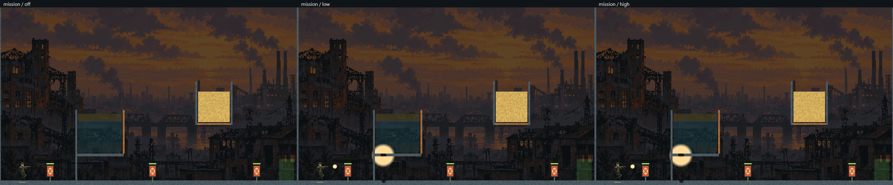
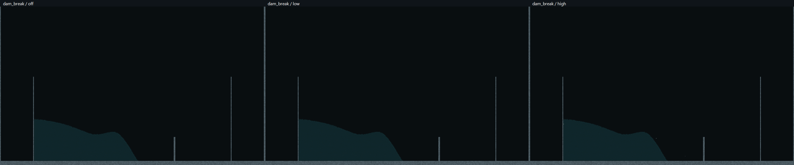
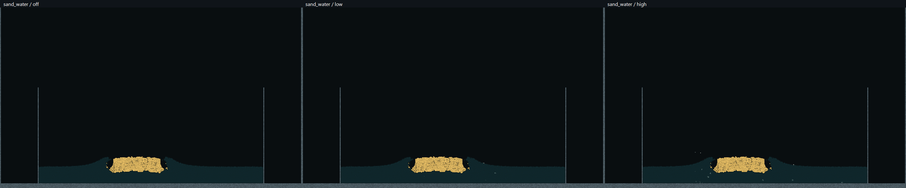
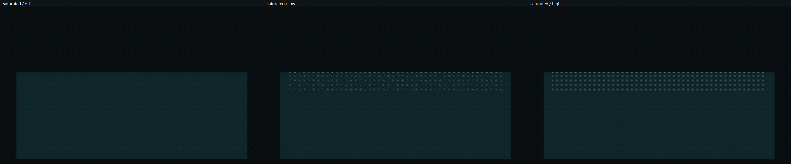

# I09 — wspólny system GPU VFX i cząstki wtórne

Data: 2026-10-31. Fizyka: I07.1, domyślnie `legacy`. Render wody: I08, domyślnie `basic`. VFX: domyślnie `low`, pula 16 384. Odbiór wydajności jest opisany w wynikach poniżej; dostępność efektów nie oznacza automatycznie spełnienia budżetu.

## Właściciele i dane

`RenderDevice` pożycza kontekst SDL z wątku okna i posiada bibliotekę programów, tracker GL oraz jedną pulę VFX. `ParticleWorld::create` zachowuje stare wywołania i przyjmuje opcjonalne współdzielone urządzenie. Aplikacja tworzy je leniwie i ustawia low. Samodzielne historyczne wywołania `ParticleWorld::create` tworzą zasoby z VFX wyłączonymi; nowy konsument włącza je jawnie przez `set_vfx_options`. Dzięki temu stare testy i profile samej fizyki zachowują zakres. Poligon CPU korzysta z tego samego `VfxPool`, bez tworzenia `ParticleWorld`; GL 3.3 zachowuje uproszczone efekty ImGui.

`VfxParticle` to 48 B/std430: pozycja/prędkość, poprzednia pozycja/wiek/czas życia oraz cztery liczby całkowite opisujące typ, RGBA8, rozmiar i seed. Same cząstki zajmują 768 KiB. Osobne bufory przechowują wolne sloty, dwie listy aktywne, listy rysowania warstw, liczniki i polecenia indirect. Dane świata nie są częścią puli. Raport pamięci obejmuje jawne bufory, pola, cele obrazu i zaalokowany staging statystyk; nie mierzy pamięci programów i wewnętrznych alokacji sterownika.

Fizyka jest autorytatywna. VFX czytają cząstki i teren, a konsument pakietu misji deklaruje bufor zdarzeń jako `readonly`. Zapisują wyłącznie własne zasoby. Slot VFX nie ma masy ani odwrotnej masy. Gruz fizyczny nadal tworzy solver.

## Cykl ticka i zdarzenia

Po wykonanym kroku świata: pole cieczy → aktualizacja/odzyskanie slotów i kompaktowanie → emisje ważne → trafienia → bryzgi → piana → pęcherzyki → polecenia indirect. Emisja używa atomowego przydziału wolnych slotów, a wygaszanie oddaje je dokładnie raz. SSBO i polecenia indirect mają jawne bariery. Wiązania pozostają w zakresie 0–7.

Świat GPU aktualizuje VFX w 120 Hz; CPU w 60 Hz. Ruch i intensywność źródeł ciągłych używają czasu symulacji. Render interpoluje poprzednią/bieżącą pozycję. Nie wykonuje kroków VFX. Pauza, brak fokusu i pojedynczy krok korzystają z tego samego harmonogramu co świat.

GPU konsumuje ukończony pakiet zdarzeń przed jego nadpisaniem następnym tickiem. Kluczem jest generacja/tick/ID; osobny kursor nie potwierdza `EventRing` ani poleceń `GameplaySession`. Zaakceptowany strzał przekazuje pozycję lufy i prędkość w istniejących polach zdarzenia (`reserved=1` dla karabinu); rozmiar ABI pozostaje 64 B. Punkt emisji jest kopiowany z rzeczywistego początku pocisku przed odrzutem, co sprawdza osobny test. Trafienie wizualne korzysta z potwierdzonej geometrii, a plecak z autorytatywnego stanu postaci. Odrzucony strzał nie tworzy błysku lufy.

CPU publikuje osobny pakiet zdarzeń prezentacyjnych, niezależny od historycznego limitu 128 efektów. Adapter pobiera wyłącznie materiał, objętość wody/oleju i prędkość ze wspólnego modelu przez `sample_fluid`; nie uruchamia obliczeń termiki, aby przygotować obraz. Pakiety dekoracyjne powyżej 256 wpisów są najpierw porządkowane według priorytetu, ograniczane i raportowane; nie blokują modelu CPU.

Puste pakiety narzędzi GPU nie wymagają uploadu. Niepuste pakiety CPU używają osierocenia magazynu bufora, aby nie nadpisywać danych czytanych przez GPU. Statystyki są kopiowane do osobnych buforów i odczytywane dopiero po gotowości fence, z timeoutem 0. Przy wyłączonym profilowaniu VFX statystyki nie tworzą zapytań czasu GPU. Profiler `--gpu-profile-check` / `--gpu-profile` jawnie wyłącza dekoracje, aby zachować zakres liczenia przebiegów fizyki; pełny dodatkowy koszt mierzy `--gpu-vfx-benchmark`. Synchroniczne obrazy, snapshoty i `glFinish` występują w jawnych kontrolach/pomiarach.

## Woda i kolizje

Pole VFX ma 320 × 192 i jest budowane z bieżących pozycji/prędkości, niezależnie od FPS, interpolacji, jakości renderera i opcjonalnych pól I07. Punktowy splat używa jednego wierzchołka na aktywną cząstkę, tego samego radialnego kernela 1,35 komórki i maskowania odcinka przez teren co I08. Liczba punktów jest przygotowywana na GPU. Nie pomijamy cząstek fizycznych, aby przyspieszyć pole.

Pokrycie GPU normalizujemy przez sumę kernela spoczynkowej siatki `1 + 4·(1−1/1,35²)²`; pokrycie CPU pochodzi z rzeczywistych objętości komórek. Prędkość jest ilorazem ważonej sumy i gęstości. Źródła wymagają powierzchni, krzywizny i energii względnego ruchu. Średnia prędkość sąsiedztwa uwzględnia obecność wody, więc puste komórki nie udają stojących sąsiadów.

Reżimy bryzg/piana/pęcherzyk używają znormalizowanego pokrycia, progów 0,15/0,75 i histerezy 0,05. Bryzgi lecą balistycznie, piana jest unoszona polem i utrzymywana przy powierzchni, a pęcherzyki mają wizualny wypór/opór. Olej nie otrzymuje białej piany wody. Jest to model wizualny inspirowany [Ihmsenem i współautorami](https://cg.informatik.uni-freiburg.de/publications/2012_CGI_sprayFoamBubbles.pdf), bez fizycznej fazy powietrza i bez sprzężenia zwrotnego.

Pełny odcinek ruchu VFX sprawdza supercover DDA, wraz z bocznymi komórkami narożnika. Przekroczenie limitu, wyjście poza świat i niefinitywny stan wygaszają cząstkę. Piana nie przecina osłon. Osmalenie potrzebuje istniejącego podłoża i znika po jego usunięciu.

## Obraz, jakość i przeciążenie

Eksplozja: krótki błysk, iskry, odłamki dekoracyjne, smugi, fala dystorsji i osmalenia. Ten sam system obsługuje trafienia, lufę i plecak. Liczniki emisji dotyczą typów cząstek: na przykład iskry trafień są raportowane jako `spark`. Zastąpione efekty misji i ImGui są wyłączane na GL 4.3; `off` wyłącza też uproszczone efekty. Pociski i granaty fizyczne pozostają widoczne.

W GPU dekoracje zanurzone trafiają przed optykę cieczy, piana/bryzgi po niej, dystorsja korzysta z osobnej kopii obrazu, a oznaczenia celów i HUD są ostatnie. Dystorsja nie pobiera próbek przez ściany. GPU pomija kopiowanie/dystorsję, kiedy nie ma fal. CPU otrzymuje warstwę świata przed aktorami ImGui i przezroczystą warstwę efektów po aktorach; dystorsja obejmuje jego warstwę świata. Nie przenosimy całego renderera referencyjnego CPU do I08.

`low` i `high` utrzymują po 16 384 sloty. `high` emituje więcej iskier, odłamków i wody. `low` dodatkowo stosuje stabilny wybór po seedzie dla wtórnych cząstek wody przy dużym zapełnieniu, celując w około 8192 rysowane markery. Wszystkie aktywne sloty nadal są aktualizowane. Statystyki osobno pokazują liczbę aktywnych i rysowanych cząstek; nie deklarujemy rysowania wszystkich 16k na poziomie low.

Ostatnie 2458 wolnych slotów jest zarezerwowane dla eksplozji, broni i trafień. Nieudane przydziały liczymy według typu. Po osiągnięciu rezerwy GPU pomija dalszą ocenę emiterów wody i osobno liczy ograniczone przebiegi; ten licznik nie udaje liczby odrzuconych cząstek. Pełna pula nigdy nie zatrzymuje ack/trafień gry. Wariant 64k nie jest domyślnym poziomem ani automatyczną zmianą jakości.

Zmiana low/high zachowuje żywe sloty; off czyści pulę. Ponowne włączenie zaczyna od bieżących ticków, bez odtwarzania zaległych zdarzeń. Zmiana jakości VFX nie resetuje świata ani nie zmienia konfiguracji nagrania. Nie stosujemy automatycznej zmiany jakości według FPS.

## Odtworzenie

```powershell
./StrefaZero.exe --mission --gpu-vfx-quality low
./StrefaZero.exe --gpu-laboratory --gpu-vfx-quality high
./StrefaZero.exe --arena --gpu-vfx-quality low
./StrefaZero.exe --gpu-vfx-check --gl-debug --profile wyniki-jakosci
./StrefaZero.exe --gpu-vfx-benchmark --profile wyniki-pomiarow
python scripts/profiling/analyze-vfx.py wyniki-pomiarow --controls
./scripts/profile-vfx.ps1 -Executable ./StrefaZero.exe -Output wyniki-okien -Suite windows
```

W narzędziach świata i poligonie jest wspólny wybór `off/low/high`. Fizyka legacy i jakość wody basic pozostają osobnymi ustawieniami. Narzędzia VFX check/benchmark wykonują własne warianty jakości.

## Metoda odbioru

Kontrole obejmują wszystkie sloty wolne/aktywne, polecenia warstw indirect, duplikaty, reset, pełną pulę i odzyskanie slotów, rezerwę priorytetów, cienką ścianę/narożnik, osmalenia, spokojną wodę, wypór i olej. Niezależny wzorzec CPU sprawdza kernel punktowego pola, ważoną prędkość, ścianę i krawędzie. Kontrola niezmienności porównuje wszystkie bajty ośmiu buforów świata, tick i kanał zdarzeń.

Wspólne checkpointy porównują off/low/high przez 90 ticków, z identycznymi masami i materiałami per ID. Obowiązują niezmienione limity I04.5-Q: średni defekt <0,05, przesunięcie środka <0,02 i postać <0,15 komórki, także dla skumulowanego defektu. Osobno każda jakość wykonuje pełną trasę misji 1700 ticków. Adapter CPU jest porównywany przy 30/60/144 FPS, z kontrolą checksum świata przed i po VFX.

Macierz wydajności: 3 bloki ABBA, 120 klatek rozgrzewki i 240 próbek na segment; off/low/high; misja, dynamiczna przerwana zapora, piasek z wodą i pełna pula wody; 960 × 576 oraz 1600 × 960. Każda klatka kandydata zawiera dwie aktualizacje VFX. Woda do scen dynamicznych ma 120 kroków rozruchu fizyki, a w każdym bloku renderujemy wspólny zamrożony stan GPU. Pełna pula utrzymuje 16 384 aktualizowane cząstki, z jawnym LOD rysowania low. Liczbę aktywnych/rysowanych zapisujemy w CSV jako stan końca segmentu powtórzony przy jego próbkach, a nie synchroniczny odczyt w każdej klatce. W pełnej puli brak nowych źródeł i długi czas życia zapewniają zachowanie 16k przez cały segment. Osobny `vfx-pool-segments.csv` zawiera emisje i odrzucenia według typu.

Czas klatki GPU obejmuje przygotowanie pola, aktualizacje, emisje i render, w tym przerwy w dostarczaniu pracy. Nie zastępujemy go samą sumą krótszych timerów shaderów. Przyrost to mediana segmentu kandydata minus średnia z median obu referencji off w tym samym bloku. Każdy segment low przy 960 × 576 musi zmieścić się w 0,25 ms. Rozkłady p95/p99/maksimum, koszt CPU i większy render są raportowane osobno. Okno mierzymy osobno, bez sumowania percentyli etapów.

## Wyniki i status wydania

**Funkcjonalność I09 wdrożona. Odbiór budżetu VFX 0,25 ms pozostaje otwarty.** W końcowej macierzy każdy z 24 segmentów low przy 960 × 576 przekroczył próg; najgorszy dodatkowy koszt wyniósł **0,678344 ms**. Domyślne ustawienia pozostają `legacy/basic/low`, zgodnie z ustaleniami. Nie zmieniono tolerancji QA ani fizyki dla uzyskania wyniku.

Sprzęt: NVIDIA GeForce GTX 1650, sterownik 610.47, OpenGL 4.3; Intel Core i5-9300HF (4C/8T), Windows 11 Home 10.0.26200. Build MSVC 19.51.36256.0, C++23, Release/LTO, SDL 3.4.18, ImGui 1.93.0. [Metadane sprzętu](../measurements/i09/hardware.json), [powiązanie buildów i źródeł](../measurements/i09/build-provenance.json), [manifest źródeł](../measurements/i09/source-sha256.json).

### Poprawność

| Kontrola | Wynik | Dowód |
| --- | --- | --- |
| Pełna regresja Windows | 61/61, bez pominięć, 1438,94 s | [JUnit](../measurements/i09/ctest-complete/ctest.xml) |
| Ostatnie poprawki prezentacji i telemetrii | 10/10, 116,55 s | [JUnit](../measurements/i09/ctest-final-check/ctest.xml) |
| CPU GCC, warnings as errors | 9/9 | [JUnit](../measurements/i09/gcc-ctest.xml) |
| Kontrakt GPU, pula i niezmienność świata | PASS | [wyniki](../measurements/i09/quality/vfx-tests.txt) |
| Trasy misji off/low/high, po 1700 ticków | wszystkie 3/3 cele | [wyniki](../measurements/i09/quality/vfx-tests.txt) |
| Porównanie trajektorii, wspólne 90 checkpointów | PASS, niezmienione limity I04.5-Q | [CSV](../measurements/i09/quality/vfx-replay.csv), [podsumowanie](../measurements/i09/quality/vfx-replay-summary.csv) |
| Adapter CPU 30/60/144 FPS | PASS, po 20 błysków lufy i 120 markerów plecaka, checksum bez zmian | [wyniki](../measurements/i09/quality/cpu-vfx-tests.txt) |
| Kontrole negatywne analizatora macierzy | 9/9 odrzuconych uszkodzeń | [JSON](../measurements/i09/benchmark-7/analysis-controls.json) |

Maksymalny średni defekt replay wyniósł 2,062·10⁻⁷ komórki, maksymalne przesunięcie środka 7,172·10⁻⁸; defekt postaci w końcowej próbie wyniósł zero. Nie wymagamy zgodności bitowej całej wykonywanej symulacji GPU. Osobna kontrola zamrożonego świata wymaga dokładnej zgodności wszystkich bajtów ośmiu buforów, ticka i statystyk kanału zdarzeń i przechodzi.

Pełny CTest wykonano przed ostatnią korektą punktu lufy sprzed odrzutu, przesunięcia dyszy plecaka, testu dokładnego narożnika i dodatkowych kolumn CSV. Te obszary sprawdziła końcowa seria 10 testów. Późniejsze żądanie aktywacji okna dotyczy wyłącznie `--show-test-window`; jego wynik jest raportowany w pomiarach okna i kontroli paczki. Każdy proces ma własny hash EXE w `run-spec.json`; nie przypisujemy starszych pomiarów innemu plikowi.

Wstępna pełna seria została przerwana po 37 testach (35 PASS, 2 FAIL), gdy wykryto włączenie VFX w historycznych profilach samej fizyki. Przywrócono jawny zakres tych profili oraz domyślne off dla samodzielnego `ParticleWorld::create`. Kolejna pełna seria 61/61 korzysta z poprawnego zakresu. [Zachowane wyniki przerwanej serii](../measurements/i09/ctest-final/run-result.json). Domyślna aplikacja z przekazanym wspólnym urządzeniem nadal używa low.

### Koszt całego dodatkowego VFX

Końcowy plik ma 69 120 wierszy i 288 kompletnych segmentów. W tabeli podano zakres przyrostu median sześciu segmentów kandydata low/high oraz największe p95/p99 **całego mierzonego odcinka GPU** spośród segmentów low. To render zamrożonego świata z dwiema aktualizacjami VFX, bez kroku solvera. Pełne rozkłady, także CPU submit oraz kontrolnego off, są w [podsumowaniu](../measurements/i09/benchmark-7/vfx-summary.json); [surowe próbki](../measurements/i09/benchmark-7/vfx-samples.csv), [liczniki według typu](../measurements/i09/benchmark-7/vfx-pool-segments.csv).

| Rozmiar | Scena | low Δ mediana [ms] | high Δ mediana [ms] | low p95 całego odcinka [ms] | low p99 [ms] | low max mediana CPU submit [ms] |
| --- | --- | --- | --- | --- | --- | --- |
| 960×576 | mission | 0.478–0.678 | 0.368–0.442 | 2.209 | 3.512 | 0.815 |
| 960×576 | dam_break | 0.330–0.394 | 0.351–0.411 | 0.924 | 1.158 | 0.572 |
| 960×576 | sand_water | 0.422–0.535 | 0.450–0.618 | 1.284 | 1.811 | 0.699 |
| 960×576 | saturated | 0.277–0.281 | 0.309–0.313 | 1.410 | 2.073 | 0.700 |
| 1600×960 | mission | 0.187–0.400 | 0.272–0.532 | 1.364 | 1.636 | 0.772 |
| 1600×960 | dam_break | 0.111–0.115 | 0.135–0.147 | 1.156 | 1.514 | 0.601 |
| 1600×960 | sand_water | 0.122–0.127 | 0.140–0.145 | 1.118 | 1.878 | 0.560 |
| 1600×960 | saturated | 0.297–0.304 | 0.342–0.345 | 2.156 | 2.589 | 0.633 |

Wcześniejsze pełne macierze też nie spełniły bramki (najlepszy zaobserwowany najgorszy segment około 0,284 ms, kolejna seria około 0,350 ms). Zachowano surowe dane i hashe w [archiwum prób przygotowawczych](../measurements/i09/preliminary-matrices.zip). Wyników nie uśredniamy pomiędzy różnymi buildami ani nie wybieramy najkorzystniejszej serii do kwalifikacji. Zmienność dostarczania pracy CPU/GPU jest widoczna; osobny krótszy profil shaderów nie wyjaśnia całego przyrostu i nie zastępuje pomiaru bramki.

Zastosowane ograniczenia kosztu low: rzadsza ocena źródeł z kompensacją intensywności, stabilny LOD rysowania wtórnej wody, pomijanie oceny emiterów po dojściu do rezerwy, oddzielne listy warstw, brak kopii/dystorsji przy braku fali, cache uniformów i stanu rasteryzacji oraz brak timerów w zwykłej telemetrii. Nadal obecne są wszystkie typy efektów. Dalszego zysku nie uzyskano przez redukcję cząstek fizycznych ani zmianę solvera.

### Referencja I08

Z zachowanego początkowego drzewa I08 zbudowano osobny EXE z dodatkowym przebiegiem pomiarowym czterech scen. Oryginalny renderer i solver pozostały bez zmian. Jest to 23 040 próbek, 96 segmentów, po 120 klatkach rozgrzewki i 240 próbkach. Wszystkie cztery pozycje bloku są I08 bez VFX. To osobny proces; bramkę przyrostu liczymy w sparowanej macierzy I09, a referencję I08 raportujemy osobno, bez deklaracji bitowo identycznego przebiegu po dynamicznym rozruchu.

| Rozmiar | Misja [ms] | Przerwana zapora [ms] | Piasek/woda [ms] | Pełna scena wody bez VFX [ms] |
| --- | --- | --- | --- | --- |
| 960×576 | 0,154–0,197 | 0,173–0,175 | 0,176–0,178 | 0,616–0,623 |
| 1600×960 | 0,341–0,349 | 0,427–0,438 | 0,428–0,432 | 1,320–1,330 |

Zakresy median segmentów. [Próbki i08-reference.csv](../measurements/i09/i08-reference/i08-reference.csv), [podsumowanie](../measurements/i09/i08-reference/summary.json), [źródła, pełna zmiana harnessu i odtworzenie](../measurements/i09/i08-reference/README.md). Referencja I09 off pozostaje blisko tych wartości; jej rozkłady są jawne w macierzy I09.

### Etapy, pamięć i CPU

Profil pomocniczy zawiera 120 ticków i 60 renderów na scenę. Agregacja łączy dwa ticki i wszystkie wywołania warstw tej samej klatki. Poniżej mediany [ms]; suma etapów pomija przerwy pomiędzy zleceniami i nie służy do odebrania limitu 0,25 ms. W tym pomocniczym przebiegu nie ma syntetycznych zdarzeń eksplozji z głównej macierzy.

| Scena | Pole, 2 ticki | Aktualizacja, 2 ticki | Emisja, 2 ticki | Warstwy renderu |
| --- | --- | --- | --- | --- |
| mission | 0.0392 | 0.0129 | 0.0386 | 0.0141 |
| dam_break | 0.0465 | 0.0130 | 0.0391 | 0.0140 |
| sand_water | 0.0472 | 0.0222 | 0.0389 | 0.0141 |
| saturated | 0.1510 | 0.0496 | 0.0262 | 0.0429 |

[Próbki etapów](../measurements/i09/benchmark-7/vfx-pass-samples.csv), [agregacja na klatkę](../measurements/i09/benchmark-7/vfx-frame-stages.csv), [p95/p99 etapów](../measurements/i09/benchmark-7/vfx-stage-summary.json). Cały jawny magazyn VFX dla pomiaru 960 × 576 wynosi 6 230 256 B (około 5,94 MiB), w tym 768 KiB cząstek; cele okna i dodatkowe scratch mogą zwiększyć tę wartość. Statystyki runtime są asynchroniczne, co 30 ticków; log końca misji może pokazać np. tick 1680 przy ticku świata 1700. Nie jest to bieżący stan używany do sterowania fizyką.

Adapter CPU: koszt przygotowania/uploadu i zlecenia VFX na tick w próbach jakości miał mediany 1,863–2,587 ms, p95 2,608–3,958 ms, p99 2,892–10,135 ms. GPU etapy i ich rozkłady raportujemy osobno w [CPU summary](../measurements/i09/cpu-summary.json) i [surowym CSV](../measurements/i09/quality/cpu-vfx-samples.csv). To krótki test kontraktu z pomiarami, zawierający kontrole checksum i fence; nie jest niezależną kwalifikacją p95 całej gry CPU.

### Widoczne okno, VSync i debug

Trzy próby bez VSync i trzy z VSync ukończyły misję (3/3 cele), bez odrzuconego czasu symulacji. Render wynosi 960 × 576, okno 1600 × 920, monitor około 60,01 Hz. Tabela pokazuje start–start z pełnego `mission-frames.csv`, po odrzuceniu pierwszych 120 klatek; nie korzysta z obciętego do 10k wierszy pliku faz. CPU submit dotyczy wykonanego ticka (fizyka + VFX), nie klatki.

| VSync | Próba | Mediana klatki [ms] | p95 [ms] | p99 [ms] | Max [ms] | CPU submit p95 [ms/tick] | Fokus |
| --- | --- | --- | --- | --- | --- | --- | --- |
| off | 1 | 0.767 | 2.863 | 3.302 | 16.704 | 1.615 | 0% |
| on | 1 | 16.665 | 16.829 | 17.016 | 17.851 | 1.300 | 0% |
| off | 2 | 0.566 | 2.908 | 3.413 | 14.233 | 1.129 | 0% |
| on | 2 | 16.664 | 16.828 | 17.137 | 30.340 | 1.304 | 0% |
| off | 3 | 0.627 | 3.067 | 3.842 | 16.456 | 1.000 | 0% |
| on | 3 | 16.665 | 16.857 | 17.243 | 22.857 | 1.759 | 0% |

**Fokus w środowisku pozostał 0%, także po dodaniu `SDL_RaiseWindow` w `--show-test-window`.** Narzędzie computer-use nie uruchomiło się z powodu błędu `sandboxCwd is not a local file URI`. Nie użyto tych wyników do kwalifikacji aktywnego okna. Obserwowane p95 bez VSync jest poniżej 16,67 ms, ale formalny cel aktywnego okna pozostaje otwarty. VSync przekracza 16,67 ms również w tych próbach. Scheduler skryptu diagnostycznego świadomie pozwala wykonać misję bez fokusu; normalna gra zatrzymuje ticki po utracie fokusu.

[Końcowe próbki, metadane i obrazy](../measurements/i09/windows-focused/window-summary.json); wcześniejszą serię bez żądania aktywacji zachowano w [windows-final](../measurements/i09/windows-final/window-summary.json). Nazwa `windows-focused` oznacza próbę uzyskania fokusu, nie potwierdzony stan. KHR_debug nie zgłosił GL ERROR ani UNDEFINED_BEHAVIOR w kontroli VFX i próbach okna. Ostrzeżenia wydajności sterownika, m.in. migracje buforów podczas jawnych snapshotów testowych, pozostają w surowych logach; nie są usuwane z raportu. [Zestawienie debug](../measurements/i09/debug-summary.json).

### Obrazy

Zestawienia mają kolumny off/low/high; checkpoint i czas symulacji VFX są wspólne. Dynamiczne sceny po rozruchu mogą emitować tylko pojedyncze markery — nie zwiększamy intensywności wyłącznie na potrzeby zrzutu. Pełna pula jest sztucznym testem 16k pęcherzyków o długim życiu, nie naturalnym stanem misji.






### Kontrola paczki

Paczka ma nazwę `StrefaZero-Windows-x64-I09`. Jej rzeczywisty EXE wykonał ponownie pełne `--gpu-vfx-check --gl-debug`; kontrola kontraktów, adaptera CPU i tras off/low/high przechodzi. [Wyniki uruchomienia z paczki](../measurements/i09/package-quality/quality/run-result.json). Uruchomienia `--smoke-test` na GL 4.3 i wymuszonym GL 3.3 również przechodzą: [CPU](../measurements/i09/package-cpu/cpu/run-result.json), [fallback](../measurements/i09/package-legacy/legacy/run-result.json). Log CPU potwierdza `cpu_adapter=1`, `world_creations=0`; fallback `render_device_created=0`. Końcowy hash, zależności i zakresy wcześniejszych testów są w `BUILD_INFO.json`, manifestach SHA256 i `build-provenance.json`.

### Granice odbioru

64k pozostaje eksperymentem do osobnego pomiaru. I04.5 nadal jest odłożone; otwarte wcześniejsze cele I06/I07 i zmienność długich przebiegów nie są zamknięte tym wydaniem. Termika, gazy, HDR i bloom pozostają poza I09. Bramka VFX 0,25 ms jest niespełniona; I09 wydajemy jako działającą wersję z jawnym ograniczeniem wydajności.
